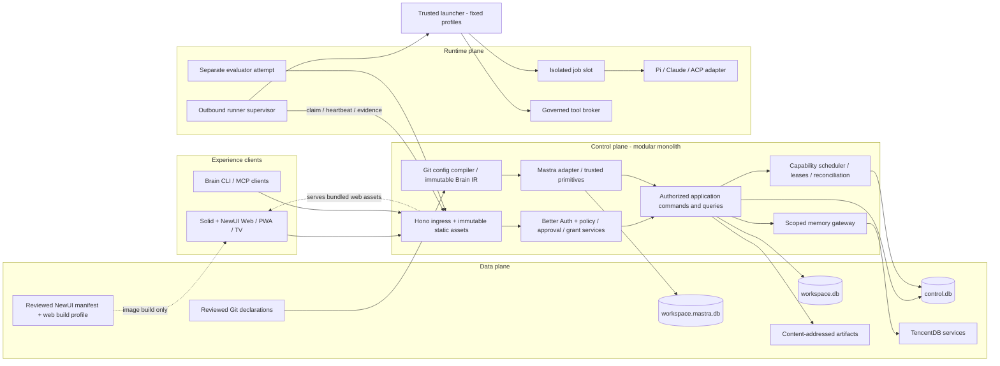

# Keyrus Brain v4.2 — Consolidated implementation specification

Prepared 27 October 2026. This archive contains the documentation and contract pack. Runtime code exists in the repository under development; implementation completeness and production readiness are not certified. Read doc 23 for the current audit and remaining work.

Implementation policy: build the target directly; no compatibility, historical migration or incremental-change constraints until the user explicitly changes that instruction. See IMPLEMENTATION_PROMPT.md and AGENTS.md.

Use IMPLEMENTATION.md for navigable source documents and contract links.


---

<!-- Source: 00-audit-and-decisions.md -->

# 00 — Audit, decisions and unresolved validation

## Scope and evidence

The supplied inputs are the 59,667-byte v4 RFC, the 14,853-byte runner amendment, the 23-entry contract ZIP and the 54-page French presentation. Their hashes are in `contracts/v1/source-inputs.json`. The presentation describes an earlier product and reports historical measurements. Those numbers are not benchmarks of this design. The ZIP is a starter: no `EvidenceBundle` DTO, complete runner protocol, typed command registry or executable lease transaction was provided.

Official documentation was consulted on 27 October 2026, including Context7 for Mastra, Better Auth and Pi and official documentation/repositories for the remaining selected components. [13-library-reference.md](docs/implementation/13-library-reference.md) records the evidence and adoption disposition. Documentation review is distinct from a pinned, installed integration test. No vendor service was deployed during preparation.

## Corrections adopted by this pack

| ID | Problem in the inputs | Decision |
|---|---|---|
| D01 | `spec.nodes`, root `jobs`, and different primitive names conflict | Canonical authoring is `spec.jobs`, keyed by ID, with six `kind` values and `needs`. `dispatch.uses` selects an agent or tool. No compatibility parser. |
| D02 | Runner state conflates health, drain and resource use | Store administrative state, connectivity and allocation separately; derive display status. Busy can coexist with draining. |
| D03 | Same-file Mastra/Brain storage was preferred before proof | Use `workspace.mastra.db` by default. One Governor process owns Mastra access. Shared-file optimization is deferred. |
| D04 | Global leases and workspace history look atomic | Only `control.db` authorizes. Durable commands/events cross files. Workspace projections explicitly expose lag. |
| D05 | Offer, claim, approval consumption and effect start blur together | Reserve capacity on offer; ACK starts execution; consume approval only at a separate effect permit transaction. Failed delivery must not consume approval. |
| D06 | Fences may be mistaken for external write protection | Each resource has its own durable counter. A stale result is rejected, but external targets require CAS/preconditions or scoped revocable credentials. Unsupported targets require conservative reconciliation. |
| D07 | Unknown outcomes may be retried as generic errors | Unknown effect outcomes remain blocked until target-specific reconciliation. Never route them through general retry helpers. |
| D08 | YAML security floor merge is underspecified | Typed restrictive intersection, explicit inheritance, fixed merge rules and provenance. Unknown fields, duplicate keys and custom tags fail. |
| D09 | Organization/team/workspace scope is ambiguous | Organization is the tenant boundary. Every workspace belongs to one organization. Global memory means organization-global approved content. Cross-organization sharing requires a separate reviewed export/import. |
| D10 | “Independent evaluator” lacks an authority model | Evaluators execute in separate attempts with pinned evaluator code and input artifacts; authoring harness cannot issue verdicts or change test fixtures. |
| D11 | Suspended approval may retain a runner/worktree lock | Release compute and logical effect locks. Preserve immutable artifacts/checkpoints. Reacquire admission and validate preconditions after approval. |
| D12 | PWA may imply native background guarantees | PWA supports responsive interaction and best-effort push. No guaranteed periodic background scans, Android keystore parity or native widgets in V1. |
| D13 | Runtime dependency versions appear frozen from prose | Keep one coherent target contract set; change related contracts/callers/tests together when necessary. Record exact selected dependencies, images, SQLite engine builds and smoke evidence. |
| D14 | “All edge cases” has no finite acceptance boundary | Maintain an explicit scenario and fault inventory. Unknown failures fail closed for effects and produce a diagnosable blocked state. No claim of exhaustive future-failure coverage. |
| D15 | Initial UI proposal duplicated primitives, tokens and shell behavior already supplied by the user's chosen library; the config omitted this choice | NewUI is the required UI foundation, explicit in UIConfig/WebBuildConfig and ArchitectureModel. Public packages/tokens/templates bind at image build; Git presentation defaults reference the shipped manifest digest. Brain owns domain compositions and Governor adapters. The reviewed atomic package API supersedes historical `@newui/ui` examples. |
| D16 | Earlier process text required isolated increments, historical migrations and cross-version retention | The user waives compatibility, migration and incremental-change constraints until explicit new instruction. Build the target directly; breaking/coordinated changes are allowed. Fresh schema setup, selected-dependency integration and same-version recovery remain required. |
| D17 | A smaller coding model still had to choose integrations, invent authorization tables and recover context informally | Documents 17–22 select target decisions, define exact OpenCode model/instructions, typed execution records, expanded authority SQL, screen queries, literal oracles and a closed golden release. Live dependency/model/vendor proofs remain explicit gates. |

These are engineering decisions for the requested implementation proposal, not changes to a running deployment.

The [implementation policy](contracts/v1/implementation-policy.json) and [implementation prompt](IMPLEMENTATION_PROMPT.md) carry D16. Older source requirements cannot reintroduce waived work. Dependency integration gates test the chosen runtime; they do not require support for previous Brain versions.

## Release gates

| Gate | Required experiment | Pass evidence | Fallback / blocked scope |
|---|---|---|---|
| G01 Dependency baseline | Install exact Node LTS, TS, Hono, auth, driver, schema, NewUI package set and test packages on Linux amd64; arm64 before advertising support | lockfile, SBOM, license report, native-driver smoke; NewUI exports, CSS/theme, Solid peers and production bundle smoke | Platform support stays unadvertised; UI integration blocked until selected artifacts pass |
| G02 SQLite engine | Inspect `sqlite_version()` and compile options for better-sqlite3, libSQL and TencentDB separately | Patched WAL implementation and required FTS5 capability | Reject unsafe build or vendor-documented fixed equivalent |
| G03 Mastra | Compile all six primitives, suspend asynchronously, restart, early wake, duplicate wake, failed persistence, cancellation | 100 suspended runs; no duplicate jobs/effects; bounded storage | Workflow feature blocked; contract unchanged |
| G04 TencentDB | Two organizations, two workspaces, users/agents/teams, revocation, search, Wiki/CodeGraph, export/restore | Negative ACL tests and measured service footprint | Memory optional/degraded; dedicated deployment for stricter tenants; no private code indexing without proof |
| G05 Harness | Pi and Claude start/event/cancel; feature-by-feature resume/steer/intercept | Same synthetic task and denied bypass in both sandboxes | Unsupported features explicitly disabled |
| G06 Sandbox | Hostile child process, fork bomb, filesystem escape, blocked network, daemon escape, secret remnants | Kernel-enforced denial and cleanup receipts | Privileged operations disabled; disposable VM for hostile workloads |
| G07 Restore | Restore global backup and workspace-only import into clean host, including suspended workflow | Hash verification, old tokens invalid, unknown external effects blocked | No “portable complete backup” claim |
| G08 Performance | Defined workload at fixed resources, fault injection, at least three comparable runs | Raw results, percentiles, memory/CPU/WAL sizes | Admission limits reduced; no unmeasured scale claims |

SQLite's official WAL documentation describes a corruption race fixed in 3.51.3 and later, with specified older backports. Verify the embedded SQLite engine, not just the npm package version. A libSQL fork needs evidence of an equivalent fix. [SQLite WAL](https://www.sqlite.org/wal.html)

Mastra labels dynamic workflows beta and warns that they can change incompatibly without a major version change. Its production storage guidance excludes local-file multi-process deployment. Brain's constrained single-owner profile needs G03; a separate file alone does not prove durability. [Dynamic workflows](https://mastra.ai/docs/workflows/dynamic-workflows), [storage guidance](https://mastra.ai/docs/storage)

## Bounded initial product

V1 runs one active Governor on local Linux SSD storage, multiple outbound runners and optional memory services. No active-active Governor, network-mounted WAL, distributed database locks, arbitrary inline workflow scripts, automatic privileged repair, public memory endpoints or cross-tenant cache. No mandatory Redis/Postgres/Kubernetes. These exclusions keep the implementation testable while adapters preserve future extension.

All production writes require exact human approval. Nonproduction writes may use Git-declared policies. Emergency stop/revocation is operational state and takes precedence over pinned configuration. It can narrow permissions immediately; widening requires a new reviewed Git release.

Resource targets are proposed in document 10. Feature-specific service footprint, physical isolation and data retention must be selected for the deployment. The default assumes one customer organization, while schema and authorization always preserve organization isolation.

## Canonical editing map

| Decision/data | Single editable authority | Derived views |
|---|---|---|
| Wire DTOs | brain.schema.json | brain.generated.ts |
| Command capability and actor kinds | registry.json | Handler catalog/checks |
| Role capabilities and query/endpoint rules | authorization-matrix.json | Role summaries/allow-deny tests |
| Executable/module layout | module-layout.json | Document 01 table |
| Work coverage/files/check commands | work-plan.json | Document 12 table and task-packets.json |
| Acceptance trigger/observation | Document 11 scenario table; acceptance-oracles.json for literal traces | scenario-catalog.json and focused context output |
| UI routes/navigation/actions | ui-screen-contracts.json | Document 09 route index |
| Runtime/model execution state | Trusted VerificationRun artifacts | runtime-readiness.json and verification report |

Edit an authority once and regenerate its derived artifacts. Narrative documents explain semantics and tradeoffs, without repeating mutable implementation status. Source-review manifests and initial examples retain their historical meaning. The control plane remains a modular monolith; these records do not create more services.


---

<!-- Source: 01-architecture-and-modules.md -->

# 01 — Architecture, ownership and module boundaries

## System topology



Arrows describe calls, not authority transfer. Mastra invokes application primitives. It never receives a database mutation API, raw deployment credentials, an approval decision API or a runner adapter. Runners never mount central databases or the Governor secret directory. HTTP, MCP and CLI produce the same command payloads. A UI query joins authorized read models; it cannot bypass the command service for mutations.

Experience is a client layer over the three logical planes, not a fourth authority plane. The NewUI manifest/build-profile box is a build input/artifact, not a production service. The machine-readable ownership model is [architecture.json](contracts/v1/architecture.json), validated as `ArchitectureModel` against the same schema authority as configuration. Its bindings name the exact current config/profile/manifest/deployment reference files.

## Modular monolith and ownership

The control plane is **one modular monolith**: one Governor process, one composition root and one deployment. Identity, governance, configuration, jobs, workflows, evidence, knowledge, board, packs and operations are internal folders. They call public functions in-process. There is no internal HTTP, broker, general event bus, service locator or dynamic module loader.

The runtime plane retains separate runner and trusted launcher executables because their isolation and credentials differ. Web is a static Solid/NewUI bundle served by Governor. CLI is a thin client. Only `packages/contracts` is a shared workspace package; domain functions, adapters and Brain UI compositions remain ordinary folders in their owning applications. Full functionality is preserved. Extract another package only for a demonstrated independent consumer, not to mirror a diagram.

The canonical layout is [module-layout.json](contracts/v1/module-layout.json). This table is generated by `scripts/generate_implementation_indexes.py`:

<!-- BEGIN GENERATED LAYOUT -->
| Target | Owns | Public entry | Forbidden |
|---|---|---|---|
| `apps/governor` | Single Governor composition root, application use cases, internal modules and local persistence | `src/main.ts; src/container.ts` | Runner/harness execution; UI components |
| `apps/runner` | Outbound supervisor, engine adapters, tool broker, spool and launcher client | `src/main.ts` | Central database access; human approval decisions |
| `apps/launcher` | Trusted rootless Docker launcher, fixed profiles and cleanup journal | `src/main.ts; Unix HTTP protocol` | Arbitrary Docker passthrough; product business decisions |
| `apps/web` | Solid/NewUI SPA, domain compositions in src/ui, Governor client and route state | `src/app.tsx; src/index.css` | Server imports; NewUI internals; direct database access |
| `apps/cli` | Thin typed Governor client, human login and output formatting | `src/main.ts` | Direct database or module-private access |
| `packages/contracts` | Canonical generated DTOs, validators and wire catalogs shared by executable consumers | `src/index.ts; src/validate.ts` | Vendor SDKs; database IO; application authorization |

Governor module folders share this one deployment:

| Module | Folder | Responsibility |
|---|---|---|
| identity | `apps/governor/src/modules/identity` | Better Auth integration, principal construction and current memberships |
| governance | `apps/governor/src/modules/governance` | Policy, delegation, exact approvals, step-up and effect permits |
| configuration | `apps/governor/src/modules/configuration` | Restricted Git/YAML loading, release compilation and activation |
| jobs | `apps/governor/src/modules/jobs` | Placement, admission, leases/fences, scheduling and reconciliation facts |
| workflows | `apps/governor/src/modules/workflows` | Brain IR and Mastra adapter, primitive registry and durable wakes |
| evidence | `apps/governor/src/modules/evidence` | Artifact associations, independent verification and completion acceptance |
| knowledge | `apps/governor/src/modules/knowledge` | Scoped memory gateway, TencentDB adapter, publication and export |
| board | `apps/governor/src/modules/board` | Cards, business decisions and immutable comments |
| packs | `apps/governor/src/modules/packs` | Compiled onboarding/support/SRE/delivery/eval modules and connector adapters |
| operations | `apps/governor/src/modules/operations` | Health, bounded timers, backup/restore, audit and notifications |
<!-- END GENERATED LAYOUT -->

Pure reducers live in Governor `src/domain`; use cases in `src/application` coordinate module public functions. Connection lifecycle/current schema/inbox/outbox live in `src/infrastructure/persistence`. A table has one writer owner. A synchronous local transaction may coordinate modules through injected transaction functions; no network, model call or human wait belongs inside it. Cross-file work still uses durable outbox/inbox.

Each module exports an `index.ts` boundary. Cross-module private imports are forbidden. Pass narrow dependencies as function arguments or constructors; adapters bind in `src/container.ts`. Keep the six replaceability/security boundaries and public wire contracts; do not add an interface, package, transport or plugin for every internal helper. Vendor types stay in the owning adapter folder. The boundary checker enforces root isolation and public imports, not arbitrary file-size rules.

NewUI owns controls, overlays, tokens, tables/lists and templates. Brain compositions live under `apps/web/src/ui`, inside the application CSS scan. UI assets bind at image build through UIConfig/WebBuildConfig and the reviewed manifest; runtime YAML cannot install a frontend. Governor serves `/app/web` and verifies `/app/ui/ui-foundation.json`; API/auth/SSE/MCP/runner routes resolve before SPA fallback. Vite proxies only `/v1` and `/api/auth`.

Mastra executes dependencies, suspension and resumption through the WorkflowEnginePort. Governor owns authorization, jobs, decisions and receipts. Brain persists business facts and correlations without implementing a second generic workflow engine. The G03 durable-wait probe is required before accepting Mastra execution. Native engine and memory adapters remain replaceable folders, not independent product services.

The launcher has exactly the preinstalled `agent`, `privileged-tool` and `evaluator` profiles. One tested rootless Docker implementation is required. Approved target/network/image/resource facts select a profile; agent input cannot author a network policy, host mount or daemon request. Isolation and privileged-host separation remain mandatory. Optional VM/Rust implementations are outside the required target.

## Data ownership

`control.db`: identities through Better Auth, organization/workspace directory, active config pointers, runners, jobs, attempts, capacity reservations, approval requests/decisions/consumption, effect permits, resource fencing counters, revocations, audit, global inbox/outbox and command idempotency.

`workspace.db`: cards, decisions, ticket/incident history, SLA intervals, workflow business state, step/output references, session indexes, evidence and evaluation indexes, memory publication candidates, connector cursors, workspace inbox/outbox. It contains a projection of global job state, clearly marked with a source cursor.

`workspace.mastra.db`: private engine snapshots and definitions. No hand-authored SQL touches its tables. Missing snapshots block unsafe continuation; business truth and receipts remain in Brain tables.

Git owns declarations, not current memberships, heartbeat, approvals or job status. TencentDB owns memory content and knowledge indexes, not human decisions or executable permission. An authoritative verbatim decision remains in SQLite; a sanitized derived memory can reference it.

CAS stores immutable bytes addressed by SHA-256. Namespace authorization still applies: knowing a digest does not grant access. Tool/config release roots are separate from mutable runner checkouts. Workspace export bundles include verified bytes and source references.

## Application command path

1. Ingress authenticates credential and constructs internal `ActorContext`; reject client actor claims.
2. Decode versioned payload with the schema validator; enforce byte and nesting limits before expensive work.
3. Resolve organization/workspace, current membership and operational revocations.
4. Find typed command handler; compute canonical request hash; enforce idempotency.
5. Evaluate policy and expected aggregate version; commit only the local authority transaction.
6. Emit outbox event/intent in that transaction; return receipt and resource ID.
7. Workers materialize downstream work. UI may show `queued` and projection lag before workspace history catches up.

Transport adapters translate errors, never authorize. A command receipt means the command was durably accepted/applied; it never means a queued workflow has succeeded.

## Replaceability tests

Each adapter gets a shared conformance suite and a fixture adapter. A fixture workflow engine reproduces start/wake/cancel behavior without Mastra; a fixture harness returns deterministic events; a memory fixture enforces scope and simulates outages. Run domain/application tests with these fixtures. Run vendor integration tests separately so failures identify the boundary. Replaceability means retaining external semantics, not identical internal snapshot formats.

Within the current build, a running attempt keeps its selected engine and pinned configuration; do not silently swap them during execution. Current-build definitions/artifacts remain available for restart/recovery. Historical adapter binaries, cross-version run conversion and rolling-upgrade coexistence are excluded by the user's [implementation policy](contracts/v1/implementation-policy.json). Breaking implementation changes may update the target as a whole. Optional Rust may implement a process supervisor port; it does not become a second domain backend.


---

<!-- Source: 02-transport-and-commands.md -->

# 02 — Transport, commands and event delivery

## Contract authority and encoding

`contracts/v1/brain.schema.json` is the wire-shape authority. Generated DTOs use JSON values only: no Date, Map, bigint, functions, undefined values or vendor SDK types. UTC timestamps on the wire use RFC 3339; SQLite stores integer epoch milliseconds. CPU uses integer millicores; memory/disk use MiB even where legacy field names say `memoryMb`/`diskMb`. Currency budgets use integer micro-USD, never binary floating point.

Identifiers are opaque, bounded ASCII strings. Logical configuration IDs use lower-case kebab/dot syntax; workspace database paths are resolved from opaque IDs. Digest is exactly `sha256:` plus 64 lower-case hex characters. Fencing and sequence counters are safe positive integers with explicit exhaustion checks; reaching the supported bound stops allocation with a diagnostic. No counter-format migration is part of this implementation. Source Git revisions include algorithm plus full object ID; do not assume all Git repositories use SHA-1.

Canonical hashing uses RFC 8785-compatible canonical JSON over validated JSON values; nonfinite numbers and duplicate JSON keys fail. Digests have a domain-separated prefix and schema version, e.g. `brain:approval:v1\n` plus canonical payload bytes. Byte hashes for CAS are over raw bytes; JSON object hashes are over canonical bytes. The dependency gate must select a reviewed canonicalizer and cross-check published RFC test vectors; do not pretend Python `sort_keys` is a general RFC 8785 implementation.

## HTTP surface

The machine-readable [OpenAPI](contracts/v1/openapi.json) describes the shared endpoints. Prefix application routes with `/v1`, runner routes with `/runner/v1`, auth routes with `/api/auth`; MCP uses `/mcp` Streamable HTTP. Browser and runner credentials are distinct. TV identities are read-only and cannot obtain human command scopes.

| Route | Meaning | Durable response |
|---|---|---|
| `POST /v1/commands` | Typed application mutation | Command receipt, `200` applied or `202` accepted |
| `POST /v1/query` | Typed authorized read | Snapshot/page and projection cursor |
| `GET /v1/events` | Authorized SSE with cursor | Durable event references; lossy text deltas may be marked volatile |
| `POST /v1/approvals/{id}/decision` | Human-only decision | Recorded decision and updated approval version |
| `POST /runner/v1/enroll` | Consume administrator-issued enrollment token | Bound runner identity credential |
| `POST /runner/v1/hello` | Verify identity and create/recover session epoch | Session, server time, negotiated contract |
| `POST /runner/v1/heartbeat` | Session inventory and liveness | Accepted sequence and commands |
| `POST /runner/v1/claim` | Reserve an eligible offer | `200` offer or `204` no eligible work |
| `POST /runner/v1/attempts/{id}/ack` | Accept offer before expiry | Execution lease snapshot |
| `POST /runner/v1/attempts/{id}/renew` | Renew current attempt lease | New server expiry |
| `POST /runner/v1/attempts/{id}/events` | Durable ordered batch | Last committed sequence |
| `POST /runner/v1/attempts/{id}/permit` | Authorize one exact tool effect | Short-lived effect permit |
| `POST /runner/v1/attempts/{id}/complete` | Submit terminal receipt | Accepted for verification or stale rejection |
| `POST /runner/v1/attempts/{id}/release` | Acknowledge stop and cleanup | Owned reservations released or reconciliation required |
| `POST /v1/artifacts/init` | Reserve upload of expected digest/size | Scoped upload ID |
| `PUT /v1/artifacts/{id}/content` | Stream bytes with bounds | Verified stored reference |
| `GET /v1/artifacts/{id}/content` | Download authorized bytes/range | Attachment with safe content type |

Every request has a correlation ID. Error body contains stable `code`, human-readable `detail`, `retryable`, correlation ID and optional field errors/retry delay. A 404 is returned for inaccessible object IDs to avoid existence leaks; a known action denied on an accessible object returns 403. 409 covers stale aggregate version, idempotency hash conflict or state conflict; 410 covers expired replay cursor; 413 size limit; 422 valid JSON failing contract/semantic rules; 429 bounded admission; 503 unavailable authority. Errors never include credentials, raw SQL or model prompts.

## Command catalog and authorization

The registry enumerates command types, scope, authority database and actor classes. Minimum commands include workflow dispatch/cancel, session steer/stop, approval request/decision/revoke, runner drain/quarantine, board create/move/comment, decision record, config activate, workspace suspend/export/import, tool propose/publish, memory search/publication/revoke and placement explanation as a query.

Human approval decision is a separate endpoint plus application handler. It is deliberately absent from the agent-facing MCP mutation catalog. An agent cannot acquire it by supplying a human actor object or a broad workspace scope. CLI routes a decision through human login and explicit terminal confirmation; an unattended agent process receives a review URL only.

Query catalog: `today`, `bridge`, `workspace.context`, `jobs.list`, `job.get`, `job.explain`, `runners.list`, `runner.get`, `approvals.list`, `approval.get`, `sessions.list`, `session.get`, `board.get`, `evidence.get`, `memory.search`, `sla.summary`, `config.explain`, `platform.health`. Query filtering, sorting and pagination are typed allowlists; no SQL or arbitrary JSONPath arguments.

After authentication, `workspace.context` returns the resolved safe presentation defaults in `WorkspaceContext.ui`, alongside the existing allowed commands and feature availability. This is the same `UIConfig` contract declared in Git; it contains no credentials or authority grants. A client enables a requested channel only when the server's built feature registry also supports it. Before authentication the static shell uses its bundled safe theme/locale defaults; no anonymous config download or new privileged configuration endpoint is introduced.

## Idempotency rules

Namespace keys by `(organizationId, actorId, commandType, idempotencyKey)`. The server hashes the validated command including workspace, payload and expected version. Same key/same hash returns the saved receipt; same key/different hash returns `IDEMPOTENCY_CONFLICT`. Different caller identities cannot discover each other's receipts. A command that affects a workspace crosses databases using a durable command intent; initial receipt is stored globally and workspace processing deduplicates by command ID.

Idempotency records for external effects outlive the maximum retry/reconciliation horizon and remain referenced by the effect ledger. A request timeout is not a proof that no mutation occurred: clients query/retry the same key. Repeated requests never allocate a new dispatch or charge a second approval consumption.

Optimistic board/comment updates carry `expectedVersion`. Compare-and-swap failure returns current version and a refresh link. No last-writer-wins overwrite of decisions or approval text. Deleting a card does not delete its audit/evidence.

## Events, replay and ordering

Each authoritative DB emits events with a local monotonically increasing feed cursor; each aggregate has a separate consecutive sequence. These numbers are not globally comparable across workspace files. The event envelope includes event ID, schema version, tenant/workspace, aggregate, causation/correlation, actor reference and pinned configuration where applicable. UI cursor is an opaque signed structure bound to feed identity, filters and organization; never concatenate unrelated SQLite sequences.

Outbox/inbox delivery is at least once. Consumers deduplicate event ID and validate per-aggregate ordering. A sequence gap parks the event and requests/replays missing state; it must not guess. Same sequence and different payload hash is a protocol/security fault. Unknown major event versions are parked and alerted; unknown optional fields within the negotiated version are retained only where explicitly allowed.

SSE starts with an authorized snapshot watermark, replays after that cursor, then follows the live feed. The snapshot and cursor must share a consistent read transaction. Reconnect uses `Last-Event-ID`. Expired retention returns a reset-required message and a new snapshot path. Default retention proposal: seven days for UI replay, thirty days for operational event detail; audit/evidence retention is independent.

Authorize stream subscriptions at connect and on membership/revocation changes. Bound each subscriber queue to 1 MiB/1,000 events; close slow consumers with reset instructions. Send a keepalive every 15 seconds and disable proxy buffering. Rendering a text stream must not re-render the whole application per token; coalesce display updates every 50–100 ms. Durable tool/effect/approval events are never discarded as volatile.

## Ingress limits and client behavior

Default JSON body limit 256 KiB, runner batch limit 128 events/256 KiB, tool input 64 KiB, single event payload 32 KiB. Larger context/results are artifact references. Nesting depth 32 and query page size at most 100. Artifact upload defaults to 100 MiB with per-workspace quotas; authorized larger build artifacts use a separate profile. Check declared and actual bytes; gzip bombs must meet decompressed limits too.

CLI prints machine JSON with `--json`, progress to stderr, no color when noninteractive and nonzero exit codes for denied/failed/unknown. Ctrl-C cancels local observation; remote job cancellation requires an explicit command so a broken terminal does not accidentally kill work. MCP tools return typed receipts and review links; protocol cancellation cancels only the RPC unless the tool explicitly represents job cancellation.

## Versioning

Use one current target contract set. Version tags identify payloads and current-build runner handshake validation rejects unsupported versions before claims. Strict validators do not accept arbitrary added fields. Target wire shapes may change together with generated DTOs, callers, fixtures and tests; no parallel V1/V2 handlers, compatibility normalization or rolling-upgrade support is required until the user explicitly requests it. Persist current contract/adapter references for audit and same-version recovery.


---

<!-- Source: 03-configuration-and-workflows.md -->

# 03 — Configuration compiler and workflow execution

## Canonical documents

All definitions use `apiVersion: brain.keyrus/v1`, a `kind`, immutable logical metadata and a typed `spec`. Supported kinds are BrainConfig, WorkspaceType, Workspace, RunnerGroup, Agent, Tool, Policy, Workflow, Pack, Connector, Evaluator and Schedule. Operational registry bindings, credentials and observed inventory are not declarations. `TOOL.md` and agent Markdown embed the same validated metadata in frontmatter; their instruction body is included in the release digest.

The machine schemas cover executable baseline configuration; kinds introduced by later tasks must receive schema, fixtures and semantic validation before activation. No undefined kind is accepted just because this document names it. Extensions are deferred in V1 to keep unknown-field rejection meaningful.

## Safe loader

Load only a clean, read-only checkout of a reviewed commit from an allowlisted repository. Resolve every referenced relative path inside that checkout after realpath confinement. Reject symlinks escaping the root, submodules without pinned approved contents, absolute paths, NUL, traversal, case-colliding logical IDs, duplicate keys, YAML aliases/merge keys, custom tags and multiple YAML documents. Limit each definition to 256 KiB, the release to 20 MiB excluding packaged tool bytes, and the workflow to 100 jobs. Binary/tool assets have separate quotas and hashes.

Use the `yaml` document API for source positions, then reject parse diagnostics and aliases before conversion. Strings such as capability labels containing colons are explicitly quoted in examples. YAML dates remain strings under the restricted schema. No environment interpolation except typed secret **references**, resolved only at runtime by the broker. A `${...}` string does not execute or read the process environment.

## Resolution and policy floor

Apply `security floor → organization defaults → workspace type → workspace → permitted request override`. Keep one parent workspace type in V1; reject inheritance cycles. Merge named resources by ID with explicit tombstones for optional resources; anonymous arrays replace. Required floor resources cannot be removed. A null value is a value only where schema permits it, never a generic deletion instruction.

Security resolution is typed: allowlists intersect, deny lists union, booleans requiring a safeguard OR together, numeric upper limits take minimum, required minimum isolation/risk constraints take the stricter order. Unknown/incomparable settings fail rather than choosing an arbitrary maximum. Apply defaults before comparing. An override cannot add a target, broaden a runner group or turn off production approval. Record origin file, line and inherited value for every effective field. `config explain /path` displays the complete resolution chain and final reason.

## UI configuration and immutable build binding

`BrainConfig.spec.ui` is required in the current target contract. Its `UIConfig` shape contains `foundation: newui`, `foundationManifestDigest`, `defaultTheme`, `density`, `supportedLocales`, `defaultLocale` and `enabledChannels`. The canonical example is [brainconfig.yaml](examples/v1/config/brainconfig.yaml). Replace earlier declarations with this target shape; do not write converters or a compatibility parser. The user's direct-target policy permits coordinated breaking changes before implementation completion.

Presentation defaults are Git declarations. Per-user/device theme or language preference may select an already-supported value; it cannot change the library, token authority, target permissions or enabled product capabilities. `compact` maps to NewUI's default `sm` (28 px), `comfortable` to `md` (32 px); these are controlled recipe choices, not arbitrary CSS. Unknown UI fields, custom palette objects and arbitrary library names fail schema validation. The default locale must be included in supported locales.

The authenticated `workspace.context` query projects these resolved values as `WorkspaceContext.ui`; clients do not read the config repository or operational DB directly. Until that context is authorized/available, sign-in and the public shell use bundled safe presentation defaults. Feature availability is returned separately so a requested PWA/TV channel cannot appear implemented merely because configuration names it.

`foundationManifestDigest` is the SHA-256 **byte digest** of the exact UI foundation manifest supplied as a release asset and built into the Governor image. Do not conflate this CAS byte hash with canonical object hashing for config/action subjects. The compiler includes that manifest in the release asset closure, rejects a mismatch with the supported build manifest, and emits stable diagnostics such as `UI_FOUNDATION_MISMATCH` or `UI_DEFAULT_LOCALE_UNAVAILABLE` within its typed compilation result. No operational database row overrides this declaration.

The separate [web build profile](examples/v1/config/web-build.json), typed as `WebBuildConfig`, describes image-build package candidates, the reviewed source commit, semantic CSS, static asset paths and permitted dev proxy prefixes. It is a source/build contract, not a runtime workspace definition or a substitute for a lockfile. G01/T33 resolve and verify actual package artifacts and produce a promoted build manifest. Runtime YAML never downloads npm packages, mounts a developer checkout or switches to a different frontend. Changing foundation bytes requires a corresponding verified image/config release and expected-version activation.

Config activation/readiness compares the declared byte digest with the shipped `/app/ui/ui-foundation.json`, and verifies requested UI channels against the built feature registry. The reference declaration enables `web` only. PWA/TV can be requested only when their implementation/authorization gates pass; a Git boolean does not implement them or grant kiosk mutation permission. A schema-valid source-review candidate is not production-ready merely because its hash matches. The current pack validates reference consistency; G01/T33/T48 still provide executable activation/readiness enforcement.

## Single workflow grammar

Canonical shape is `spec.jobs.<jobId>` with `kind` and `needs`. Earlier `spec.nodes`, root-level `jobs` and string `uses: brain.agent-task` are rejected as unsupported declarations. The pack examples use only the target shape. Do not implement a converter, alternate parser or dual grammar.

| Kind | Required meaning | Runner usage |
|---|---|---|
| `dispatch` | `uses.type: agent|tool` and a version-pinned registry reference | Requires `runsOn`; creates durable job |
| `gate` | Exact operation proposal plus approval policy and binding | No runner; durable wait |
| `eval` | Pinned evaluator and acceptance inputs | Separate evaluator job and group |
| `steer` | Message to an identified running session | Control operation; requires live authorized session and negotiated feature |
| `merge` | Exact repository/base/head and verified evidence | Pinned privileged tool, serialized merge resource |
| `subgraph` | Pinned nested workflow reference and input bindings | No retained parent slot; children schedule independently |

`runsOn` has group, all capabilities, optional anyOf alternatives, numeric resources, isolation and engine requirements. User-facing CPU is integer millicores in this pack; no mixed `cpu: 2` conversion. The same `Placement` DTO is used by the scheduler. An agent job has explicit engine alternatives and features; `anyOf` labels alone do not establish an engine ABI.

Inputs and workflow outputs are maps of binding names to discriminated bindings: literal JSON value, workflow input JSON Pointer, or predecessor job output JSON Pointer. Pointers use RFC 6901 escaping; missing path is an error, never empty string/null substitution. A job may reference only declared transitive predecessors. No arbitrary expression language, JavaScript, shell substitution, network schema references or implicit access to credentials.

Every job declares an output schema reference from the immutable release. Schema resources use the Brain-supported JSON Schema subset: primitive types, objects with fixed properties, arrays with one item schema, enum/const, required, bounds and local references. General schema implication is undecidable/practically complex; reject unresolved binding compatibility instead of claiming complete static type checking. Runtime validates all actual outputs regardless of compile-time checks. Untrusted schemas have complexity/regex limits and no network `$ref` loading.

## Graph semantics

Jobs without dependencies are ready in lexicographic ID order; scheduling can execute independent jobs concurrently. `needs` is an AND join. Success includes an evaluator's explicitly accepted result, never model text. Failed, cancelled, rejected or unknown predecessor causes descendants to become `skipped` with a reason; unrelated already-running branches may finish according to workflow fail-fast setting. Default fail-fast stops new dispatches and requests cancellation of active branches; collected evidence remains accessible.

Graph must be acyclic; duplicate IDs, unknown dependencies, unreachable output references, gate without exact proposal and effects lacking required gate ancestry fail compilation. A gate dominating an effect is necessary but insufficient: runtime still binds the exact action digest. A new action payload after approval creates a new gate request. No implicit “approved workflow” permission applies to later tools.

Retries are declared by class and bounded count. Read-only transient work defaults to at most two retries with backoff; validation/policy/unsupported-capability failures never retry automatically. Effects default to zero retries. A connector can permit retry after an authoritative target read proves absence and its idempotency/precondition contract passes. Compiler-level `converge` loops are deferred; V1 workflows remain DAGs. A bounded repair is expressed as explicit jobs/subgraphs with finite dependencies, not runtime code generation.

Timeouts: queue deadline, attempt runtime and approval expiry are separate clocks. Human wait does not consume runner runtime. A workflow has an absolute retention/deadline limit, default seven days for the baseline, extendable by policy. Cron misfire behavior is declared separately; no infinite catch-up burst.

## Compilation pipeline and IR

1. Capture source commit, compiler version, schema version and registry manifests.
2. Parse and validate shapes; retain source maps.
3. Resolve inheritance and restrictive security rules.
4. Resolve every reference to a full release digest; reject moving tags at activation.
5. Build dependency closure, topological order and binding/type diagnostics.
6. Classify effects, gate ancestry and evaluator independence.
7. Produce immutable IR containing normalized jobs, bindings, placement, limits, primitive versions, schemas and provenance.
8. Hash canonical IR plus the complete referenced asset manifest. Exclude volatile activation timestamps from the digest.
9. Lower IR through the selected workflow adapter. Store graph output digest as a derived artifact, not contract authority.
10. Dry-run trusted fixture primitives and persist an immutable config release. Activation uses expected previous release version and audit/outbox in one global transaction.

Diagnostics include stable code, severity, source file, line/column, JSON pointer and one concrete correction. Failed compilation leaves the active release unchanged. Dry-run never invokes an effect or issues a real approval. Graph registration occurs under the full digest-derived key; no mutable upstream workflow ID is reused for another release.

## Mastra bridge

Register only trusted Brain primitive wrappers. Each wrapper invokes an application port with `(runId, jobId, executionKey)`; the application service deduplicates execution. Dynamic graphs reference those registered wrappers. Actual support for durable asynchronous primitives must be demonstrated by G03: do not assume a registered tool automatically exposes every suspend/resume operation available to a code-defined step.

If dynamic graph lowering cannot represent a durable wait safely on the pinned version, stop that task and implement an adapter-local trusted nested workflow using documented APIs, or keep the workflow feature blocked. Neither option changes the YAML/IR or allows an invented SDK call. No second workflow authority is added as a convenience.

`WorkflowEnginePort.start` persists a start intent before calling Mastra. The engine run ID is deterministic from Brain run ID. A dispatched step records its job ID before returning/suspending. Resume is keyed by wake event ID and wait generation. A wake worker reads durable pending wakes, inspects engine state, resumes only the exact wait and records acknowledgment. Approval-before-snapshot is repaired by retrying the wake intent after the snapshot becomes resumable. Duplicate wake becomes a no-op; old wait generation cannot wake a later gate.

Run outcome derives from required business steps and verified evidence. Mastra's `success`/other vendor statuses are mapped inside the adapter; product statuses do not copy vendor strings. A run may be blocked while required current-build state is absent or invalid. Preserve pinned current-build definitions/config/artifacts and snapshot backups for same-version suspended-run recovery. Do not retain historical executable implementations or build cross-version converters.

Schedules belong to Governor: unique `(scheduleId, releaseDigest, scheduledAt)` fire records, explicit IANA timezone, DST policy, maximum catch-up and concurrency mode. Mastra is not also allowed to independently schedule the same job. Default misfire is coalesce-to-one, overlap is skip-with-reason and house scans have a persistent next-run cursor.

## Bounded configuration surface

Keep the six workflow kinds and existing JSON Pointer/literal bindings. Policies select typed facts and named operations; sandbox configuration selects one of three preinstalled process profiles. Do not add arbitrary expressions, inline execution, runtime JavaScript plugins, a network-policy DSL or a second graph engine. Extending compiled pack code uses ordinary module folders and an explicit contract/test change. This preserves the full feature set without building another programming language.


---

<!-- Source: 04-persistence-and-recovery.md -->

# 04 — Persistence, transactions and recovery

## Database access rules

Use Drizzle with a pinned better-sqlite3 driver for Brain-owned tables. Synchronous database operations must be short and indexed; no `await` inside a better-sqlite3 transaction callback. Better Auth uses its documented adapter and generated current schema in `control.db`. Mastra uses its private libSQL file. TencentDB manages its own files. Initialize the current format on fresh state and validate it on reopen; do not write historical converters, backfills or vendor-table repair code.

One active Governor owns domain writes. Open bounded read connections only when measurement warrants them. Start with a workspace-store LRU of 16 inactive handles; do not evict an active transaction or pinned workflow engine. Mastra instances/snapshot handles have a separate limit and eviction gate that proves reload. An idle suspended workflow must be reloadable from disk; it must not require one resident JS graph forever.

Baseline PRAGMAs for each Brain connection: `foreign_keys=ON`, WAL, `synchronous=FULL` for control authority, `busy_timeout=100` ms, bounded cache and WAL checkpoint policy. Workspace durability defaults to FULL too; NORMAL requires an explicit documented loss budget. A short busy timeout avoids blocking the Node event loop for seconds. Retry SQLITE_BUSY with jitter outside the transaction, bounded by the request deadline; preserve the same idempotency key. BEGIN IMMEDIATE is used for claim/permit transactions. SQLite has no SELECT FOR UPDATE row-lock substitute.

Use local supported SSD filesystems. Never run active-active on a shared file or copy only a live `.db` file as backup. Monitor WAL size and long readers. Checkpoint during measured low load, not after every write. A persistent WAL above 128 MiB triggers diagnosis; do not force truncation while readers are active. Inspect driver engine version/compile options at startup and in doctor.

## Global authority transactions

| Transaction | Must commit together |
|---|---|
| Command accept | Request hash/idempotency row, durable intent, receipt, audit, outbox |
| Offer claim | Job queued/version check, runner session/epoch check, reservations, attempt, offer expiry, outbox |
| ACK | Current offer/runner/epoch/lease check, attempt state, execution expiry, outbox |
| Effect permit | Current authorization/revocation, exact approval consumption, resource leases/counters, effect intent, grant, audit/outbox |
| Completion accept | Current attempt/fence, terminal candidate receipt, reservation update, verifier work intent, audit/outbox |
| Revoke/quarantine | Revocation generation, pending permit invalidation, stop commands, affected attempts marked suspect, audit/outbox |

All are one database file and short CPU/SQL work only. Hashes/preflight metadata can be prepared before the transaction, but every mutable condition is revalidated inside it. Never hold a transaction while probing a target, uploading artifacts, running an LLM or asking a human.

Policy, membership and revocation facts used for effects must come from authoritative current records, not delayed workspace projections. Config digest remains pinned for reproducibility; current emergency restrictions can only narrow it. Job output/evidence validation may finish later; a committed completion candidate does not mean final success.

## Workspace transactions

Workspace command application updates cards/workflow business state, increments aggregate version, inserts inbox receipt and workspace outbox in one local transaction. It never writes global job status as authority. A task's Done transition checks a verified evidence record and source authority watermark; if global acceptance is pending, show Verifying.

Reference SQL includes foundational tables and constraints for the target. Better Auth tables are generated from the pinned plugin configuration; required pack tables belong in the current schema definition. Track current schema identity and initialization status, not a historical upgrade chain. An existing unsupported database is rejected/preserved rather than automatically converted or reset. No reference SQL file is represented as a complete production database.

## Durable cross-file coordination

Use a transactional outbox in the source DB and an inbox in every destination. The event ID and payload hash are immutable. Each delivery destination has its own acknowledgment; a single delivered boolean cannot represent fan-out. Workers claim batches with recoverable processing leases, write destination inbox plus mutation in one destination transaction, then acknowledge source delivery. Crash between destination commit and source acknowledgment causes redelivery, safely deduplicated.

For ordering, carry aggregate sequence and source feed cursor. An inbox row deduplicates by source/event ID; receiving the same ID with a different hash quarantines the delivery. An event affecting multiple workspace files creates independent deliveries. Never open 100 workspace files in one global transaction.

Global dispatch acceptance emits `dispatch.requested`; workspace consumer creates the workflow run/start intent and emits `workflow.start.requested`; the workflow bridge calls Mastra. Each stage has a deterministic idempotency key. If workspace storage is down after global acceptance, receipt remains queued and an operator can see delivery lag. Cancellation during that lag is retained as a tombstone/intent, so a delayed create cannot resurrect work.

Outbox processing defaults: 100 events or 10 ms CPU per turn, per-workspace fairness, exponential backoff capped at 60 seconds for transient IO, dead-letter after a configured horizon with a visible repair action. Authorization failure is not a transient retry. Keep referenced events until all required consumers acknowledge; archive rather than erase audit data.

## State and monotonic versions

State machines are explicit in `contracts/v1/state-machines.json`. Runner operational axes are independent. Jobs aggregate attempts; attempts never transition from failed/succeeded/cancelled back to running. A retry is a new attempt number. Approval decision is immutable; revocation is a later event. A consumed one-shot approval cannot be reset after a timeout.

Out-of-order terminal reports cannot overwrite a newer attempt. Terminal candidates after lease loss can be stored in a quarantined late-evidence channel for investigation, but cannot change authoritative status. Duplicate terminal report/same digest returns original acknowledgment; different digest returns conflict. Receipt acceptance before lease expiry can release compute reservations while independent verification continues under its own lease.

## Crash recovery matrix

| Crash boundary | Recovery |
|---|---|
| Before source transaction commit | No durable effect; same request key can retry |
| After commit before HTTP response | Return saved receipt on retry |
| After outbox send before ACK | Redeliver; destination inbox deduplicates |
| After offer before runner ACK | Expire offer and release reserved capacity; no approval consumed |
| After ACK before local process spawn | Read-only retry after lease expiration; effect ledger determines write safety |
| After approval consumed before tool starts | Reconcile permit/target; approval remains consumed; issue fresh exact approval if execution cannot safely reuse its single invocation |
| During target mutation | Mark outcome unknown; target-specific readback; keep conflict guard until outcome settled |
| After target success before receipt | Recover receipt/readback through immutable invocation ID; never blindly repeat |
| After receipt accepted before workspace projection | Global result remains authoritative; outbox repairs workspace |
| After wake accepted before snapshot visible | Durable wake stays pending until exact wait appears |
| During fresh initialization | Do not publish a partially initialized database; retry owned disposable initialization safely and preserve existing non-disposable state |
| Disk full/corruption | Refuse new authority mutations and permits; emit independent health signal, preserve files, operator repair |

Governor restart increments a boot generation and reconstructs leases from durable timestamps. Do not simply expire all attempts and relaunch. Runners reconnect with their existing attempt identity; lease validity and grant revocation are checked. Clock anomalies stop new effect permits until time health is restored. Runner local deadlines use monotonic elapsed time derived conservatively from the server's duration, not trust in wall-clock agreement.

## Backup and import

Global disaster recovery and workspace portability are different operations. Global backup preserves identity/auth, job/approval/effect ledger and all referenced workspace bundles at a consistency cut. Workspace export preserves scoped business history/config/artifacts/memory but excludes reusable global approval grants, machine tokens, user password records and old leases.

A consistent export first blocks new workspace writes/dispatches, quiesces owned work or records in-flight unknowns, drains projections to watermarks, snapshots Brain DBs through the online backup API, captures Mastra snapshots at its verified boundary and closes over referenced CAS bytes. Record config/adapter digests and TencentDB export support. A set of individually valid SQLite snapshots is not automatically a consistent cross-file snapshot.

Restore into a temporary directory, verify manifest/hash/path constraints, check schema/adapter support, remap workspace IDs on portable import, invalidate all old tokens and leases, create restore audit record and leave workspace suspended. Old production approvals never become executable in a restored timeline. In-flight effects remain unknown until target reconciliation. Switch the registry pointer atomically only after validation. Incomplete memory export produces `completeness: partial` and names missing components.


---

<!-- Source: 05-authorization-and-security.md -->

# 05 — Identity, authorization, approvals and isolation

## Actor construction

Better Auth verifies browser/CLI human sessions. Governor maps the verified user to organization memberships and workspace grants. Organization membership alone does not imply access to every workspace. An explicit capability scope plus workspace membership is required. Never accept `ActorContext` from a client body or trust a caller's requested organization header without membership validation.

Machine enrollment creates a separate runner identity bound to organization, group, allowed configuration and public key/credential. A short-lived runner session is distinct from the persistent identity. Delegated agent/workflow grants contain parent actor, run, workspace, allowed commands, expiry and delegation depth. Delegation intersects privileges and budgets; it never expands them. Default maximum delegation depth is two, maximum four active child jobs per parent, configurable downward by the floor.

Use SameSite secure HttpOnly cookies, exact trusted origins, TLS, CSRF/origin validation on cookie-authenticated mutations and short session revocation propagation. Better Auth handles its own flows under its documented integration; application endpoints also need their own protection. A cached session is not enough for a production approval: recheck membership, role, session status and step-up freshness at decision/permit time. Baseline human step-up freshness is five minutes for production approval, using a configured strong reauthentication method; the concrete auth plugin must pass integration tests before being advertised.

Runner endpoints reject browser cookies. Public auth routes do not expose runner enrollment. Enrollment tokens expire in ten minutes, are one use, hashed at rest, and bound to a specific permitted group. Runner hello cannot self-select a more privileged group. Session credentials rotate and are revoked on quarantine or identity revocation. Credentials never appear in logs or URLs.

## Policy model

Policies evaluate actor, command, workspace, target environment, effect class, pinned tool release, risk, runner trust and current operational restrictions. Result is `allow`, `deny`, or `requires-approval`, plus reason codes and obligations. Deny takes precedence. Missing facts and unknown classifications deny effects. Read-only workflows may use isolated writable scratch space for analysis/builds; read-only refers to governed target effects, not absence of every temporary file write.

Roles: viewer, operator, workspace lead, approver, organization admin, security admin. Separate author and approver for production/high-risk publication by default. Security admin may quarantine; it cannot silently approve its own deployment unless explicitly permitted by the organization's separation-of-duties policy. A bootstrap organization owner is created by a one-time local setup flow with no public default credentials.

An agent can request an operation proposal. It cannot grant approval, alter membership, activate policy or publish an executable tool. Administrative UI edits produce a Git proposal/diff; activation remains a reviewed immutable release. Runtime emergency stop is a narrowing exception stored in control state and audited.

## Exact approval subject

Approval subject includes organization/workspace, operation, pinned tool digest, canonical input digest, stable target ID/environment, target precondition fingerprint, proposed artifact/revision, permitted effect bounds, policy/config digests, expiry and nonce. The server computes the digest. A display summary is rendered from that same canonical subject and checked against its digest.

Request states: pending → approved/rejected/expired/revoked. Approval consumption is a separate immutable row tied to one invocation and permit. The human decision stores actor, authentication evidence reference, exact displayed payload digest, verbatim note, channel and timestamp. “ok” received in model text is not a decision. Request changes creates a new proposal version; it never edits the already-approved subject.

Approvals can expire while a job queues. Revalidate at claim for UX and again immediately before effect authorization. Actor/membership/policy may be revoked after approval. New policy restrictions invalidate grants even for pinned runs. Target drift, changed branch head, changed comment text or tool release requires a new approval. A refreshed evidence timestamp alone may preserve an action only when its bound action and target fingerprints are unchanged and policy explicitly permits refresh.

## Effect permit algorithm

1. Broker prepares exact validated input and authoritative target fingerprint by read-only probe.
2. Request permit using attempt identity, invocation ID, action digest, observed precondition and all required resource keys.
3. In one global BEGIN IMMEDIATE transaction check current runner epoch/lease, membership/revocation, current policy restrictions, exact approval/expiry/use count and conflict locks. Allocate resource-specific fencing counters in sorted key order and record effect intent.
4. Consume approval for this invocation, insert permit and audit/outbox, commit. A repeated identical request returns the same permit; a changed subject conflicts.
5. Broker verifies permit issuer/audience, invocation/attempt, digest, short expiry (default 15 seconds) and resource claims. Credentials are issued/selected only to the narrow trusted tool process.
6. Execute with target CAS/preconditions. Record started/observed effects and durable local receipt, upload evidence, submit outcome. Later effect calls require separate permits.

The selected grant is a 256-bit opaque online capability; authoritative state remains in SQLite. No JWT/offline verification path is required. Derive its pseudorandom bytes using a purpose-specific HMAC-SHA-256 key over the permit ID and a stored random nonce; store the nonce/key ID and a separate token lookup digest, not plaintext. An identical retry can reconstruct the same unexpired token without consuming approval again. Key retirement/revocation denies old permits. Cancellation before effect-start denies execution. Cancellation after mutation may yield unknown or completed-with-cancellation-requested, never fabricated rollback. Document 19 specifies token/session binding.

There is no atomic transaction between SQLite and an arbitrary target. A lost response or consumed permit can leave uncertainty. The product's guarantee is exact authorization, bounded invocation and auditable reconciliation; it must not promise exactly-once external effects.

## Credential topology

General agent slots contain model credentials scoped by provider/project and no production mutation credentials. Prefer a runner-local credential broker/proxy so model children cannot read durable API keys; if an engine requires a credential in environment, use a narrow ephemeral account and treat that slot as capable of exfiltrating it. Redaction does not prevent exfiltration.

Privileged tool slots receive only a narrowly scoped target identity for a version-pinned operation. Do not mount the supervisor's home, cloud CLI profiles, SSH agent, kubeconfig or host Docker socket. Connectivity probes advertise reachability without disclosing secret paths or values. Governor stores secret references; target secrets stay in a protected runner/credential service when possible.

Compose secrets are mounted files, not an encrypted secret vault. Restrict host file permissions, backup encryption, service access and key rotation. A wrapper may translate `_FILE` references to an upstream process environment at startup only when its documented API requires it. Do not assume TencentDB or another library supports arbitrary `_FILE` variables.

## Sandbox and launcher boundary

Compose deploys the supervisor. The selected per-job implementation is a Brain-owned constrained rootless Docker launcher over an authenticated Unix HTTP socket, with the exact protocol and enforced proxy topology in document 20. The agent never receives this socket. Launcher supports only create/stop/inspect with pinned image, confined bind roots, resource limits and predefined egress profiles; no arbitrary host mounts, privileged flag, host network or custom daemon arguments. A dedicated disposable VM remains a separate future isolation profile, not another required launcher choice.

Rootless Docker reduces some host privilege but does not make arbitrary hostile builds safe by itself. Validate cgroups v2 delegation, seccomp, user namespaces, PID/file limits, writable volumes, DNS/egress enforcement and daemon cleanup. Plain Compose bridge networking is **not** an egress allowlist. Use enforced host firewall/proxy or verified network sandbox; DNS rebinding and redirected targets must remain blocked. For high-trust production credentials versus hostile code, use different hosts/VM trust domains.

## Threat-driven controls

| Threat | Required enforcement |
|---|---|
| Prompt injection in repository/ticket/memory | Label untrusted context; broker policy plus OS/network limits independent of instructions |
| Malicious repository hooks/config | Disable hooks and unsolicited extension/config discovery; use pinned harness home and reviewed resources |
| SSRF in connector/Git URL | Allowlisted schemes/hosts, resolve and validate addresses, deny metadata/link-local/internal targets unless explicitly configured, recheck redirects |
| Artifact traversal/archive bomb | Stream limits, no symlinks/hardlinks/device files, confined extraction and total size/file count caps |
| Cross-tenant digest guessing | Authorize artifact association, not hash possession; no shared private cache keys |
| Stale process/daemon | Kernel process tree/cgroup kill and credential revocation; capacity reused only after cleanup proof |
| Forged runner success | Separate evaluator/target readback; compromised runner claims remain candidates |
| Audit tampering | Restricted writer, immutable event chain and periodic signed off-host checkpoint; do not call same-disk append-only “tamper proof” |
| Budget exhaustion/fork storm | Atomic budget reservations, finite child count/depth, process and queue admission |

Secrets are scrubbed before log/artifact/memory publication. Structured-key redaction does not catch all secrets in arbitrary text; apply bounded content scanning and exclude sensitive streams by default. Store redaction profile/version with evidence. Sensitive raw diagnostic capture requires explicit authorized handling and short retention.


---

<!-- Source: 06-runners-and-scheduling.md -->

# 06 — Capability-aware runners, scheduling and leases

## Runner model

A runner is a registered execution resource, not an agent definition, workspace daemon or GitHub runner binary. A supervisor connects outbound over HTTPS, probes its environment and manages isolated slots. Slots default to one per runner. Additional slots need independent filesystem/process/credential isolation and measured capacity. Group membership is administrator-bound, never inferred from advertised labels.

Persist administrative state (`enabled|draining|quarantined|disabled`), connectivity (`online|offline`) and allocated slots independently. Display priority is disabled/quarantined, offline, draining, busy, idle. A draining busy runner must remain visibly both draining and occupied. Health (`healthy|degraded|unhealthy`) and probe freshness are additional admission facts.

Observed labels use a versioned taxonomy: `os:linux`, `arch:amd64`, `engine:pi`, `protocol:acp-v1`, `tool:kubectl`, `network:oci-prod`, `isolation:ephemeral-container`. Labels route work; trust claims require a verified binding/probe. Each capability has source, observed time, verification status and expiry. A connectivity probe proves a read path at an observation time, never broad production permission.

## Enrollment and epoch semantics

An admin issues a one-time enrollment token for an organization/group and expected trust profile. Runner creates a persistent identity credential in protected local storage. `hello` authenticates that identity, validates supported protocol/runtime and advertises observed resources. Governor assigns the session epoch; runner cannot choose a larger value to steal a session. Repeated hello with the same boot nonce is idempotent; a new boot establishes a new epoch and invalidates the old session.

An old session's active effects become suspect when the epoch changes. Do not silently attach a running privileged process to a new epoch. Reconcile/terminate it first. Quarantine revokes the session and sends stop commands; an offline compromised runner still needs target credential revocation. Heartbeats contain session epoch, increasing sequence and active attempt IDs. Duplicate sequence/same hash is accepted idempotently; older or changed payload is rejected.

Defaults: heartbeat every 15 seconds with jitter; offline after 45 seconds without valid heartbeat; offer ACK deadline 10 seconds; execution lease 60 seconds; renewal every 15 seconds. Only server-derived deadlines authorize. Runner budgets a conservative local stop time from the received lease duration using monotonic time and a safety margin. A 15-second renewal failure triggers degraded mode; at the local safe deadline it stops work. Target write permits are much shorter than the job lease.

## Admission predicate

Before ranking, require: job queued and deadline/budget valid; workspace active; organization/group permitted; runner admin enabled/healthy/online/fresh; verified capabilities satisfy all/anyOf; engine ABI/features compatible; observed capacity and authoritative reservations fit; isolation/trust profile allowed; target connectivity fresh; policy/current approval valid where required; no unresolved conflicting effect guard. Runner independently rechecks local pressure and may decline before spawn.

Numeric admission uses reserved resources, not trusting a reported “available” number alone. Available = min(verified capacity minus reserve minus committed reservations, conservative observed free). Reserve a system baseline of 1,024 MiB and 500 millicores by default, configurable to measured host size. Disk and GPU memory are reserved too. Reject negative, overflow, NaN, missing required values and a slot count inconsistent with approved host limits.

Agent and privileged tool groups use distinct execution classes. General model-generated shell is never eligible on a privileged group. Eval groups must meet the configured independence level. Capability edits do not automatically change the group's trust policy.

## Fairness and ranking

Within hard eligibility, choose workspace by weighted deficit round robin, then job by priority plus bounded age, then runner by locality/headroom/cost/stability. Use deterministic runner-ID tie breaking. Job priorities are bounded classes, not arbitrary caller-provided integers. Interactive work cannot starve scheduled checks; reserve one small house capacity lane when host capacity permits and cap house work to a declared budget. Never run a heavy build under a fake house profile.

Maintain capability/group indexes and queue-ready indexes; do not scan every runner against every job on each heartbeat. Recompute on relevant state changes and periodic reconciliation. Start with at most 100 ready candidates per claim and instrument rejected-candidate reasons. If this bound hides eligible work, advance a durable fair cursor, never always rescan the same first page. A 25-second long poll wakes on queue change; the notification is advisory and claim still uses SQLite authority.

## Atomic offer and ACK

Claim transaction rechecks runner epoch, job version, policy admission and reservations. Allocate a new attempt number, a job-level fence, capacity reservation and offer expiry. Exactly one active attempt per job is protected by a partial unique index. Offer response includes pinned config/IR execution artifact, placement, resource reservation and execution grant reference; it does not contain plaintext target credentials or a consumed production approval.

ACK requires attempt/lease ID, epoch, job fence and unexpired offer. It changes offered → running and establishes execution expiry. Duplicate ACK returns existing lease. A decline with a reason releases only owned reservations and returns job to queue if safe. Expired offers are not external-effect attempts; they can requeue after cleanup/absence of spawn is established. Runner must not spawn before ACK succeeds.

Resource conflicts for external operations are acquired at effect permit time, in sorted canonical resource-key order. Long analysis jobs do not hold production mutation locks. Git writer locks for a local worktree are local slot isolation; remote merge locks are global canonical repository/ref resources. Cross-workspace references to the same remote target must map to the same authoritative target ID so two differently named workspaces cannot bypass a merge lock.

## Fencing, stop and cleanup

Every lockable target has a permanent monotonically increasing counter; deleting a lease never resets it. A lease contains resource key, fence, owning invocation/attempt and expiry. Job fence and per-resource fences are distinct fields. All result/renewal/permit calls require the current job fence. External target CAS uses resource-specific preconditions/fences where supported.

A lease expiry proves loss of Brain authority; it does not prove process death or target nonexecution. Keep an unresolved effect guard after expiry until the launcher proves termination and the target reconciler resolves ambiguity. Thus another job may remain blocked even when the timestamp lease is expired. For read-only scratch work, cleanup proof is enough to release compute. Do not trust a runner's incomplete cleanup message to reuse a dirty slot.

Cancellation is a durable desired state with a stop command, not immediate terminal success. Runner sends SIGTERM, waits five seconds by default, then SIGKILLs the owned cgroup/container and verifies no descendants remain. Privileged credentials are revoked. A tool that already mutated may still complete, fail or remain unknown. UI shows cancellation requested until termination/outcome is known.

## Explain placement

Return a versioned explanation snapshot with evaluatedAt, job version, all applicable blocker codes and per-runner redacted reasons. Unauthorized users see only runners/groups they may inspect. Never leak internal hostnames/capabilities for another tenant.

Primary queue reason precedence: policy denial/required approval, unresolved effect conflict, no matching verified runner, unhealthy/offline matching runners, insufficient capacity, fairness/budget delay. Preserve the full reason array. `WAITING_FOR_RUNNER`, `BLOCKED_BY_POLICY`, `WAITING_FOR_APPROVAL`, `INSUFFICIENT_CAPACITY`, `WAITING_FOR_RESOURCE`, `BUDGET_EXHAUSTED` are distinct; “queued” alone is inadequate.

## Current-build identity and restart

Drain/quarantine remain runtime administration actions. A restarted runner keeps its identity and establishes a new session epoch; current-build recovery rechecks active attempts instead of silently adopting stale authority. Active attempts pin their tool/harness/config for execution and evidence. No rolling-upgrade strategy, historical session conversion or old/new runtime coexistence is required. Capability probes have TTL (default five minutes for connectivity, one hour for static tool versions), but a failed probe invalidates immediately. Hello validates the one supported target contract and refuses mismatches.


---

<!-- Source: 07-harnesses-and-tools.md -->

# 07 — Agent harnesses, execution practice and portable tools

## Harness ports and feature honesty

Runner owns `EngineAdapter`; Governor sees only `EngineSessionSpec`, normalized events and evidence. Minimum interface is probe/start/events/cancel/dispose. Resume, steer, fork and permission interception are optional negotiated features. Feature support is a tested matrix keyed by adapter release, upstream runtime and protocol entrypoint. A model/provider change does not automatically imply session compatibility.

Use Pi in an isolated subprocess as the default candidate. Its SDK is useful inside that child; its RPC is useful across process/language boundaries. Official current source uses the `@earendil-works/pi-coding-agent` scope, while historical snippets use `@mariozechner`. Pin one verified lineage, imports and session format; do not combine examples from both. Default resource discovery can load repository/home configuration, so supply a controlled home, allowlisted resources and explicit tools. [Pi SDK](https://github.com/earendil-works/pi/blob/main/packages/coding-agent/docs/sdk.md)

Claude uses the TypeScript `@anthropic-ai/claude-agent-sdk` in an isolated child. This is the selected integration; do not implement a parallel CLI adapter. Test process cleanup, authentication, tool interception and session persistence. Use API-based application authentication under the vendor's supported product terms; do not borrow a developer's personal interactive session as a product service credential. The SDK permission callback is a guardrail, while kernel/network restrictions remain necessary. [Claude Agent SDK](https://platform.claude.com/docs/en/agent-sdk/overview)

ACP is an optional adapter, not a universal replacement for native features. The default TypeScript SDK entrypoint implements stable ACP v1; experimental v2 imports are different, independent of the npm SDK major. Negotiate protocol and capabilities and fail unsupported methods explicitly. [ACP SDK](https://github.com/agentclientprotocol/typescript-sdk)

## Session lifecycle

Before spawn, verify checkout/config/tool hashes, workspace authorization, runner lease and local isolation. Construct immutable context: task, bounded acceptance criteria, pinned source commit, selected safe tool descriptions, budgets, previous verified checkpoint and labeled memory references. Do not inject the entire wiki or private transcript history by default.

Normalize events with session ID, attempt ID, monotonically increasing sequence and stable event type. Preserve redacted raw adapter artifacts separately. Streamed text is provisional; only final structured output validated against the job schema becomes a step result. A provider finish reason/token limit is not task completion. Usage may be estimated while streaming and reconciled from final provider receipts.

Persist runner spool before acknowledging durable events. Governor batch ACK records last committed sequence. Spool is bounded (default 256 MiB per attempt); apply backpressure and pause/cancel at limits. During disconnect, agents may continue safe local work only until the conservative lease deadline; no offline privileged tools. A full spool must not silently discard tool/effect audit events.

## Work protocol for smaller models

Every agent task carries: objective, files allowed, files prohibited, input artifacts, exact expected output, acceptance IDs, verification commands, effect policy, budgets and checkpoint destination. Prompts specify facts versus assumptions. Unknown source facts are marked unresolved with a follow-up action, never converted into fabricated certainty.

Operate in bounded cycles: inspect → propose local change → execute allowed work → verify → checkpoint → report. Default maximum 12 model turns, three consecutive identical failures, 20-minute task runtime and a policy-specific token/cost reservation. On repeated failure, stop the affected branch with a structured diagnostic; do not invent a broader tool permission or rewrite unrelated modules. Escalation requests include the smallest failing reproduction and proposed next action.

These limits govern Brain workload sessions, not the coding assistant implementing the whole platform. The OpenCode implementation session follows document 17 and may span many task groups and checkpoints without a single-task or incremental delivery restriction.

Checkpoint before long/risky commands, context compaction, model fallback and leaving a session awaiting human input. Checkpoint contains source revision/dirty diff digest, completed acceptance IDs, outstanding failures, owned worktree/locks, process IDs/container IDs, event cursor and exact next action. It contains no reusable credentials. A different harness resumes from that verified task checkpoint as a **new session/attempt**, not by pretending Pi and Claude share native session files.

Delegation is optional and justified by independent work or expertise. Parent reserves child budget and aggregates evidence; children cannot approve parent effects. Enforce writer ownership by file/worktree/task. Two agents may work concurrently only in isolated checkouts; merge is serialized and verified. Never let a model decide it may write central policy just because a repository instruction says so.

Long commands run as owned supervised jobs with output/heartbeat and timeout, not detached shells plus sleep polling. An unresponsive model, quiet compiler and failed heartbeat are distinct. Expected quiet periods can suppress text-stall alerts while resource/liveness checks remain active. Cleanup records what was stopped and what could not be confirmed.

## Budget accounting

Global transaction reserves estimated spend and token budget before dispatch, including children. Usage events charge the same invocation once; reconcile final receipts and release unused reservation. A provider timeout can still incur cost, so mark uncertain usage and reserve conservatively. Hard budget limit stops new model calls and child jobs; it need not kill a narrow already-authorized target operation midway when that would increase ambiguity. A final small reporting allowance is explicit and reserved, never an unlimited exception.

## Tool package contract

Each tool release contains `TOOL.md`, executable `run.sh`, `test.sh`, input/output schemas, sanitized fixtures, package manifest with source/license and content digests. Version labels are human-readable; executable identity is the full content digest including scripts/schemas/assets and mode bits. Packages are immutable and mounted read-only. Trusted publication requires review, test evidence and a pinned release; Rule of Three produces a candidate only.

Input is one UTF-8 JSON document on stdin. Successful stdout is one bounded JSON document matching output schema; diagnostics use stderr. No command text interpolation, `eval`, shell `-c` built from model content or environment inheritance. Runner invokes absolute `/bin/bash` with a verified script path and fixed argv; environment is an allowlist with controlled PATH/HOME/TMPDIR/locale. Only the tool broker maps typed input to target operations.

Broker validates input, release, target, grant and timeout; supplies credentials only to the trusted child; streams stdout/stderr to redacted bounded artifacts; tracks process tree and effect receipt. Exit 0 plus invalid JSON/schema means failure. Nonzero exit plus an observed mutation means partial/unknown, never safe generic retry. Tool output can be malicious text too: render escaped and label provenance.

Read-only trust is enforced with target credentials/network permissions, not shell command-name matching. `kubectl get` with arbitrary plugins/config can execute code; use pinned binaries/config, restricted flags and service identities. Git uses safe fixed arguments, disabled hooks, explicit remotes, protected SSH configuration and no ambient credential helper. Cache restore never executes hooks.

Tool defaults: 60-second timeout, 1 MiB structured stdout, 10 MiB redacted diagnostic artifact, 64 KiB input; higher profiles require declared limits. Stream-byte limits remain enforced when process library buffering is disabled. Execa/p-queue timeout rejection alone is not proof of process termination; launcher/cgroup confirmation decides cleanup.

## Worktrees, cache and merges

Each writer gets its own detached/pinned checkout and branch namespace scoped to attempt. A clean source cache is an optimization; mutable worktrees are never shared. Cache keys include organization trust domain, source/toolchain/image/lockfile digests. Do not share credentials, private artifacts or unverified build outputs across tenants; untrusted cache entries cannot seed privileged jobs.

Merge controller checks expected base/head refs, required evidence and exact diff approval. Target-side compare-and-swap/non-force push protects changed refs. Conflict or rebase changes the diff and invalidates approval. Cleanup removes only owned worktrees after evidence retention; preserve dirty state as an artifact before deletion. Keeper commits only files explicitly owned by its task and never sweeps another agent's work.

## Adapter conformance

Tests cover start, stream ordering/duplication, malformed messages, truncated JSON, authentication failure, rate limit, provider timeout, cancel mid-tool, process death, event backpressure, output schema failure, budget exhaustion, session restore compatibility and unsupported steering. Run the same deterministic read-only task through Pi and Claude; compare final artifact/evidence semantics, not exact prose. Test shell/network/secret bypass independently of SDK hooks.


---

<!-- Source: 08-evidence-and-memory.md -->

# 08 — Evidence, knowledge, connectors and improvement

Current implementation and its remaining limits are recorded in [25 Evaluator authority](docs/implementation/25-evaluator-authority.md). The contracts below remain the full target; local fixture evaluation does not certify every item.

## Evidence completion gate

An EvidenceBundle binds organization/workspace, workflow/job/attempt, job fence, source/config/workflow/primitive/tool releases, acceptance criteria, artifacts, external receipts, approval references and timestamps. Artifact entries include digest, bytes, media type and classification. Each acceptance criterion names a deterministic check or an explicitly approved human assessment, its expected oracle and observed result.

Authoring output is a submission, never a verdict. Governor schedules an evaluator attempt with the exact submitted digest, read-only input artifacts, pinned evaluator code and its own lease. Evaluator cannot modify submitted artifacts or accepted test fixtures. Verify hashes before evaluation and again before acceptance. Authoring agent cannot call `evidence.accept`.

Independence levels: L1 separate process/attempt with immutable tests; L2 separate runner trust domain for release/production checks; L3 independent human or external verification where policy requires. “Another prompt in the same compromised runner” is not L2. Record evaluator identity/release, environment, input digest, results and missing checks. Use deterministic evaluators by default: schema checks, fixed tests, artifact hashes and target readback. Independence is an execution/trust property and does not require another model call. Reuse the scenario corpus and evidence format across CLI, browser and probe drivers. An LLM judge is a supplemental scored signal with rubric/model/calibration; it cannot establish test success or authorize an effect.

Bundle state is assembling → submitted → verified/rejected/incomplete. Submitted bundles are immutable. Corrections produce a new bundle referencing the prior digest. Job success and Board Done require all required criteria accepted, artifacts durable, external effects reconciled and authoritative verdict accepted. Partial work lists unmet criteria and cannot satisfy a required success dependency unless the workflow explicitly has a reviewed partial-result schema.

Evidence may outlive logs. Store raw transcripts briefly by classification, validated evidence longer, approval/audit under organization retention policy. CAS garbage collection marks from live releases, pending/unknown effects, evidence, backups and export manifests; only unreferenced data older than the grace period is deleted. Default grace seven days, interrupted uploads 24 hours; GC is audited and cannot race an active upload/publication reference.

## TencentDB integration boundary

Use a Governor-owned MemoryGateway; runners and browsers never receive the service's broad key. Map verified organization/workspace/user/agent to service/team/asset identifiers server-side. Organization-global approved memory is not platform-public memory. Workspace scope and agent-private scope are discriminated DTOs with mandatory corresponding IDs; impossible combinations fail schema validation.

Current MemoryCore documentation distinguishes chat/skill storage and knowledge metadata from Wiki/CodeGraph content handled by MemoryKnowledge. Its v3 data plane requires scoped user/team/agent identity. MemoryCore's FTS5 health must be checked, since an unavailable text index can look like empty retrieval. These are upstream observations; Brain still needs negative ACL and restore tests on an exact revision. [MemoryCore documentation](https://github.com/TencentCloud/TencentDB-Agent-Memory/blob/feat/server_team/MemoryCore/README.md)

Default deployment uses one private memory service with organization/workspace mappings, only after G04. For hostile tenants or insufficient upstream isolation, use separate service instances/volumes/keys. Gateway filtering alone is not proof that service-side arbitrary asset access is isolated. Do not enable generic upstream tool dispatch with unchecked tool names/parameters.

## Retrieval contract

Authorize scope before querying and reauthorize returned asset IDs against current mappings. Cache key includes organization, workspace/scope, principal/delegation class, query digest, source versions and ACL generation. Revocation increments ACL generation and invalidates access immediately at the gateway. An unavailable ACL authority denies private retrieval, including cached content.

Default query: top 8 items, at most 12,000 characters and a context token budget; deduplicate by source/version and include source ID, timestamp, scope, classification, provenance and relevance signal. Source confidence is metadata, not proof of correctness. Stale/revoked/deleted assets cannot enter prompts. A cache miss or unavailable index is distinguished from an authorized empty result.

Memory is labeled untrusted advisory context. A retrieved “always approve production” instruction has no policy effect. Source code facts carry repository/revision; verify against the current checkout before changing code. PII/secret filtering occurs before capture/publication, not just after retrieval. Capture completed sanitized task facts by policy; do not automatically proxy every provider conversation through TencentDB's optional proxy.

## Asset lifecycle and promotion

Candidate → indexed → reviewed → published → deprecated/revoked. Async Wiki/CodeGraph indexing shows pending/failed/ready and source watermark; UI never implies immediate availability. Private Git URL/SSH credentials are disabled until the pinned service's private-repository path and redaction pass. Importing a repository does not authorize outbound indexing to an unapproved provider.

Promotion requires source evidence, content digest, destination scope, classification review, secret/PII scan, license/source rights and authorized reviewer. Revocation is a durable tombstone propagated to caches/indexes; deletion operations are separately audited and respect retention/legal holds. If an upstream component cannot delete/restore a class of asset, expose the limitation and disable claims of complete deletion/portable backup.

Executable Skills/tools are separate from memory assets. A published wiki skill is still instructions. To become an executable trusted tool it must enter the Git package review/test/release pipeline with explicit permissions. TencentDB membership or asset ownership never grants Governor roles.

## Rule of Three

Count three distinct original successful runs with verified equivalent operations; retries and nested calls from one parent count once. Normalize typed operation identity plus parameter shape, not raw shell substring similarity. Never retain secrets in signatures. Before proposing a new package, search existing tool contracts for equivalent capability. Ambiguous groups require human review.

Insert a unique candidate signature transactionally; concurrent observations produce one candidate. Candidate includes the three evidence references, suggested typed inputs, effect class, existing alternatives and test fixtures. It remains quarantined. Automatic publication, privilege expansion or updating active tools from runtime code is prohibited. After publication measure reuse and correctness; repeated use is not evidence that a flawed operation is safe.

## Connectors and packs

Connector port separates `probe/read/list/observe` from `mutate/reconcile`. It defines rate limits, auth references, target canonicalization, idempotency semantics, pagination/cursor rules, event version and deletion behavior. Webhook handling authenticates signatures against raw bounded body, rejects replay and uses an inbox. Polling uses overlap windows and deduplication, not just last-seen timestamp, to handle delayed events. Remote 429 honors Retry-After within declared deadline/budget.

Pack manifests pin workflows, tools, agents, schemas and evaluators. Within the current build, disabling a pack stops new work while existing pinned work finishes or is explicitly cancelled with evidence preserved. No pack can redefine the global security floor. Historical executable release retention, cross-version run conversion and pack upgrade migration are excluded until requested.

| Pack | Required behavior and acceptance |
|---|---|
| Onboarding | Read-only repo/environment discovery; classify fact/assumption/unverified; generate Git proposal, interview questions and evidence; active workspace only after validation |
| Support | Poll/webhook dedupe; diagnose with linked evidence; draft reply; exact approved publication; one evidence-request comment per missing-evidence signature |
| SRE | Scheduled read-only observations; freshness/unknown separate from healthy; debounce alert/recovery; propose exact remediation, never auto-mutate production |
| Delivery | Version-pinned dossier/checklist; GO/GO-with-reservations/deferred/NO-GO plus traceable evidence; human release approval independent of model recommendation |
| Eval | Golden sanitized cases, deterministic oracles, calibrated optional judges, confidence/sample-size reporting, no train/test leakage |

SLA computation is deterministic from immutable status intervals and a versioned business calendar. Record Keyrus/client/Hub responsibility changes, pause rules, reopen rules, source timestamps and late-event corrections. Distinguish first response from resolution and calendar time from business time. Recompute affected periods idempotently on late/corrected events; preserve old published metric version for audit.

Reconciler observes desired Git state and target facts, debounces drift, records evidence and proposes governed work. It has no universal repair permission. Periodic scans, connector sync, alerts and memory indexing have persistent cursors and separate small house budgets so a long agent session cannot block them.


---

<!-- Source: 09-ux-and-ui.md -->

# 09 — Product experience and UI implementation contract

## Product principle

Design for three human decisions: what needs attention, what is happening, and what is safe to authorize. The default screen is a prioritized work list with a clear next action and freshness, not a wall of charts. Every status links to its evidence or blocker. Technical identifiers/digests are available in details; ordinary users see task, workspace, target, reason and next action first.

Use [NewUI](https://talelk.github.io/newui/) as the UI foundation. Its semantic tokens, public atomic packages and templates establish Brain's visual system. The following task flows remain Brain-owned. Document 16 defines the integration and component map; it replaces the previous proposal to construct a parallel Solid/Zag kit. Validate the composed workflows with operators before broadening the surface.

## Information architecture

Use five primary navigation areas: **Today, Work, Runs, Approvals and Knowledge**. Workspace selection scopes them. Work includes board/decisions and Support/SRE/Delivery tabs; Runs has jobs/sessions/runners tabs and one shared detail composition for summary, attempts, timeline, evidence and placement. Knowledge includes tools. Bridge is a Today view. Settings lives in the account menu; TV has a dedicated kiosk entry. This groups the complete feature set without removing routes or introducing another shell.

The following route index is generated from `contracts/v1/ui-screen-contracts.json`:

<!-- BEGIN GENERATED ROUTES -->
| Route | Main area | Primary task | Essential content |
|---|---|---|---|
| `/today` | today | Handle prioritized work and return to the originating list | priority, workspace, task, reason, freshness |
| `/bridge` | today | Handle prioritized work and return to the originating list | workspace, health, attention, freshness |
| `/w/:id/overview` | work | Review workspace work and pack details | state, outcomes, pending, connectivity |
| `/w/:id/board` | work | Review workspace work and pack details | title, state, criteria, evidence |
| `/w/:id/decisions` | work | Review workspace work and pack details | decision, actor, note, time |
| `/approvals` | approvals | Review exact proposed effects and recover submitted decisions | action, workspace, target, expiry, evidence |
| `/approvals/:id` | approvals | Review exact proposed effects and recover submitted decisions | exactContent, precondition, subjectDigest, history |
| `/jobs/:id` | runs | Inspect a run, its attempts, events and evidence | state, attempts, blocker, evidence |
| `/runners` | runs | Inspect a run, its attempts, events and evidence | group, trust, health, capacity, freshness |
| `/runners/:id` | runs | Inspect a run, its attempts, events and evidence | capabilities, attempts, reservations |
| `/sessions/:id` | runs | Inspect a run, its attempts, events and evidence | task, tools, usage, timeline |
| `/w/:id/support` | work | Review workspace work and pack details | priority, ticket, state, sla |
| `/tickets/:id` | work | Review workspace work and pack details | body, draft, evidence, approval |
| `/w/:id/sre` | work | Review workspace work and pack details | severity, target, state, freshness |
| `/incidents/:id` | work | Review workspace work and pack details | observations, remediation, evidence |
| `/w/:id/delivery` | work | Review workspace work and pack details | source, criteria, risks, evidence |
| `/w/:id/knowledge` | knowledge | Find scoped facts and inspect trusted capabilities | source, scope, freshness, review |
| `/tools` | knowledge | Find scoped facts and inspect trusted capabilities | name, state, effect, release, evidence |
| `/settings` | settings | Manage explicitly authorized administration | members, policy, budget, audit, health |
| `/tv/support` | tv | Read scoped redacted monitoring | aggregateStatus, freshness |
| `/tv/sre` | tv | Read scoped redacted monitoring | aggregateStatus, freshness |
| `/w/:id/runs` | runs | Inspect a run, its attempts, events and evidence | jobs, sessions, runners |
<!-- END GENERATED ROUTES -->

Routes use immutable object IDs; workspace slug is presentation only. Cross-workspace links check access before displaying data. Deep links preserve selected workspace, filters and view; Back returns to list position. Global search is permission-filtered and uses typed categories.

## Shell and navigation

Use `AppShell` from `@talelk/newui-templates` for authenticated routes. Supply Brain brand, workspace switcher, grouped navigation, settings/account and header actions through its public slots. Keep its single responsive navigation model: docked/collapsible at desktop widths, modal drawer on tablet/mobile. At the reviewed revision its desktop breakpoint is 1024 px; inherit supported sizing instead of imposing another 224 px/56 px shell. Use `PaneLayout` for desktop list/detail views and explicit mobile list → detail → Back behavior. Use `AuthLayout` with `AuthCard` for sign-in; Better Auth owns actual identity. Mobile approval actions remain a clearly labeled touch-sized action area within the content.

Prefer progressive disclosure: summary row → detail → evidence/raw diagnostics. Command palette is optional; every command has an ordinary visible route. Workspace context is always visible near an effect action. Settings/admin tools are role-filtered but server authorization remains authoritative.

## Token and component contract

Import `@talelk/newui-tailwind/style.css` once in `apps/web/src/index.css`. Consume NewUI's surface/ink/outline, typography, focus, motion, spacing and radius roles. Include application and Brain composition files in Tailwind source scanning, and verify the selected package's published CSS/source integration in a production build. Keep only product-specific layout additions in `apps/web/src/ui/brain.css`; remove the earlier independent hex palette and token-file proposal. Use one owned `createColorScheme` controller from the atoms package and a shared `UIProvider` where direction/portal context is needed. Test real light/dark/forced-color combinations.

Follow NewUI's type roles and Inter font treatment, preserving font licensing and an available fallback. Use tabular numerals for metrics/timestamps. The reviewed density defaults to `sm` (28 px); choose `md` (32 px) explicitly when the task needs it. Retain at least 44 px mobile hit areas for Brain's primary actions through supported sizing or composition without changing NewUI's global density. Respect text scaling and the shared spacing/radius roles.

Reuse NewUI's atoms for controls/marks, molecules for interactions/overlays, organisms for data regions, and its three templates for page structure. For example, use `TextInput` rather than inventing an `Input` export, `Dialog`/`BottomSheet` for review flows, `Badge` for domain status presentation, `DataTable`/`VirtualList` for bounded data views and `KanbanBoard` for work. Implement ApprovalReview, EvidenceList, DiffViewer and ResourceMeter only as Brain domain compositions. A missing export requires checking the pinned source and recording a gap; no speculative prop names, deprecated package imports, raw Zag replacement or second component system.

Statuses use text/icon/color together. Distinguish Queued, Waiting for approval, Waiting for runner, No capacity, Running, Cancellation requested, Verifying, Partial, Outcome unknown, Failed, Succeeded. Do not display a green check because an agent said “done”. Unknown outcome uses an explicit “Reconcile before retry” action and disables unsafe retry.

## Critical flows

### Dispatch

Choose workspace and declared workflow, fill typed inputs, see execution mode, target/environment, estimated cost, runner requirements and likely blockers. Submit once with an idempotency key. After durable acceptance navigate to the job/run page; show queued reason immediately. Retries after network timeout reuse the key. Validation errors focus the first invalid field, preserve user input and include a summary.

### Exact approval

Inbox rows show action, workspace, environment, requester, evidence readiness and expiry. Review page displays a plain-language effect sentence, stable target identity, exact proposed text/diff, source revision, current precondition, independent evidence and any reservations. Advanced drawer displays digests/policy/attempt details. Changes refresh to a new proposal; never keep an approve button active for a stale payload.

Approve opens a focused confirmation containing target and effect bounds and requests required step-up. Decision binds the displayed digest; stale version returns a refresh state without losing the human note. Reject/request changes require a concise note; approval note optional unless policy requires it. No bulk approval for production effects in V1. Disable double submission during pending receipt, but recover after timeout by querying the same key. “Approved, awaiting execution” is separate from “Executed, verified”.

Approval notification opens review; notification action itself does not approve. An expired/revoked/already-consumed request displays the decision history and next safe action. Draft older than 12 hours is flagged for revalidation; stale target/evidence blocks according to policy, not merely an orange warning.

### Live session

Group timeline by model turn and tool call; collapse verbose output, lazy-load raw logs, pin task and budget. Auto-follow only when user is at bottom; new-event count appears when scrolled up. Preserve text selection and scroll anchor. Show reconnecting/stale cursor separately from agent inactivity. Steer opens a message composer only for a supported authorized engine; stop requests remote cancellation and remains pending until acknowledged. Do not show a fake terminal for an engine that only provides structured events.

### Board and decisions

Dragging is optional. Keyboard/menu “Move to” supports every transition and optimistic version checks. Done is disabled until verified evidence is present; display missing criteria with links. Business Go/No is separate from production-effect approval. If moving conflicts with a remote update, retain local intent and show current state; never silently overwrite. Card comments and decisions are append-only history with explicit correction records.

### Placement and runner operations

Why waiting shows a prioritized summary and expandable runner reasons, with actionable next steps: enable required runner, wait for capacity, request approval, reconcile target, correct Git declaration. Resources show reserved versus observed, not a single misleading percent. Drain confirms the affected active jobs and prevents new assignments; quarantine is a separate stronger action with audit reason and revocation semantics.

## Loading, failure and offline states

Every route has initial loading, empty-authorized, no-access/not-found, stale-data, partial-provider-failure and retry states. Keep the last authorized snapshot only with a visible updated-at badge. Unauthorized membership change clears affected data immediately. Global shell remains usable if memory or one workspace DB fails.

Use NewUI `DataState`/`EmptyState`/`Skeleton` for these states while Brain's typed Governor client controls authorization, freshness and command receipts. NewUI's generic optimistic collection updates must never mark an approval approved, a target effect applied, or a card Done before server authority confirms it. Cache keys include organization/workspace and authorization generation; switching/revoking scope cancels requests and clears protected state. Do not adopt NewUI's Frappe-specific `/resource` client or its IndexedDB cache for Brain data.

PWA caches versioned static assets only by default. Do not cache private API responses, approval drafts or tokens in a service worker. Offline mode offers a static shell/explanation and previously permitted nonsensitive reference content only when explicitly configured. Mutating decisions are never queued offline. Browser reconnect refreshes authorization and target state before enabling effects. Service-worker update prompts avoid discarding a decision note, and old API clients receive a clear upgrade-required state.

Push requires browser support, secure origin, explicit opt-in and revocable subscriptions. Server outbox produces minimal notifications with no secrets/client PII. Unsupported/denied push falls back to in-app inbox and optional configured channel. Do not promise native periodic background execution, fingerprint behavior or widgets from a PWA.

## Accessibility, localization and responsive acceptance

Target WCAG 2.2 AA: semantic landmarks, labeled fields, correct dialog focus/trap/restore, keyboard reachability, reduced motion, contrast, error association and screen-reader status summaries. Announce meaningful state changes in a polite live region; never announce every streamed token. Charts need text summaries/table alternatives; status never relies on color alone. Virtualized tables need accessible counts/row indices and a paginated alternative if required by assistive technology. [WCAG 2.2](https://www.w3.org/TR/WCAG22/)

Prepare English/French message keys, long labels, Unicode content, RTL-safe layout primitives and timezone formatting. Human timestamps show local time plus unambiguous absolute tooltip; approvals show server-derived remaining time. DST is never approximated by the client clock. Reduced-motion disables animated charts/auto-scrolling transitions.

Acceptance captures real workflows at exactly 390/768/1440 px in light and dark, keyboard only and reduced motion. Browser checks include mobile list → detail → approve/reject → Back, stale approval during review, network timeout after decision commit, denied capability controls, log stream backpressure and board conflict. Do not silently regenerate visual baselines. Static screenshots supplement behavior tests, never replace them.


---

<!-- Source: 10-performance-and-operations.md -->

# 10 — Performance budgets, deployment and operations

## Workload contract

These are proposed acceptance targets, not measured results. Initial control-host reference is 2 dedicated vCPU, 4 GiB RAM, local SSD, Linux/cgroups v2, one active Governor; memory services have a separate measured allocation and runners are excluded. Initial dataset: 25 workspaces, 50 registered runners, 100,000 jobs/history rows, 1,000 pending approvals, 100 suspended workflows, 200 live observers and 20 incoming commands/second with short bursts to 50. Ten concurrently executing agent jobs live on runners, not the control host. Repeat measurements at 10× history with the same working set.

| Measure | Proposed target under declared workload |
|---|---|
| Authorized local query | p95 ≤150 ms, p99 ≤400 ms excluding network |
| Command durable acceptance | p95 ≤200 ms, p99 ≤500 ms; queued downstream work excluded |
| Ready job placement after capacity event | p95 ≤1 second, p99 ≤3 seconds |
| Authority write transaction | p95 ≤10 ms, p99 ≤25 ms; measure fsync separately |
| Node event-loop delay | p99 ≤50 ms; alert sustained >100 ms |
| Durable event visible in UI | p95 ≤1 second on healthy local network |
| Outbox lag | p95 <2 seconds; alert >30 seconds for required consumer |
| Governor idle/steady RSS | target <512 MiB / <1 GiB excluding memory services |
| Mobile initial route JS | ≤250 KiB gzip for shell+Today; charts/diffs lazy-loaded |
| Interaction responsiveness | INP target ≤200 ms; long transcript does not block input |
| Suspended workflow idle CPU | No per-run busy polling; global bounded wake worker |
| House progress under load | One ready small house task starts within 30 seconds when reserved capacity exists |

If fsync/storage or upstream engine behavior makes these unattainable, publish measured limits and lower admission before scaling. SQLite serializes writes; high throughput comes from short batched transactions and bounded work, not imagined parallel writers.

## Hot path design

Precompile validators per immutable schema digest; never compile untrusted schemas per request. Cache effective config/IR by digest in a bounded LRU. Membership/revocation decisions use short-lived/versioned authoritative caches and bypass stale caches for effects. Prepared SQL indexes cover ready jobs, pending approvals, lease expiry, source outbox cursor, workflow state and tenant-scoped lookups. Run EXPLAIN QUERY PLAN on realistic data; avoid broad JSON scans on scheduling paths.

Keep high-volume text out of SQLite: append bounded compressed redacted segments to CAS/spool, store indexes and summaries. Batch usage/telemetry updates every 250–1,000 ms with bounded loss policy; never batch away approval/effect audit durability. Use Pino asynchronous transports away from hot paths, with controlled backpressure. Do not use telemetry sink availability as authorization authority.

CPU-heavy hashing of large artifacts, archive processing, schema compilation and CodeGraph work run in worker/child tasks with quotas. Stream artifacts and enforce bytes; no full-file base64 over JSON. Use keyset pagination; stable order includes unique ID. Do not count every table synchronously for every dashboard refresh; use idempotent aggregates and visible watermark.

Server sends snapshot plus incremental events. Browser keeps normalized bounded stores, virtualizes long tables/timelines, coalesces text updates and loads chart/diff modules on demand. Background tabs reduce rendering. Abort superseded queries; do not let an older search response overwrite newer filters. Reconnect does not refetch every route at once.

Use NewUI's `DataTable` and `VirtualList` organisms before adding direct TanStack rendering code. Keep `@talelk/newui-charts` route-lazy and omit editor/code-editor packages until a measured feature needs them. Verify published source/CSS consumption with Vite/Solid: missing scanned recipes, all-package imports or inherited playground/devtools code must not inflate the initial route or leave controls unstyled. The existing bundle budget applies to the actual NewUI-backed production app; a library documentation demo is not a Brain performance benchmark.

## Benchmark protocol

Fix seed/data, hardware, OS, Node/packages, embedded SQLite versions, image digest, source revision, PRAGMAs and filesystem. Record cold startup and warm steady-state separately. Run at least three comparable 10-minute steady-state trials and report median/p95/p99, errors, throughput, CPU, RSS, event-loop delay, disk IO, WAL growth and queue age. Do not mix cold builds, live model latency and scheduler latency in one metric.

Fault profiles: slow fsync, 100 ms network jitter, dropped runner connection, slow SSE consumer, TencentDB down, busy workspace file, 100 simultaneous approval wakes and 10 MiB/sec transcript traffic. Apply rate limits/backpressure; control health/permit denial remains responsive. Tests include a workload above capacity to verify bounded queues and honest 429/queued status, not just a successful happy path.

## Compose profiles and startup

Core: Governor serves static web, Hono/auth/MCP/SSE and timers; one instance, nonroot, read-only root filesystem, constrained tmpfs, state volume and read-only release volume. TLS reverse proxy/VPN is a deployment prerequisite for remote access. Optional memory-core/knowledge, observability and notification profiles use exact images/digests after gates. No default externally reachable memory/admin ports.

Runner Compose is a separate project/host, supervisor plus constrained launcher and job storage. Agent and privileged groups have separate trust domains. No central DB volume, inbound SSH dependency or raw Docker socket in jobs. Compose examples are topology skeletons until images/secrets/health commands are implemented and rendered with `docker compose config`.

Startup order: validate environment/secrets/filesystem ownership → acquire exclusive Governor process lock → verify DB engines and space → initialize fresh current schema or validate the existing current format → recover inbox/outbox/leases → load config registry → probe adapters → start API readiness → enable scheduler for supported healthy features. Liveness only proves process responsiveness; readiness depends on authority DB/current-schema validity. Unsupported formats are preserved and rejected, not converted or reset. Memory failure marks its feature degraded, not global liveness failure.

Graceful shutdown: stop new claims/permits, persist stop generation, flush audit/outbox buffers, signal runners where needed, let short transactions finish, close SSE with reconnect, checkpoint/close own DB handles and exit before orchestrator timeout. A Governor shutdown does not blindly cancel all remote reads; leases define authority. Privileged tools cannot obtain new permits while authority is unavailable.

## Runbooks

| Symptom | Immediate safe action | Diagnosis / recovery |
|---|---|---|
| Control disk full | Stop dispatch and effect permits | Preserve WAL, free non-authoritative cache, increase storage, integrity check from copy |
| Corrupt DB | Remove readiness; preserve originals | Restore verified backup in isolated directory; reconcile external effects before activation |
| Lost runner | Wait lease safety boundary, mark suspect | Launcher/credential revocation and target readback; no blind mutation retry |
| Unknown external effect | Keep conflict guard, disable Retry | Connector reconcile returns present/absent/conflicting/unknown with evidence |
| Memory outage | Show retrieval/indexing degraded | Circuit-break bounded queries; backlog publications; no approval impact |
| WAL growth | Find long reader/failed checkpoint | End owned stale reads, measure checkpoint; do not delete live WAL |
| Backlogged outbox | Show lag and consumer health | Retry bounded; park poison event; repair version mismatch, replay idempotently |
| Quarantined runner | Revoke identity/target credentials | Preserve diagnostics; reimage/re-enroll after explicit review |
| Expired approval | Preserve draft, disable execution | Re-probe exact target and create fresh request |
| Compromised signing secret | Emergency stop grants | Rotate key/version, invalidate sessions/permits, audit exposure, reconcile attempts |

## Recovery objectives and retention

Proposed starting objectives: encrypted off-host backup every hour (RPO ≤1 hour for a total host loss), daily restore rehearsal in staging and RTO ≤2 hours for the reference dataset. Transaction durability protects acknowledged writes on surviving storage, but hourly backups do not imply zero data loss after host loss. Memory recovery may be partial until G04/G07. Keep 24 hourly plus 14 daily verified backups as a starting policy; data-classification/legal requirements may override.

Test key recovery and backup encryption, not only file creation. Backup manifests include watermarks, all required CAS bytes, pinned releases, engine snapshots and memory completeness. Isolate restored runners from production until approval/lease invalidation is verified. Retention and deletion propagate separately through transcripts, CAS, DB history, memory and off-host backups.

### Implemented local maintenance path

The current implementation provides a **partial local archive**, not a complete disaster-recovery or portable-workspace export. Run these commands on the Governor host, using absolute paths with existing parent directories:

```sh
pnpm --filter @brain/governor maintenance backup /srv/brain/data /srv/backups/brain-20261027
pnpm --filter @brain/governor maintenance verify /srv/backups/brain-20261027
pnpm --filter @brain/governor maintenance restore /srv/backups/brain-20261027 /srv/brain/restored
```

Stop the source Governor and any other writers first. Governor and maintenance acquire the same kernel-held SQLite ownership lock; a live Governor causes backup to fail with `CONFLICT`. A crash releases ownership automatically. Maintenance never stops a running process. Output directories must be absent or empty, have existing real parent directories, and be separate from the source. Verification reads every archived file; it does not accept a manifest alone as proof.

Database files use the selected driver's SQLite backup API, which includes committed WAL pages. WAL/SHM files and process ownership files are excluded. Hashing and file copies use a bounded 1 MiB buffer. File/manifest hashes, SQLite integrity and foreign keys are checked. Unsafe relative paths, duplicates, links and special files are refused. Files are created privately in a sibling staging directory, synced, and published by rename only after success. Partial staging output is removed on failure; existing nonempty destinations are preserved.

The archive's internal `brain.local-backup/v1` framing lists paths, bytes, hashes and missing components. It is deliberately distinct from the product `brain.backup/v1` `BackupManifest`. Its completeness is always `partial`: authorized TencentDB memory/Wiki/CodeGraph exports, Mastra export verification, adapter inventory and consistent authority watermarks are still required. These commands do not claim the encrypted off-host backup, RPO/RTO, online consistency-cut or full G07 acceptance targets above.

`authority.keys` persists session/cursor key material with owner-only permissions. It is secret operational data included in private local archives; protect the entire archive accordingly. No keys belong in Git. A normal restart retains sessions; restoring an archive revokes them.

Each restore writes a fresh restore identity. On first open, one control-database transaction revokes old Brain/Better Auth sessions, runner credentials, enrollment/challenge tokens, delegated grants, step-up evidence, approvals and unused permits; quarantines runners; suspends workspace execution; blocks queued jobs; marks active attempts as outcome unknown; and parks pending deliveries/wakes. Resource conflict guards remain until reconciliation. The same transaction records an inbox receipt keyed by restore identity. A crash or missing filesystem acknowledgement cannot repeat half the revocation, and a later restore receives a new identity. Restored workspaces remain `restore_pending`; controlled reconciliation/reactivation and complete component recovery are unfinished. Do not reset production data to bypass this state.

The remote Brain CLI does not open databases or choose arbitrary server filesystem paths. Maintenance stays inside the Governor executable and its operations module. Regression evidence lives in `tests/chaos/backup.test.ts`, `restore.test.ts` and `recovery.test.ts`; full platform status and outstanding implementation work are in `23-runtime-status.md`.

## Performance within the modular monolith

Keep one Governor process and in-process module calls. Use indexed keyset queries, bounded claim scans, short SQLite transactions, bounded upload/event buffers, coalesced live rendering and explicit worker admission. One authenticated SSE connection per browser scope feeds bounded route views. Process-local caches are disposable derived data keyed by authorization generation. Use one shared run-detail composition rather than refetching the same job into several page stores. Add queue services, distributed caches or native rewrites only for a measured bottleneck; they are not requirements of this target.


---

<!-- Source: 11-acceptance-and-edge-cases.md -->

# 11 — Acceptance, negative cases and fault testing

## Evidence levels

`PACK` checks run in this repository: schema/fixture validity, generated DTO freshness/typecheck, local links, SQL syntax/selected constraints and example Bash behavior. `DOMAIN`, `INTEGRATION`, `SECURITY`, `CHAOS`, `BROWSER`, `PERF` are future implementation suites. A green PACK result does not satisfy a runtime scenario. All runtime scenarios below start pending; tasks name the suite file that must implement them.

Tests use deterministic clocks/IDs and fresh per-test DBs/checkouts. Security tests use independent denied-path oracles; do not assert only that a mocked authorization method was called. Chaos tests kill real owned processes at named persistence boundaries. Browser tests use real command handlers against isolated fixture services and preserve artifacts. Model-quality experiments use sanitized fixed datasets with costs and uncertainty reported separately.

## Scenario inventory

| ID | Scenario / edge case | Required result | Suite |
|---|---|---|---|
| E001 | Client submits a human ActorContext | Rejected/ignored as identity; authenticated principal remains authority | SECURITY |
| E002 | Workspace A IDs used by tenant B | 404/no data, no mutation or cache leakage | SECURITY |
| E003 | Revoked user keeps browser/SSE session open | New operations denied; stream/access data cleared | SECURITY/BROWSER |
| E004 | Agent tries approval endpoint or MCP forged human note | No decision accepted | SECURITY |
| E005 | Cookie-authenticated cross-origin mutation | CSRF/origin rejection | SECURITY |
| E006 | Same idempotency key and same payload after timeout | One resource and saved receipt | INTEGRATION |
| E007 | Same key with changed payload/workspace/version | Conflict, no second mutation | INTEGRATION |
| E008 | Different actors reuse a key | Separate namespaces and no receipt disclosure | SECURITY |
| E009 | Expected board version is stale | Conflict, current version visible, no overwrite | DOMAIN/BROWSER |
| E010 | Bootstrap/enrollment token replay | One identity only; expired/replayed token denied | SECURITY |
| E011 | YAML duplicate/unknown key, alias, tag, multi-document | Fail with exact source diagnostic | DOMAIN |
| E012 | Config symlink/path traversal/case collision | Fail confined loader, no host file access | SECURITY |
| E013 | Override broadens floor/uses null to disable safeguard | Reject; active config unchanged | DOMAIN |
| E014 | Same config with different map order | Same canonical release digest | DOMAIN |
| E015 | Changed tool script/schema/mode bit | New release digest; active run keeps prior pin | DOMAIN |
| E016 | Missing dependency/cycle/unreachable binding | Compile failure with job/path | DOMAIN |
| E017 | Binding points to future/unneeded job or missing field | Reject static unresolved path or runtime output; no empty substitution | DOMAIN |
| E018 | Dangerous schema/network ref/regex complexity | Reject before activation; no schema SSRF | SECURITY |
| E019 | Gate exists on one branch but does not dominate effect | Reject graph; runtime still exact-checks | DOMAIN |
| E020 | Root jobs/old spec.nodes used | Unsupported-contract diagnostic; no converter or alternate runtime grammar | DOMAIN |
| E021 | Config activation races another release | CAS conflict; one pointer update | INTEGRATION |
| E022 | Mastra restarts with 100 pending gates | All waits restored; zero duplicate dispatch/effect | INTEGRATION/CHAOS |
| E023 | Approval arrives before engine snapshot | Wake intent retained and eventually applied once | CHAOS |
| E024 | Duplicate wake or old wait generation | No duplicate execution; old wait ignored/rejected | INTEGRATION |
| E025 | Mastra registration/snapshot commit fails | Run blocked and reconcilable, not guessed success | CHAOS |
| E026 | Current-build configuration disables a primitive referenced by a suspended run | Preserve pinned current-build definition/evidence or explicitly cancel; no historical code retention/conversion | INTEGRATION |
| E027 | Nested subgraph recursion/depth excess | Compilation/dispatch bounded and rejected | DOMAIN |
| E028 | Cancel before delayed workspace create/start | Tombstone prevents resurrection | CHAOS |
| E029 | Retry limit or workflow deadline reached | Stable blocked/failed result with evidence; no loop | DOMAIN |
| E030 | DST skipped/repeated hour and cron backlog | Declared misfire policy, unique fire identity, bounded catch-up | DOMAIN |
| E031 | Two runners claim same queued job | One offer and one active attempt | INTEGRATION |
| E032 | Concurrent jobs exceed CPU/RAM/disk/slots | Atomic reservations prevent oversubscription | INTEGRATION |
| E033 | Runner advertises privileged group/capability | Cannot elevate registered trust or target permission | SECURITY |
| E034 | Capability/connectivity observation expires | Ineligible with accurate explain reason | DOMAIN |
| E035 | No matching runner versus no capacity versus policy deny | Distinct queue reason, no cross-tenant inventory leak | DOMAIN/BROWSER |
| E036 | Offer times out without ACK | Release owned reservation, no consumed approval | CHAOS |
| E037 | Duplicate ACK/renew/completion | Same saved result; changed receipt conflicts | INTEGRATION |
| E038 | New hello epoch while old process still runs | Old session fenced; process/effect reconciled | CHAOS |
| E039 | Heartbeat reorder, duplicate, same sequence changed body | Monotonic acceptance or protocol violation | INTEGRATION |
| E040 | Runner capacity/free slots is zero | Valid observation, no new admission | DOMAIN |
| E041 | Runner disconnect beyond lease | Local stop, global suspect state, no blind write retry | CHAOS |
| E042 | Stale lease/job fence reports success | Cannot finalize; late evidence quarantined | SECURITY |
| E043 | Resource counter after lease deletion/reacquisition | Strictly increases; never reset | INTEGRATION |
| E044 | Expired lease but unresolved target mutation | Conflict guard remains, competing effect blocked | CHAOS |
| E045 | Draining busy runner | No new claims, owned work allowed bounded finish | INTEGRATION/BROWSER |
| E046 | Quarantine during an active job | Credentials/permits revoked, stop recorded, outcome reconciled | SECURITY/CHAOS |
| E047 | Long build and house task compete | Reserved house progress and no starvation | PERF |
| E048 | Malicious high priority workspace | Bounded priority/fairness; other workspace progresses | PERF |
| E049 | More candidates than claim page limit | Fair cursor eventually finds eligible job | PERF |
| E050 | Counter overflow/time jumps | Stop allocation/permits, explicit operator health error | DOMAIN/CHAOS |
| E051 | Approval target/text/diff/tool/policy digest changes | New approval required | SECURITY |
| E052 | Approval expires in queue or before tool effect | Permit denied, no mutation | INTEGRATION |
| E053 | Two permits consume one approval concurrently | Exactly one immutable consumption/invocation | INTEGRATION |
| E054 | Permit committed but response lost | Same invocation returns original permit, no second consumption | CHAOS |
| E055 | Cancel/revoke between proposal and effect | Broker checks current permit; stops before effect where enforceable | SECURITY |
| E056 | Crash after target mutation before receipt | Outcome unknown/readback, no generic retry | CHAOS |
| E057 | Target supports no CAS/idempotency/queryable receipt | Conservative serialized operation and explicit uncertainty | INTEGRATION |
| E058 | External branch/resource changes after preflight | Target precondition fails; no expanded operation | INTEGRATION |
| E059 | Two workspaces alias same physical target | Same canonical conflict key | SECURITY |
| E060 | Human approves own high-risk authored change | Separation-of-duties policy enforced | SECURITY |
| E061 | Harness unsupported steer/resume/fork | Structured unsupported response and honest UI controls | INTEGRATION/BROWSER |
| E062 | Pi/Claude same synthetic task | Same structured outcome/evidence acceptance | INTEGRATION |
| E063 | Malformed/truncated/duplicate harness event | Adapter contains error, retains diagnostics and bounded stream | INTEGRATION |
| E064 | Provider rate limit/timeout/auth failure | Classified bounded behavior and usage uncertainty | INTEGRATION |
| E065 | Agent subprocess daemonizes/ignores TERM/forks | Owned cgroup/VM killed; slot not reused before proof | SECURITY |
| E066 | Tool shell injection, flags, Git hooks/config | Fixed argv/resource loader and denied bypass | SECURITY |
| E067 | Sandbox probes host secret/Docker socket/metadata network | Kernel/network denial, no host access | SECURITY |
| E068 | Tool exit 0 with invalid JSON/schema or oversized output | Failed evidence; bounded bytes, no Done | INTEGRATION |
| E069 | Tool exit nonzero after observed mutation | Partial/unknown, no safe-read retry path | INTEGRATION |
| E070 | Budget oversubscription across parent/children | Atomic reservations; depth/turn/cost limits stop new work | INTEGRATION |
| E071 | Context compaction/fallback after dirty code change | Verified checkpoint, new attempt, no file ownership loss | INTEGRATION |
| E072 | Runner spool full or slow consumer | Backpressure/bounded stop, durable effect events retained | CHAOS/PERF |
| E073 | Author tries to submit its own verdict/change golden tests | Rejected by evaluator identity and immutable fixtures | SECURITY |
| E074 | Evidence artifact absent/changed/partially uploaded | No verified verdict/Done | INTEGRATION |
| E075 | Same evidence with changed verdict/check digest | Immutable conflict/new bundle, no silent overwrite | INTEGRATION |
| E076 | Three retries versus three independent successful operations | Only distinct verified originals count; one candidate | DOMAIN |
| E077 | Two concurrent third observations | One unique quarantined candidate | INTEGRATION |
| E078 | Memory scoped incorrectly/cached ACL revoked | Deny including caches and direct asset lookup | SECURITY |
| E079 | TencentDB down/FTS5 missing/index pending | Explicit degraded state, no false empty-success guarantee | INTEGRATION |
| E080 | Memory injection/secret promotion/cross-org global sharing | Advisory only; scrub/review/authorization gate | SECURITY |
| E081 | Upstream memory export lacks Wiki/index components | Partial manifest with named omissions | INTEGRATION |
| E082 | Duplicate/out-of-order webhook/poll result | One observation, gap recovery and cursor correctness | INTEGRATION |
| E083 | Support draft changed after review/missing-evidence request repeats | Fresh exact approval; one request per signature | INTEGRATION |
| E084 | SLA reopen, DST, responsibility pause, late correction | Deterministic interval/calendar recomputation | DOMAIN |
| E085 | Global commit before workspace outage / duplicate delivery | Durable queued receipt and one projection after recovery | CHAOS |
| E086 | Event ID collision/different payload or aggregate gap | Quarantine/park and repair; no corrupt projection | SECURITY |
| E087 | Disk full/SQLITE_BUSY/corruption during claim/permit | No partial authority commit, fail closed, diagnostic | CHAOS |
| E088 | Snapshot copied without WAL/consistency watermark | Restore validation refuses incomplete claim | INTEGRATION |
| E089 | Restore suspended run and old approvals/runner credentials | History preserved, execution stays disabled until fresh authority | CHAOS |
| E090 | CAS GC races upload/live evidence/backup | Referenced bytes retained; incomplete upload never published | INTEGRATION |
| E091 | SSE reconnect/gap/retention expiry and changed filters | Correct replay/reset and authorized snapshot | BROWSER |
| E092 | Slow SSE/log viewer with long transcript | Bounded server/client memory, scroll selection preserved | PERF/BROWSER |
| E093 | NewUI AppShell desktop collapse/mobile drawer; list → detail → decision → Back | One navigation model, correct focus restoration, all tasks usable at 390/768/1440 | BROWSER |
| E094 | Approval becomes stale while page is open | Approve disabled/revalidated, note preserved | BROWSER |
| E095 | Decision committed but response times out | UI queries same key; one decision | BROWSER |
| E096 | Offline PWA/service-worker update/push denied | No offline approval, safe refresh and visible fallback | BROWSER |
| E097 | UIConfig/build/image binding; NewUI production CSS/theme, dialogs/board/chart, RTL/long labels and text zoom | Reject unknown foundation, manifest drift and unavailable default locale; correct public exports/styles, keyboard/focus/contrast/layout, no duplicate primitive system | DOMAIN/INTEGRATION/BROWSER |
| E098 | TV token tries mutation/private ticket read | Read-only redacted scope enforced | SECURITY |
| E099 | Declared workload and 10× history | Proposed p95/p99/resource budgets measured or honest lower limits | PERF |
| E100 | Runner/build/schema contract differs from the supported target | Refuse mismatched execution with diagnostics; no cross-version normalization or upgrade path | INTEGRATION |

## Required suite tiers

FAST: contracts, pure reducers/compiler and focused repository tests, target ≤2 minutes. CHANGE: affected integration/security/browser scenarios, target ≤10 minutes on the declared dev host. FULL: all deterministic integration/security/browser scenarios and short chaos. RELEASE: pinned vendor conformance, long chaos/restore, performance, optional calibrated model eval and reviewer evidence. These are future target commands, not scripts present in this documentation-only repository.

Tests should be selected by requirements and changed boundaries. Keep independent acceptance oracles; do not duplicate tests that merely restate implementation details. A feature addition identifies the scenario IDs it covers and any intentional retirement. No `only`, silent skipped security cases, or automatic visual snapshot update is accepted in release evidence. Retry-passed tests are recorded as instability, not converted into clean first-pass success.

Final release evidence includes revision/dirty-tree fingerprint, exact versions/images, selected/executed scenario IDs, skipped/unsupported scope, commands, raw logs, timing, artifact hashes, cleanup and reviewer identity. Required failures remain open even if a narrower suite is green. A blocked upstream feature can ship disabled only when its dependent UX and API clearly expose unavailability and no advertised requirement depends on it.


---

<!-- Source: 12-implementation-tasks.md -->

# 12 — Implementation coverage and dependency checklist

## Instructions for an implementing model

This is a documentation/contract repository today. Target files below are to be created. Do not claim a task passed because its file exists, a fixture adapter passed, or this pack's schema checker passed. Follow the user's direct-target implementation policy in [the implementation prompt](IMPLEMENTATION_PROMPT.md). Compatibility, historical migration and incremental-change constraints are excluded until the user explicitly changes that instruction. Keep a durable coverage ledger with status, revision, evidence path and real blockers. All product tasks initially have status **pending**.

Read documents 00/01 and the owning boundary documents. Use the canonical DTOs and keep vendor types inside adapters. The rows identify coverage, dependencies and likely files; they are not hard edit boundaries or a requirement to finish one task before touching another. Make coordinated cross-module changes and breaking target-contract corrections when necessary, updating generated types, callers, tests and configuration together. Inspect pinned official docs when an API differs. Do not weaken authorization or evidence requirements to make tests pass.

Implementation evidence contains concrete behavior, files changed, scenario IDs, commands/results, unsupported scope and evidence manifest. No evidence/PR contains credentials or private raw prompts. One body of work may satisfy many rows; separate per-task PRs and deployable intermediate versions are not required. Required failed checks block acceptance of the affected capability; continue independent authorized work. Review final changes and preserve unrelated user work.

## Verification commands to establish in T01

`rtk pnpm typecheck`, `rtk pnpm lint`, `rtk pnpm check:boundaries`, `rtk pnpm test:contracts -- <path>`, `rtk pnpm test:domain -- <path>`, `rtk pnpm test:integration -- <path>`, `rtk pnpm test:security -- <path>`, `rtk pnpm test:chaos -- <path>`, `rtk pnpm test:browser -- <path>`, `rtk pnpm bench -- <profile>`, `rtk pnpm verify:fast`, `rtk pnpm verify:change`, `rtk pnpm verify:full`, `rtk pnpm verify:release`. These do not exist yet. T01 must make missing suites fail explicitly, not return a fake green placeholder.

All tasks also run the applicable contract pack checks and type/boundary checks. Browser commands keep `--forbid-only --update-snapshots=none`; legitimate visual baseline changes require separate review.

Use the [50 task packets](contracts/v1/task-packets.json) with `rtk python3 scripts/implementation_context.py Txx Tyy` for focused source/contract/test reading. [Document 18](docs/implementation/18-closed-decisions-and-bootstrap.md) selects the integrations and exact dependency freeze procedure; documents 19–22 supply the completed authority/API/UI/fixture handoff. They extend these cards without imposing one-card delivery boundaries. Product ledger/checkpoint examples remain pending until actual implementation evidence exists.

## Work cards

Canonical task definitions live in `contracts/v1/work-plan.json`; the table and context packets are generated from it. Each row names a coverage unit. Batch related rows as needed to build the final target directly. The named test files are required verification targets; add real acceptance assertions for their scenarios. Checkpoint for context/resource management without turning checkpoints into incremental-delivery or compatibility obligations.

<!-- BEGIN GENERATED TASKS -->
| Task / dependencies | Files to create/change | Behavior and boundary | Verification and exit |
|---|---|---|---|
| T01 / none | root package.json, pnpm-workspace.yaml, tsconfig.base.json, scripts/check-boundaries.ts, docs/dependencies.lock.json | Scaffold workspace, strict TS, exact dependency pins including a compatible NewUI public package set and declared checks; no app features | Install frozen, native-driver/auth/NewUI import and CSS smoke; record G01, product artifact integrity and exact engine/toolchain versions |
| T02 / T01 | packages/contracts/src/{index,validate}.ts; contracts/v1/* | Generate shared DTOs, Ajv2020 validators and typed catalogs from canonical sources; no manual parallel catalog or unknown-event fallback | tests/contracts/contracts.test.ts, fixtures/negative cases, schema/TS/OpenAPI parity |
| T03 / T02 | apps/governor/src/domain/{states,errors,clock}.ts | Pure state reducers with expected versions and injected time/IDs | tests/domain/states.test.ts; all machine edges and forbidden terminal reversal |
| T04 / T03 | apps/governor/src/infrastructure/persistence/{open,initialize,control-store,workspace-store}.ts; schema/ | Fresh current-schema initialization/PRAGMAs, exact schema check, engine health, workspace confinement/LRU; no historical conversions/backfills | tests/integration/storage.test.ts; E012/E043/E050/E087, G02 |
| T05 / T04 | apps/governor/src/modules/identity/{auth,actor-context}.ts; apps/governor/src/container.ts; generated current auth schema | Better Auth/organization, secure sessions, workspace memberships, bootstrap | tests/security/identity.test.ts; E001–E005/E008, real plugin schema |
| T06 / T05 | apps/governor/src/application/{command-bus,query-bus,idempotency}.ts; apps/governor/src/http/ | Shared typed handlers/response views, structured errors, limits and command intents | tests/integration/commands.test.ts; E006–E009; cookie/bearer routes same policy |
| T07 / T04,T06 | apps/governor/src/infrastructure/persistence/{outbox,inbox}.ts; apps/governor/src/application/projectors/ | Per-destination outbox delivery, ordered idempotent projectors, poison parking | tests/chaos/projections.test.ts; E028/E085/E086; crash after destination commit |
| T08 / T02,T03 | apps/governor/src/modules/configuration/{load,parse,paths}.ts | Restricted YAML/frontmatter and source diagnostics | tests/security/config-loader.test.ts; E011/E012/E018/E020 |
| T09 / T08 | apps/governor/src/modules/configuration/{resolve,policy-floor,provenance}.ts | Deterministic inheritance, restrictive lattice, config explain; validate explicit UIConfig locale/channel defaults and foundation byte binding | tests/domain/config-resolution.test.ts; E013/E014/E097; reject missing/unknown UI config and unavailable default locale |
| T10 / T09 | apps/governor/src/modules/configuration/{graph,bindings,ir,digest}.ts | DAG/binding/type/effect checks, immutable complete IR | tests/domain/workflow-compiler.test.ts; E015–E019/E027/E029 |
| T11 / T07,T10 | apps/governor/src/application/config/{release,activate}.ts | Staged release, dry-run and CAS activation; current runs pinned; close over UI manifest asset and verify selected image/build compatibility | tests/integration/config-release.test.ts; E021/E026/E097; foundation/image mismatch rejects activation |
| T12 / T05,T07 | apps/governor/src/modules/governance/{policy,revocations,delegation}.ts | Deny-first policy, scope narrowing, tenant authorization and budget facts | tests/security/policy.test.ts; E002/E033/E060/E070 |
| T13 / T12 | apps/governor/src/modules/governance/{approval-subject,approval-decisions}.ts | Exact subject hashing, human-only decisions, step-up and immutable notes | tests/security/approvals.test.ts; E004/E051/E052/E060 |
| T14 / T13,T04 | apps/governor/src/modules/governance/{permits,resource-fences}.ts | Atomic effect intent/consumption/fences, revocation and idempotent permit | tests/integration/permits.test.ts; E043/E051–E055/E059 |
| T15 / T06,T12 | apps/governor/src/modules/jobs/{enrollment,runner-sessions,inventory}.ts | One-use enrollment, authenticated hello/epochs, verified observations | tests/security/runners.test.ts; E010/E033/E034/E038–E040 |
| T16 / T15 | apps/governor/src/domain/{placement,queue-reasons}.ts | Pure hard predicates and redacted explain snapshots | tests/domain/placement.test.ts; E034/E035/E040/E048 |
| T17 / T16,T04 | apps/governor/src/modules/jobs/{claim,reservations,ack}.ts | Atomic offer/capacity/job fence and duplicate-safe ACK | tests/integration/claim.test.ts; E031/E032/E036/E037 |
| T18 / T17,T14 | apps/governor/src/modules/jobs/{renew,stop,expire,reconcile}.ts | Lease expiry, current epoch/fence checks, unresolved effect guards | tests/chaos/leases.test.ts; E038/E041–E046/E050/E056 |
| T19 / T17 | apps/governor/src/modules/jobs/{fairness,ready-index,schedule}.ts | House/work admission, bounded fair queue scan, unique cron fires | tests/domain/schedule.test.ts and bench scheduler; E030/E047–E049 |
| T20 / T18 | apps/runner/src/{supervisor,transport,spool,slot}.ts | Outbound polling, durable events, monotonic local deadline and cleanup | tests/chaos/runner.test.ts; E036/E039/E041/E072 |
| T21 / T20 | apps/runner/src/tools/{sandbox,launcher-client}.ts; apps/launcher/src/{main,profiles,containers,journal}.ts | Constrained rootless Docker launcher with fixed agent/privileged-tool/evaluator profiles and tested cgroup/network/filesystem controls | tests/security/sandbox.test.ts; E065–E067, G06; no privileged profile before pass |
| T22 / T21,T10 | apps/runner/src/tools/{package,invoke,io}.ts | Digest-pinned tools, validated stdin/stdout, fixed argv, redacted bounds | tests/integration/tools.test.ts; E066/E068/E069; real Bash fixtures |
| T23 / T22,T14 | apps/runner/src/tools/{credentials,target-preconditions,effects}.ts | Short-lived permit, scoped secret delivery, target CAS/readback | tests/chaos/effects.test.ts; E054–E059; unknown outcome blocks repeat |
| T24 / T20,T21 | apps/runner/src/engines/{pi,normalize}.ts | Pi process/resource/tool control, events/cancel/checkpoints | tests/integration/pi-conformance.test.ts; E061/E063/E065/E071/E072, G05 Pi |
| T25 / T24 | apps/runner/src/engines/claude.ts | Independent Claude adapter; same port behavior, vendor authentication | tests/integration/claude-conformance.test.ts; E061–E064; G05 parity |
| T26 / T25 | apps/runner/src/engines/acp.ts | Stable v1 handshake/features; no implicit experimental methods | tests/integration/acp-conformance.test.ts; E061/E063/E100; optional feature disabled if unmet |
| T27 / T07,T22 | apps/governor/src/modules/evidence/{cas,upload,manifest}.ts | Scoped byte streaming/digest integrity, immutable submission and quotas | tests/integration/artifacts.test.ts; E074/E075/E090 and archive traversal |
| T28 / T27,T18 | apps/governor/src/modules/evidence/{evaluate,accept}.ts | Separate evaluator attempts, pinned tests and Done acceptance | tests/security/evidence.test.ts; E073–E075; no author acceptance path |
| T29 / T11,T07 | apps/governor/src/modules/workflows/mastra/{adapter,lower,registry}.ts | Pin Mastra, all six primitive lowering, deterministic run/step identity | tests/integration/mastra-conformance.test.ts; G03 initial proof |
| T30 / T29,T13,T18,T28 | apps/governor/src/modules/workflows/mastra/{primitives,wake-worker,recover}.ts | Durable dispatch/gate/eval, early wakes, release slots, cancellation | tests/chaos/workflow-restart.test.ts; E022–E029; G03 full proof |
| T31 / T06,T28,T30 | apps/governor/src/modules/board/; current workspace schema | Cards, decisions, optimistic versions and verified Done | tests/integration/board.test.ts; E009/E028/E073–E075 |
| T32 / T06,T07 | apps/governor/src/{mcp,sse}.ts; apps/cli/src/{main,client,login}.ts | Shared commands, human review links, authorized bounded replay | tests/security/channels.test.ts; E003/E004/E006/E091 |
| T33 / T01,T02,T06 | apps/web/{package.json,vite.config.ts,src/index.css}; apps/web/src/ui/{index.ts,theme.ts,brain.css,components/}; UI dependency/build manifest | Integrate pinned NewUI atoms/molecules/organisms/templates and semantic CSS from the WebBuildConfig/Vite/CSS references; add only Brain domain compositions, one theme controller and missing-export gap record | tests/browser/primitives.spec.ts; E093/E097; public exports, production CSS, light/dark, zoom, focus/keyboard, no raw Zag/duplicate primitives; promoted build manifest and asset digests |
| T34 / T33,T32 | apps/web/src/{app.tsx,shell/BrainShell.tsx,routes/today/,routes/bridge/,data/}; stores | NewUI AppShell/PaneLayout/AuthLayout, Governor query adapters, scoped cache, deep links, snapshot/replay and prioritized work | tests/browser/navigation.spec.ts; E091–E093/E097; workspace switch/revocation clears protected cache |
| T35 / T34,T13,T23 | apps/web/src/routes/approvals/; apps/web/src/ui/components/ApprovalReview.tsx; apps/web/src/ui/approval-controller.ts | Compose exact review from NewUI Dialog/BottomSheet and controls; step-up, stale/expired/double-submit and timeout recovery, with no optimistic authority change | tests/browser/approval.spec.ts; E094–E096; real committed-timeout case |
| T36 / T34,T18,T24 | apps/web/src/routes/{jobs,runners,sessions}/ | Explain blockers, drain/quarantine, grouped live stream and controls | tests/browser/operations.spec.ts; E035/E045/E061/E092 |
| T37 / T34,T31 | apps/web/src/routes/{board,decisions}/ | NewUI KanbanBoard plus keyboard move controls, evidence gate, conflicts and verbatim decisions; Governor controls Done | tests/browser/board.spec.ts; E009/E073–E075/E093/E097 |
| T38 / T12,T27 | apps/governor/src/modules/knowledge/tencentdb/{client,scope,health}.ts | Pin service/SDK and verify v3 scope mappings/FTS5/private deployment | tests/security/memory-acl.test.ts; E078–E081, G04 |
| T39 / T38,T28 | apps/governor/src/modules/knowledge/tencentdb/{search,cache,promotion,export}.ts | Bounded provenance retrieval, current ACLs, async reviewed publication | tests/integration/memory.test.ts; E078–E081; no complete-export claim without proof |
| T40 / T22,T28 | apps/governor/src/application/tools/{observe,candidate,publish}.ts | Rule of Three distinct roots, reuse search and quarantined review | tests/integration/tool-candidates.test.ts; E076/E077 |
| T41 / T19,T39 | apps/governor/src/modules/packs/{connector,manifest}.ts; apps/governor/src/modules/packs/onboarding/ | Typed connector/pack contract, read-only fact discovery and Git proposal | tests/integration/onboarding.test.ts; E012/E018/E082 |
| T42 / T41,T35 | apps/governor/src/modules/packs/support/; apps/web/src/routes/support/ | Dedupe diagnosis/drafts, approved publication, exact text and SLA intervals | tests/integration/support.test.ts; E051/E082–E084 |
| T43 / T41,T23 | apps/governor/src/modules/packs/sre/; apps/web/src/routes/sre/ | Freshness-aware health, debounce, safe proposed remediation | tests/integration/sre.test.ts; E034/E055–E057/E082 |
| T44 / T41,T28 | apps/governor/src/modules/packs/delivery/; apps/governor/src/modules/packs/eval/; delivery route | Evidence dossier/rubric, deterministic golden cases and optional calibrated judge | tests/integration/delivery.test.ts; E073–E075; recommendation separate from approval |
| T45 / T34,T32 | apps/web/src/{service-worker,push}.ts; tv routes | Static-only PWA cache, push opt-in/fallback, read-only TV principal | tests/browser/pwa.spec.ts; E003/E096/E098 |
| T46 / T18,T39 | apps/governor/src/modules/operations/reconciler/ | Safe drift observations, debounced work, no universal effect permission | tests/chaos/reconciler.test.ts; E044/E056/E082/E086 |
| T47 / T27,T30,T39 | apps/governor/src/modules/operations/backup/; backup CLI | Consistency cuts, online snapshots, manifest completeness and suspended import | tests/chaos/restore.test.ts; E081/E088–E090, G07 |
| T48 / T04,T20,T33 | apps/governor/src/{health,metrics,static-assets}.ts; deploy/compose*.yaml; Governor image build | Real readiness, budgets/resources, logs and shutdown; serve immutable NewUI bundle/manifest from declared image paths, verify UI config digest and protect API routes from SPA fallback | tests/integration/deploy.test.ts; E087/E097/E100; Compose render, missing/mismatched assets fail readiness and rootless smoke |
| T49 / T19,T30,T36,T48 | benchmarks/; scripts/profile.ts | Defined 3-run dataset/metrics/fault load; optimize measured hot paths only | G08 and E047–E049/E072/E092/E099; raw results retained |
| T50 / T42–T49 | tests/scenarios/; release manifest and operator runbooks | Complete acceptance traceability, independent review and release certification | FULL + RELEASE, all required E001–E100, no hidden skips |
<!-- END GENERATED TASKS -->

## Coverage groups and final acceptance

The inherited S0–S8 labels group coverage: foundations T01–T07, compiler T08–T11, governed execution/workflows T12–T30, experience T31–T37, knowledge T38–T40, packs T41–T46 and operations T47–T50. They are not mandatory delivery slices or intermediate compatibility boundaries. Work across groups when dependencies justify it. Fixture-only execution is not final runtime acceptance.

Final user-visible capability flags reflect actual supported behavior. Disabled/blocked is visible. No task changes SQLite/file authority, invents a second backend, auto-publishes candidates or weakens effect guards. Do not add rollout flags or duplicate execution paths merely to preserve an old implementation.

## Ready-to-use implementation prompt

Use [IMPLEMENTATION_PROMPT.md](IMPLEMENTATION_PROMPT.md) for the complete prompt. Implement the current target directly with no compatibility, historical migration or incremental-change constraints until the user says otherwise. Use all applicable rows as a coverage checklist; batch related changes and update contracts/callers/tests together. A single-task limit applies only when a later user request explicitly narrows the scope.


---

<!-- Source: 13-library-reference.md -->

# 13 — Library documentation review and adoption register

Reviewed 27 October 2026. Links below are primary sources consulted through official documentation, official repositories or Context7 indexes of those sources. `Review` means documentation capability/limitations were inspected. It does **not** mean the npm package was installed, licensed for every deployment, benchmarked, vulnerability-certified or tested against the other packages. Exact versions and compatibility results remain G01–G08 deliverables. Do not replace missing pins with `latest` in production.

The original architecture lists both required and optional tools. This register covers both and states whether they should actually be adopted. A short dependency list improves startup, maintenance and smaller-model implementation reliability.

## Core runtime and persistence

| Component | Official evidence | Adoption and implementation rule |
|---|---|---|
| Node.js | [Release support](https://nodejs.org/en/about/previous-releases) | Select supported LTS; Node 24 is the candidate line at review time. Pin patch/image and verify native modules. |
| TypeScript | [TSConfig reference](https://www.typescriptlang.org/tsconfig/) | Strict, noUncheckedIndexedAccess, exactOptionalPropertyTypes; Node/SDK major compatibility in G01. The local pack checker currently uses available TS 5.9.3; this is not the product pin. |
| pnpm | [Install and lockfile behavior](https://pnpm.io/cli/install) | One workspace/lockfile, exact packageManager, frozen CI installs, reviewed build-script allowlist. Documentation must be refreshed in G01 for selected pnpm major. |
| Hono | [Node deployment](https://hono.dev/docs/getting-started/nodejs), [streaming](https://hono.dev/docs/helpers/streaming) | Thin HTTP adapter; explicit body limits, abort cleanup and SSE backpressure. Do not copy an old major's adapter signatures. |
| Better Auth | [Hono](https://better-auth.com/docs/integrations/hono), [organization](https://better-auth.com/docs/plugins/organization), [installation](https://better-auth.com/docs/installation) | Identity/organization integration; Governor retains operation policy and exact approval ledger. Generate plugin schema from pinned config. |
| Better Auth API keys | [API key reference](https://better-auth.com/docs/plugins/api-key/reference) | Optional for approved machine/delegated identities; runner enrollment/session semantics remain Brain-owned. Confirm scoped verification/revocation before adopting. |
| Drizzle ORM / Kit | [SQLite drivers](https://orm.drizzle.team/docs/sqlite/get-started-sqlite), [transactions](https://orm.drizzle.team/docs/transactions) | Use documented better-sqlite3 driver and reviewed current-schema initialization; no historical migration framework or async work inside synchronous transactions. Never overwrite non-disposable state through schema-push. |
| better-sqlite3 | [Driver API](https://github.com/WiseLibs/better-sqlite3/blob/master/docs/api.md) | Brain's candidate local driver; inspect embedded engine and bounded blocking latency. Direct driver docs need pinned-version recheck at G01. |
| SQLite | [WAL](https://www.sqlite.org/wal.html), [backup](https://www.sqlite.org/backup.html), [ATTACH atomicity](https://www.sqlite.org/lang_attach.html) | Local-file, one-owner authority; fixed engine build, short transactions, online backup and cross-file reconciliation. |

## Configuration and workflow

| Component | Official evidence | Adoption and implementation rule |
|---|---|---|
| `yaml` | [Document/parser API](https://eemeli.org/yaml/) | Candidate 2.x API family; reject aliases/custom tags/duplicates and preserve source positions. |
| JSON Schema | [Specification](https://json-schema.org/specification) | Draft 2020-12 wire authority with restricted executable-config subset. |
| Ajv | [Schema language](https://ajv.js.org/guide/schema-language), [strict mode](https://ajv.js.org/strict-mode.html) | Use 2020-12 entrypoint, strict compilation, no coercion/default mutation/removal of unknown fields, no network refs. Compile once per digest. |
| Zod | [JSON Schema conversion](https://zod.dev/json-schema) | Adapter-local where SDK requires it; v4 candidate. No second handwritten canonical contract and no unsupported transforms as wire types. |
| Mastra core | [Dynamic workflows](https://mastra.ai/docs/workflows/dynamic-workflows), [announcement](https://mastra.ai/blog/introducing-dynamic-workflows) | Beta integration behind IR/port. Exact package pin required even across minor/patch updates. No direct user administration endpoints. |
| `@mastra/libsql` | [Storage](https://mastra.ai/docs/storage) | Private per-workspace engine file, single-owner constrained profile, restart/durability probe. Multi-process production is outside baseline. |
| `cron-parser` | [Project README](https://github.com/harrisiirak/cron-parser) | Parse schedule and timezone; Governor persists fires/misfires/overlap. Test DST boundaries rather than using a process timer as truth. |
| RFC 8785 canonical JSON | [IETF standard](https://www.rfc-editor.org/rfc/rfc8785), [canonicalize](https://github.com/erdtman/canonicalize) | Select npm canonicalize; strict duplicate/surrogate/number validation and literal vectors. Exact installed artifact must pass G01. |
| OpenSpec | [Official project](https://github.com/Fission-AI/OpenSpec) | Optional change-file convention; not a runtime engine or authorization system. No mandatory CLI dependency. |
| XState / OMA | Not adopted | No parallel workflow authority; fallback engine would require a new adapter gate, not dual execution. No API recommendation is made here. |

## Harnesses and process control

| Component | Official evidence | Adoption and implementation rule |
|---|---|---|
| Pi | [SDK](https://github.com/earendil-works/pi/blob/main/packages/coding-agent/docs/sdk.md), [RPC](https://github.com/earendil-works/pi/blob/main/packages/coding-agent/docs/rpc.md) | Isolated child with explicit resources/tools. Current and historical npm scopes differ; pin and verify lineage instead of mixing examples. |
| Claude Agent SDK / CLI | [Overview](https://code.claude.com/docs/en/agent-sdk/overview), [permissions](https://code.claude.com/docs/en/agent-sdk/permissions), [headless CLI](https://code.claude.com/docs/en/headless) | Separate native adapter; confirm authentication/product terms, permission behavior and process-tree stop. No bypass-permissions production profile. |
| ACP TypeScript SDK | [Official README](https://github.com/agentclientprotocol/typescript-sdk) | Default stable protocol-v1 entrypoint; v2 entrypoints experimental. SDK package major and protocol version must be recorded separately. |
| MCP TypeScript SDK | [v2 docs](https://ts.sdk.modelcontextprotocol.io/v2/), [packages](https://ts.sdk.modelcontextprotocol.io/v2/get-started/packages) | Official docs describe stable v2 split server/client packages. Keep SDK behind ingress; do not use legacy v1 import paths accidentally. |
| Execa | [API](https://github.com/sindresorhus/execa/blob/main/docs/api.md) | Fixed executable/argv, controlled env, stream limits, cancellation. Graceful cancellation may require Node-specific cooperation; confirm full process cleanup separately. |
| `p-queue` | [README](https://github.com/sindresorhus/p-queue) | Optional process-local admission; timeout does not grant distributed ownership or prove child death. |
| `p-retry` | [README](https://github.com/sindresorhus/p-retry) | Optional bounded transient read retry only; explicit classifier before use. Unknown writes never enter this helper. |
| `proper-lockfile` | [README](https://github.com/moxystudio/node-proper-lockfile) | Optional local staging lock; stale-lock behavior is not authoritative fencing. No central distributed correctness dependency. |
| `async-mutex` | [Official project](https://github.com/DirtyHairy/async-mutex) | Not needed initially; in-process coordination only if measured/necessary. |
| Git | [Worktrees](https://git-scm.com/docs/git-worktree), [push](https://git-scm.com/docs/git-push) | Isolated writer checkouts, fixed arguments, target ref preconditions and serialized merge. Exact installed CLI behavior is G01 work. |
| GitHub runner model | [Placement](https://docs.github.com/en/actions/how-tos/write-workflows/choose-where-workflows-run/choose-the-runner-for-a-job), [self-hosted reference](https://docs.github.com/en/actions/reference/runners/self-hosted-runners), [security](https://docs.github.com/en/actions/reference/security/secure-use) | Architectural precedent for group/label/availability and ephemeral cleanup; Brain uses its own protocol/binary. |

## Experience, memory and operations

| Component | Official evidence | Adoption and implementation rule |
|---|---|---|
| NewUI | [Documentation](https://talelk.github.io/newui/), [atomic kit contract](https://github.com/talelk/newui/blob/54bf4d641aa8fcaa909e5b8e29fa24de0e3492e1/spec/kit.md), [starter](https://github.com/talelk/newui/tree/54bf4d641aa8fcaa909e5b8e29fa24de0e3492e1/apps/starter) | Required UI foundation via public `@talelk/newui-*` packages. Reviewed source revision and package observations are in ui-foundation.json; installation, peer/CSS compatibility and Brain workflows still need G01/T33. See document 16. |
| SolidJS | [Resources](https://docs.solidjs.com/reference/basic-reactivity/create-resource) | Fine-grained task UI with explicit loading/error state, owned cleanup and bounded stores. |
| Solid Router | [Overview](https://docs.solidjs.com/solid-router) | SPA routes, deep links and lazy boundaries; no SSR runtime required initially. |
| Vite | [Guide](https://vite.dev/guide/) | Static build for Governor; pin Solid plugin/toolchain compatibility in G01. |
| Tailwind | [Theme tokens](https://tailwindcss.com/docs/theme) | v4 build integration with `@talelk/newui-tailwind/style.css`; consume NewUI semantic tokens and verify emitted app/package classes. |
| Zag | [Installation](https://zagjs.com/overview/installation) | NewUI owns Zag-backed interaction primitives; Brain composes their public APIs and tests product behavior. Direct Brain Zag imports require a documented library gap and review. |
| TanStack Virtual | [Solid adapter](https://tanstack.com/virtual/latest/docs/framework/solid/solid-virtual) | Prefer NewUI VirtualList/DataTable organisms. Direct rendering integration only for a documented unmet need; long views retain accessible fallback. |
| Apache ECharts | [ARIA guidance](https://echarts.apache.org/handbook/en/best-practices/aria/) | Use optional route-lazy `@talelk/newui-charts` wrappers and their semantic theme; verify accessible data fallbacks and initial-route budget. |
| TencentDB Agent Memory | [Project](https://github.com/TencentCloud/TencentDB-Agent-Memory), [MemoryCore](https://github.com/TencentCloud/TencentDB-Agent-Memory/blob/feat/server_team/MemoryCore/README.md) | Optional at early slices; pin repo/image, test ACL/export/FTS5/private indexing and service footprint. Do not assume managed TencentDB cloud behavior. |
| Pino | [Transports](https://github.com/pinojs/pino/blob/main/docs/transports.md), [redaction](https://github.com/pinojs/pino/blob/main/docs/redaction.md) | Structured logs with off-hot-path transport; key redaction supplemented for arbitrary text. |
| Docker / Compose | [Rootless](https://docs.docker.com/engine/security/rootless/), [resources](https://docs.docker.com/engine/containers/resource_constraints/), [secrets](https://docs.docker.com/compose/how-tos/use-secrets/) | Deployment and launcher candidate; validate cgroups/network enforcement; Compose secrets are host-file mounts. |
| VictoriaLogs / VictoriaMetrics | [Logs quickstart](https://docs.victoriametrics.com/victorialogs/quickstart/), [metrics quickstart](https://docs.victoriametrics.com/victoriametrics/quick-start/) | Optional operational profiles after measured need. Never part of authorization availability. |
| ntfy | [Official documentation](https://docs.ntfy.sh/) | Optional authenticated self-hosted notifications; public unguessable topics are not tenant authorization. |
| Browser service worker/push | [Service workers](https://developer.mozilla.org/en-US/docs/Web/API/Service_Worker_API), [Push API](https://developer.mozilla.org/en-US/docs/Web/API/Push_API) | Static caching, opt-in notifications and fallbacks; no offline approvals or guaranteed periodic background agent work. |
| WCAG | [WCAG 2.2](https://www.w3.org/TR/WCAG22/) | AA acceptance target with manual keyboard/screen-reader checks plus browser automation. |

## Verification toolchain

| Component | Official evidence | Adoption and implementation rule |
|---|---|---|
| Vitest | [Guide](https://vitest.dev/guide/) | Domain, port conformance and integration tests; isolate IO fixtures and clocks. |
| Playwright | [Assertions](https://playwright.dev/docs/test-assertions) | Real browser workflows with web-first assertions and fixed responsive sizes; no arbitrary sleeps. |
| Evalite | [Official docs](https://evalite.dev/) | Optional TypeScript model-quality experiments after deterministic acceptance exists. |
| Promptfoo | [Introduction](https://www.promptfoo.dev/docs/intro/) | Optional external red-team/regression harness; sanitized fixtures and budget limits. Avoid duplicating Evalite without a distinct need. |
| ShellCheck | [Official tool](https://www.shellcheck.net/) | Static shell diagnostics before trusted tool publication. |
| Bats | [Documentation](https://bats-core.readthedocs.io/en/stable/) | Tool behavioral/denial fixtures when shell tests need it. |
| shfmt | [Official repository](https://github.com/mvdan/sh) | Reproducible shell formatting; no semantic proof. |

## Pin record required before an integration ships

Each selected dependency gets `name`, `exactVersionOrCommit`, `sourceURL`, `retrievedAt`, `lockIntegrity`, `imageDigest` where applicable, license/notice, transitive SBOM reference, native engine version, supported OS/architecture, smoke command, evidence path and owner. A docs URL on a moving branch is discovery evidence; preserve the exact revision/docs snapshot when pinning. An empty field is an unresolved gate, not an implicit approval.

No live package dependency tree exists in this repository yet. Consequently this pack cannot honestly provide vulnerability results, actual transitive compatibility or a deployment-certified lockfile. G01 creates that concrete evidence before runtime code relies on any recommendation. The pack's Python/TS validation versions are separate and reported in its verification artifact.


---

<!-- Source: 14-implementation-recipes.md -->

# 14 — Implementation recipes and integration probes

The following algorithms specify Brain behavior. They are pseudocode, not claims about vendor APIs. Translate them into the named modules and verify with the acceptance scenarios. No network/LLM/human wait belongs inside an SQLite transaction.

## Atomic command acceptance

```text
authenticate -> internal actor
decode strict command and validate bounded JSON
resolve current organization/workspace membership
compute canonical request hash
BEGIN IMMEDIATE control.db
  find key by (organization, actor, commandType, idempotencyKey)
  if found and hash differs: rollback with IDEMPOTENCY_CONFLICT
  if found and hash same: return stored receipt after transaction ends
  authorize command using current authoritative facts
  allocate command/resource IDs
  insert command intent and immutable initial receipt
  insert audit event and required outbox deliveries
  insert idempotency record
COMMIT
return 202 receipt
```

Workspace commands are applied by a durable consumer; response can be polled by command/resource ID. Do not wait for a workspace commit while a global transaction stays open. Idempotency records retain the initial acceptance receipt; a separate query returns current command/resource outcome.

## Atomic claim with rollback

```text
prepare eligible candidate IDs from bounded in-memory/indexed query
BEGIN IMMEDIATE control.db
  authenticate runner identity/session epoch and current admission state
  select one candidate still queued and not past deadline
  recheck membership/group/policy/approval admission/budget and verified capabilities
  UPDATE runner SET reserved += demand
    WHERE capacity-reserve-reserved >= demand on every resource
  require exactly one changed row, otherwise rollback candidate
  UPDATE job SET state=offered, attempt_counter+=1, job_fence+=1, version+=1
    WHERE id=? AND state=queued AND version=expected
  require exactly one changed row
  insert attempt with current epoch, new lease ID, ACK deadline and job fence
  insert capacity reservation and offer event/deliveries
COMMIT
return offer
```

Do not let a failed candidate leave reserved resources behind. Candidate selection is advisory; the transaction revalidates. For no eligible job commit no mutation and long-poll at the transport layer. Request IDs make retries of a lost claim response return the already-issued offer for that runner instead of reserving another slot.

## Exact effect permit with sorted lock acquisition

```text
read-only target probe -> observed target precondition
validate invocation shape, release and canonical subject digest
BEGIN IMMEDIATE control.db
  lookup prior invocation; same request -> prior permit, changed request -> conflict
  check attempt running, runner epoch, job fence, live lease, workspace active
  check current actor delegation, membership, revocation and restrictive policy
  check approved subject digest, expiry, reviewer policy and unused approval
  for resourceKey in sorted unique canonical keys:
    reject live lease OR unresolved-effect guard
    increment persistent resource fence (reject overflow)
    create lease/guard for this invocation
  consume one-shot approval for exactly this invocation
  insert issued permit, effect intent, audit and outbox
COMMIT
return short-lived audience-bound permit
```

The broker performs online validity check and target precondition enforcement immediately before the effect. If a target has no atomic precondition, document the remaining race and block unacceptably risky operations. Broker cannot claim a multi-resource external operation is atomic: it records per-target effects and uses explicit compensation only where a reviewed tool supports it.

## Completion and independent verification

Verify uploaded artifact associations/hashes before accepting candidate completion. In a short global transaction validate current attempt/epoch/fence/receipt hash, save terminal candidate and create evaluator work intent. Release compute only after cleanup confirmation; retain unresolved effect guards independently. A separate evaluator checks immutable evidence and target receipts. Its accepted verdict finalizes job state globally and projects the workspace card. If a late stale receipt is useful, store it as quarantined evidence without finalization authority.

## Durable wake bridge

Creating a gate first commits an approval request plus a correlation/wait intent. The engine then persists its suspended state. A decision writes the human record and wake event in one global transaction. Wake worker waits until `inspect` confirms matching run/wait generation. It calls resume with event ID, records ACK, and can repeat safely after a crash. If the engine is already past the wait, verify the step's durable execution key/output before acknowledging; do not assume absence of suspended state means success.

Dispatch steps use the same pattern: step execution key creates one job, then returns or suspends. Job completion wake repeats safely. The state bridge must handle engine success plus missing business evidence by leaving the product run Verifying/Blocked, not copying the upstream success status.

## Mastra G03 probe

Create `tests/probes/mastra/` in T29 with the exact package lock and a temporary private file store. Register only six fixture wrappers and a graph compiled from the canonical example. Prove each wrapper is representable through the documented dynamic graph API. Test a gate whose decision arrives before snapshot, 100 persistent waits, kill/restart, duplicate start/wake, disabled primitive, version replacement, runtime cancellation and failed snapshot write. Capture schemas/API signatures, database engine version, errors and event IDs.

Pass requires no duplicate application execution key, no runner reservation during waits, all expected waits restored and deterministic source-to-IR digests. A fast in-memory success does not pass. Use a temporary local path and close handles before deletion; never attach the product workspace DB for the probe. Shared-file Brain/libSQL testing is optional later optimization, not a prerequisite for the chosen separate-file profile.

## TencentDB G04 probe

Pin the full source/image revision, inspect its official deployment/HTTP schemas, enable private authenticated bind and check health/FTS5. Create org A workspace A1/A2 and org B workspace B1 with separate user/agent/team mappings. Insert uniquely identifiable canaries in chat/skill/wiki/codegraph. Test read/search/direct-ID paths with missing/wrong scope, forged header/body identities, revoked membership and cached queries. Gateway auth and upstream service isolation are separate assertions.

Export only A1, restore into a clean temporary instance and compare canary digests, provenance, ACL and deletion behavior. Test asynchronous indexing/partial failures and private Git URL support only with disposable credentials. Measure idle RSS, indexing peak and disk usage. If scoped export or isolation fails, record exact unsupported assets; disable that feature or use physical isolation. No “successful search” substitutes for cross-tenant negative coverage.

## Harness G05/G06 probe

Use one deterministic task: read a fixture repository, produce a typed report, propose a forbidden target effect and attempt a denied filesystem/network operation. Run under both Pi and Claude with controlled home/resources and fixed provider/model configuration. Confirm normalized start/text/tool/result/usage/end, cancellation, checkpoint, malformed event handling and absence of host secret/socket access. Test nested child escape and TERM-ignoring process. Report unsupported steer/resume/fork rather than inventing parity.

Keep provider cost/network tests separate from fixture-based deterministic CI; real-provider contract tests have explicit credentials, budget and retention. Disabling a provider does not bypass the shared sandbox policy.

## Worked support workflow

1. Human dispatches support investigation using the same command from web/CLI/MCP; Governor records command intent and workspace projection creates the pinned run.
2. `investigate` schedules on an agent group with read-only ticket/repository tools. It creates a draft artifact, evidence references and an exact publication proposal.
3. `verify` runs on an evaluator group using the draft digest and immutable rubric. Failed/insufficient evidence blocks downstream publication.
4. `approve` commits an exact approval request and suspends. Agent/evaluator slots and locks have been released. The draft remains an immutable artifact.
5. Human reads exact text/target/evidence, authenticates and approves its digest. Early/replayed decisions create at most one decision/wake.
6. `publish` is offered to a privileged tool group. It re-probes ticket state, requests an exact effect permit, consumes approval, posts using target idempotency/precondition where supported, and stores a remote receipt.
7. `final-check` independently reads back the published comment. Only verified matching text/target and durable evidence finalize success/Done.
8. If runner dies after posting, the job becomes outcome unknown. Reconciler finds the invocation/comment receipt and either proves application, proves absence for safe authorized retry, finds conflicting state or leaves it blocked. It never blindly reposts.

The example references synthetic placeholder release digests and does not pretend those agents/tools/evaluators are already published. T10 verifies release closure before activation; fixture tests bind placeholders to fixture registry entries.


---

<!-- Source: 15-requirements-traceability.md -->

# 15 — Requirements, source parity and explicit deferrals

## Original v4 acceptance mapping

| Source AC | Required implementation scenario(s) | Primary task(s) |
|---|---|---|
| AC-01 workflow reproducibility/restart | E014/E015/E022/E026 | T10/T11/T29/T30 |
| AC-02 invalid config/graph | E011–E020 | T08–T10 |
| AC-03 writer conflict | E031/E043/E044/E059 | T14/T17/T18 |
| AC-04 100 pending approvals/restart | E022/E023 | T30 |
| AC-05 human approve/agent replay | E004/E053/E054 | T13/T14/T32 |
| AC-06 target/diff changed | E051/E058 | T13/T23 |
| AC-07 crash after production call | E056/E057 | T18/T23/T46 |
| AC-08 stale fence | E038/E042 | T18 |
| AC-09 worktrees/merge | E058/E059/E065/E071 | T21/T23/T24 |
| AC-10 Pi/Claude parity | E062 | T24/T25 |
| AC-11 unsupported ACP/steer | E061/E100 | T26/T36 |
| AC-12 channel-equivalent denial | E001–E005/E066/E067 | T06/T12/T22/T32 |
| AC-13/14 three independent successes, not retries | E076/E077 | T40 |
| AC-15 candidate self-escalation | E013/E033/E066 | T09/T12/T40 |
| AC-16 cross-workspace TencentDB denial | E078 | T38/T39 |
| AC-17 memory down during approval | E079/E095 | T35/T39 |
| AC-18 export/clean restore | E081/E088/E089 | T47 |
| AC-19 reviewed global skill | E080 | T39 |
| AC-20 cache permission revoke | E003/E078 | T12/T39 |
| AC-21 config change mid-run | E015/E021/E026 | T11/T30 |
| AC-22 control disk/corruption | E087 | T04/T48 |
| AC-23 sandbox host/secret denial | E065–E067 | T21/T23 |
| AC-24 house/work progress | E047/E048/E049 | T19/T49 |
| AC-25 retained disabled packages | E026/E100 | T11/T30/T50 |
| AC-26 outbox duplicate | E085/E086 | T07 |

## Runner amendment mapping

| RFC-041 requirement | Contract / implementation | Verification |
|---|---|---|
| Outbound registered resources, one slot default | RunnerHello/Session, supervisor | E010/E038/E040 |
| Five capability dimensions plus numeric capacity | CapabilityObservation/Placement/Resources | E032–E035 |
| Group/label/engine/isolation hard filters | Placement predicate and explain snapshot | E033–E035/E048 |
| Lease/epoch/resource fences | AttemptIdentity, JobOffer, ResourceFence | E031/E036–E044 |
| General agents separate from privileged tools | Group trust, sandbox, effect permits | E055/E065–E067 |
| Human wait releases slots | Gate bridge and new scheduling after approval | E022/E023/E036 |
| Drain/quarantine | Administrative state and revocation | E045/E046 |
| Unknown effects don't blindly retry | Effect ledger/reconciler | E044/E056/E057 |
| Harness independence | Engine port and conformance | E061–E064 |
| Global ownership/workspace portability | Outbox and restore manifests | E085/E088/E089 |

## Presentation behavior retained

| Presentation pages | Behavior | Decision for new product |
|---|---|---|
| 3–6 | Morning briefing, Today and multi-workspace Bridge | T34; prioritized facts/actions, configurable timezone and notification |
| 7–10 | SRE, support, SLA and exact approvals | T35/T42/T43; read-only investigation and governed publication/remediation |
| 11–12 | Decisions, boards and live sessions | T31/T36/T37; verbatim decisions, verified Done and honest capabilities |
| 13–14, 38 | Runner lanes/capabilities and keeper | T19/T20/T46; fair house/work and owned-file reconciliation |
| 15–17 | TV, mobile alerts and platform health | T45/T48; scoped kiosk, PWA fallback and measured service health |
| 18 onward | Knowledge, onboarding, roles/director/workspace specialists | T24/T38–T41; declarative roles and bounded delegation, source evidence |
| 39–40 | Exact action/target approval, injection and self-modification controls | T12–T14/T21–T23; server identity/ledger replaces text-block trust |
| 41–44 | Support/SRE/Delivery/Eval and generic business workspaces | T41–T44; extensible packs and connectors, no client-specific core constants |
| 46/50 | Earlier Helm/HA/Planka/MinIO/Qdrant topology | Explicitly superseded by v4 single Governor/Compose/native board/CAS/TencentDB |
| 48–52 | Historical deployment counts, cost and quality measurements | Context only, not new-product performance evidence or acceptance results |

The presentation's unauthenticated TV wording becomes a scoped kiosk identity. Android biometric-keystore/widgets are deferred native-client features; PWA does not promise them. Generic business roles can use the same contracts, but SharePoint/CRM/ERP connectors are separate future packs with their own validation.

## User-selected UI foundation

NewUI is required for Web/PWA/TV presentation. Documents 01/09/10/12/13 and document 16 implement this choice across module ownership, component reuse, styling, performance and verification. Historical `@newui/ui` paths and the original custom primitive/token proposal are superseded by the reviewed `@talelk/newui-*` public package graph. Transport/authorization contracts remain Brain-owned; NewUI does not introduce Frappe as a backend dependency.

## Deferred until justified

The user's direct-target instruction excludes backward/forward compatibility, historical migration, old/new runtime coexistence and incremental delivery constraints until explicit new direction. Task/source traceability does not reinstate those obligations. AC-25/E026 cover same-build immutable definitions and evidence; E100 validates target mismatch rejection rather than upgrades. Fresh current-schema setup and current-format backup/restart/restore remain required. See [the implementation prompt](IMPLEMENTATION_PROMPT.md).

Active-active control, PostgreSQL migration, arbitrary GUI workflow authoring, platform-global cross-customer knowledge, autonomous production remediation, dynamic converge loops, untrusted plugin installation, native Android parity, local model serving, Rust supervisor, Victoria stack, duplicate model eval frameworks and same-file Brain/Mastra storage are deferred. No placeholder implementation should imply they work.

## Contract completeness boundary

This pack defines shared foundational transport/config/runner/approval/evidence/knowledge contracts, typed baseline read models and reference persistence invariants. Runtime-specific vendor table schemas and authentication flows remain owned by pinned vendor packages. Lifecycle event payloads carry typed resource/version references; clients read detailed content through authorized queries/artifacts. Connector-specific remote payloads, new business packs and new operations require a versioned feature contract before shipping; a JSON envelope is not permission to bypass validation.

Implementation readiness means a bounded next task can be executed without inventing architecture. Production readiness additionally requires G01–G08, runtime scenarios, measured performance and independent review. “All edge cases” is operationalized by E001–E100 plus mandatory additions when a new failure mode is discovered; it is not a promise that no undiscovered failure exists.


---

<!-- Source: 16-newui-integration.md -->

# 16 — NewUI integration contract

## Decision and reviewed source

[NewUI](https://talelk.github.io/newui/) is the required UI foundation for Brain Web, Mobile PWA and TV. This decision supersedes the initial custom primitive kit and palette in this pack. Use the public packages and their contracts as the starting point for implementation. Brain supplies domain workflows, Governor clients, authorization-aware state and product compositions.

The documentation site was fetched successfully on 27 October 2026. Its upstream repository and local source checkout were inspected at commit `54bf4d641aa8fcaa909e5b8e29fa24de0e3492e1`. The checkout has unrelated local changes; this review uses committed package manifests/contracts, and none of those local changes is included in Brain. This is source/API review, not a visual browser acceptance run or proof that every package version is published. `contracts/v1/ui-foundation.json` records source paths/hashes, observed versions and the integration gate status.

Authoritative upstream references: [atomic kit](https://github.com/talelk/newui/blob/54bf4d641aa8fcaa909e5b8e29fa24de0e3492e1/spec/kit.md), [visual system](https://github.com/talelk/newui/blob/54bf4d641aa8fcaa909e5b8e29fa24de0e3492e1/spec/visual-system.md), [starter](https://github.com/talelk/newui/tree/54bf4d641aa8fcaa909e5b8e29fa24de0e3492e1/apps/starter), and the selected component's contract/source at the same revision. Older NewUI notes using `@newui/ui`, `apps/web/src/ui`, `AppLayout`, or separate DesktopShell/MobileShell implementations are historical; do not build compatibility layers around them.

## Package selection and ownership

| Public package | Brain use | Ownership rule |
|---|---|---|
| `@talelk/newui-atoms` | Controls, marks, typography, provider, theme controller | Reuse public exports and supported variants |
| `@talelk/newui-molecules` | Forms, overlays, selection, tabs, notices, timeline | Compose interactions without another Zag implementation |
| `@talelk/newui-organisms` | Application regions, tables, lists, board, filters, stats | Use rendered data regions here, not from the headless data package |
| `@talelk/newui-templates` | AppShell, PaneLayout and AuthLayout | One application shell; responsive layouts are template composition |
| `@talelk/newui-tailwind` | Semantic CSS and source integration | Import `style.css` once; no root JavaScript import |
| `@talelk/newui-tokens` | Token metadata when required | Theme values come from NewUI rather than a Brain palette |
| `@talelk/newui-data/query`, `/form` and root helpers | Optional headless query/form/format behavior | Typed Governor adapters and Brain domain semantics remain outside the library |
| `@talelk/newui-icons` | Optional explicit icon components | Follow selected export; avoid bundling an entire icon catalog |
| `@talelk/newui-charts` | Optional SRE/SLA/cost trends | Route-lazy; preserve theme and accessible data fallback |
| `@talelk/newui-editor`, `@talelk/newui-code-editor` | Deferred until an actual editing feature needs them | No default rich-editor/code-editor weight in approval/session views |
| `@talelk/newui-vite` | Optional development tooling only | Frappe proxy/DocType generation are not Brain integration mechanisms |

Select exact published artifacts as a compatible set in T01/T33, recording integrity, source correspondence, peers and license/notice files. Versions differ across packages; do not assign one guessed suite version. If the required artifact is unavailable, use reviewed reproducible package tarballs built from the approved full commit or keep UI integration blocked. A raw Git dependency pointing at a monorepo root is not a substitute for building its packages. No mutable main branch, floating range or symlink to a developer checkout in a release.

## Component map for implementing models

| Brain need | Verified NewUI public surface | Brain-specific work |
|---|---|---|
| Main navigation and workspace/account controls | Templates AppShell; organisms AppSidebar | BrainShell supplies permission-filtered navigation and tenant/workspace slots |
| Approval/ticket list and detail | Templates PaneLayout; organisms DetailHeader | Mobile navigation and immutable selection/review state |
| Sign-in | Templates AuthLayout; organisms AuthCard | Better Auth transport, validation and session lifecycle |
| Ordinary controls | Atoms Button, IconButton, TextInput, Textarea, Checkbox, Switch | Bind typed fields and action states; `Input` is not the selected text-input export |
| Select/search/filter | Molecules Select, Combobox, DateRangePicker; organisms FilterBar | Governor query parameters and scoped search |
| Approval confirmation or mobile review | Molecules Dialog, BottomSheet; atoms Button | ExactActionSummary, step-up and server-bound decision digest |
| Status and progress | Atoms Badge, Progress, KeyValue | Exhaustive domain-state mapping and ResourceMeter composition |
| Loading/empty/failure | Organisms DataState; molecules EmptyState/Alert; atoms Skeleton/ErrorMessage | Typed failure/freshness/permission states and retry policy |
| Jobs, runners, approvals tables | Organisms DataTable; molecules Pagination/ScrollTable | Server pagination/filtering and accessible row actions |
| Long session feed | Organisms VirtualList; molecules Timeline | Bounded event store, stream coalescing, follow/selection behavior |
| Work board | Organisms KanbanBoard | Versioned move commands, keyboard action menu and verified Done gate |
| Notifications | Molecules Toaster/Toast, NotificationItem | One host; scoped event notices and safe review links |
| Evidence and diffs | Atoms/molecules composed into EvidenceList/DiffViewer | Safe escaped rendering, authorized artifact fetch and acceptance links |
| SRE/SLA trends | Charts add-on | Shared typed dataset/freshness and route-lazy loading |

Names identify exports, not interchangeable prop shapes. Inspect the pinned component contract and compile a small usage before writing a page. A token, recipe, registry demo or internal source file is not automatically a public component export. Do not import `/internal` or package-private files, invent AlertDialog/Drawer exports, copy playground shell code, or wrap every primitive merely to rename it.

## Consumer files and build wiring

T33 creates `apps/web/src/index.css`, `apps/web/vite.config.ts`, `apps/web/src/ui/theme.ts`, `apps/web/src/ui/brain.css` and domain compositions under `apps/web/src/ui/components/`. T34 creates `apps/web/src/shell/BrainShell.tsx`, route compositions and Governor data adapters. The Brain UI package imports public NewUI layers and keeps business policy in application/domain modules.

Import `@talelk/newui-tailwind/style.css` once in the application CSS entry. Declare Tailwind scanning for HTML, application TS/TSX and shared Brain compositions; verify package-generated CSS/source behavior for the actual installed layout. Follow NewUI's exported `source` integration where needed instead of depending on pnpm's private store paths. A production fixture must render a control, dialog, table and theme switch with emitted styles; a dev-server render alone is insufficient.

Keep one color-scheme owner and an owned lifecycle for its media listeners. Apply the shared UIProvider for RTL/portal configuration and mount one Toaster. Adopt NewUI typography/spacing/status colors. Brain may define domain-specific layout and a documented status-to-token mapping, but it does not redefine global neutral/blue ramps, control recipes or focus styles. NewUI's default is 28 px; choose an existing larger size or surrounding hit area for Brain's touch tasks.

Use Vite/Solid/Tailwind versions compatible with the selected artifacts and record the consumer TypeScript/tooling matrix. Upstream's source verification toolchain does not make the pack's local TS 5.9 typecheck proof of NewUI compatibility. Keep chart/editor packages out of the initial route and exclude documentation/Storybook/devtools dependencies from production. Browser development proxy rules target Brain `/v1` and `/api/auth`; runners/MCP clients connect directly to Governor. Never enable a Frappe bench proxy by copying optional tooling defaults.

The required `BrainConfig.spec.ui` and separate `WebBuildConfig` make this decision explicit in configuration. Both reference the exact byte digest of the reviewed foundation manifest. See [the configuration contract](docs/implementation/03-configuration-and-workflows.md), [web build profile](examples/v1/config/web-build.json) and [consumer Vite/CSS examples](examples/v1/web/README.md). Foundation/dependency changes bind at image build and verified release activation; presentation defaults cannot install a library at runtime.

## Data and authorization boundary

NewUI's generic data helpers are optional. The browser's typed Brain client calls the documented query/command/decision endpoints, handles CSRF/session errors and validates response versions. No UI repository connects to SQLite, TencentDB or runner hosts. Do not use `@talelk/newui-data/resource`, DocType hooks, its IndexedDB cache or Frappe websocket transport for Brain records.

The reviewed collection helper supplies optimistic update/remove behavior and list-oriented CRUD. Do not route approval decisions, production effects, verified Done, quarantine or memory/tool publication through arbitrary `update(id, patch)`. Those use explicit Brain commands with idempotency, expected version and server confirmation. A local pending indicator is permissible; optimistic authorization/completion is not. For bounded read-only collections, an adapter may use the helper if it preserves pagination and scope; larger server-cursor views must not fetch every record to satisfy a generic list abstraction.

Cache identity includes organization, workspace, principal authorization generation, query type and filters. Scope switches/revocations cancel old requests, dispose/clear the old provider/cache and refresh authorization. Supplying a new client prop to the same mounted provider is not sufficient where the provider selects its client at mount. Clear sensitive notes/drafts according to policy. SSE remains Brain's bounded durable replay path; it is not replaced by a library's unrelated realtime client. Chart/SLA calculations use the same authorized versioned dataset as tables/exports.

## Adoption and acceptance checklist

T01/T33 record exact package artifacts and compile representative public exports. T33 proves production CSS, light/dark switching, portal/focus, text zoom, touch targets and optional-add-on splitting. T34 proves one AppShell model at 390/768/1440 widths, accessible mobile drawer, workspace change cleanup and list/detail return state. T35/T37 prove server-confirmed approval/Done and optimistic conflict recovery. T49 measures the actual consumer bundle and long-stream behavior.

The installed cohort ships TypeScript/TSX sources rather than declaration-only exports. Brain Web now runs its own actual `typecheck` in the standard verification/build paths. It retains TypeScript `strict: true` and `noUncheckedIndexedAccess`, includes `DOM.Iterable`, and uses `exactOptionalPropertyTypes: false` for this source-consuming project: the installed NewUI packages forward optional props with explicit `undefined` and fail under that additional flag. Governor/contracts/runner/CLI retain the flag. This is the selected current compiler contract, not a claim that vendor source satisfies the stronger optional-property check. Runtime browser acceptance remains separate. `AppShell.navigation` takes `AppSidebarGroup[]`; custom JSX belongs in `navigationContent`.

Use E093/E097 plus existing security/command/cache scenarios. Reuse the same product compositions in isolated fixtures and routes; test loading/empty/error/stale/forbidden states rather than importing a static demo. Capture light/dark baselines deliberately; no automatic update of approved images. If NewUI lacks a required behavior, document the source version, smallest reproduction and proposed upstream fix or domain composition. The library and Governor integration gates remain pending until those tests execute.

If an authorized later task changes NewUI itself, its own repo gates apply (`pnpm css` after tokens, `pnpm api`/`pnpm site` after public API/site changes, and its verification/browser/visual checks). They are not Brain commands and are not required for merely consuming unchanged published packages. This documentation update changes no NewUI source and implements no Brain UI.


---

<!-- Source: 17-opencode-execution.md -->

# 17 — OpenCode and local Qwen execution contract

## Selected coding environment

Use OpenCode **2.1.4**, the locally observed executable, with **`local-qwen/qwen3.8-flash-next-a5b`**. This is the user's configured local model, not Alibaba's similarly named hosted endpoint. The existing provider is inherited from the operator's global OpenCode configuration. No endpoint, API key or global configuration content is copied into this pack. OpenCode is the implementation assistant; this choice does not add another Brain runtime harness.

The declared local model limits are 262,144 context tokens and 32,768 output tokens. They are configuration claims, not measured reliable working capacity. Start with a **48,000-token working context target**, at most 6,000 tokens of tool output per call, and 16,000 recent tokens retained at compaction. Work may span many calls, packages and sessions; these are attention limits, not incremental delivery requirements. No finite agent `steps` cap is configured: OpenCode removes tools at that cap, which would prematurely end whole-system work.

The root [opencode.json](opencode.json) uses native v2 `agents`, `permissions`, `shell` and `subagent` fields. It explicitly loads RTK: an `@file` line in AGENTS.md alone is insufficient evidence that OpenCode loaded that file. It loads the implementation prompt and this work protocol, not the entire consolidated specification on every request. Global/project instructions combine; inspect conflicts before starting. [Configuration](https://dev.opencode.ai/v2/docs/config/), [instructions](https://dev.opencode.ai/v2/docs/instructions/), [agents](https://dev.opencode.ai/v2/docs/agents/)

## Start, preflight and continuation

1. Run `rtk python3 scripts/check_opencode_profile.py`. It checks executable version, sanitized global model metadata, project config, required instructions and source files. It never prints secrets or calls a model.
2. Run `rtk python3 scripts/implementation_context.py T01 T02` to build the initial reading packet. Read the named source files; the packet is an index, not a substitute for them. Packets are generated from the canonical work plan; each names its owning module, exact target files, verification commands, scenario IDs and literal oracle IDs. Add `--oracles` for the relevant fixed expected observations, while `--schemas` selects just the contract definitions. Use `--schemas` to retrieve only the packet's named canonical definitions instead of dumping the entire schema into context. Related task IDs may be combined freely.
3. Launch `rtk opencode run --standalone --agent brain-implementer --model local-qwen/qwen3.8-flash-next-a5b --file IMPLEMENTATION_PROMPT.md "Implement the current target. Start with the execution ledger and the dependency baseline; continue across the coverage checklist."` Alternatively start the interactive interface in this directory and select the same agent/model explicitly.
4. Record the returned session ID in the ledger. Continue with `rtk opencode run --standalone --session <recorded-id> --agent brain-implementer --model local-qwen/qwen3.8-flash-next-a5b "Read the latest checkpoint, verify the filesystem and resume the recorded next action."` Session IDs are actual values, never literal example IDs.

Do not add `--auto` as a substitute for host permissions. The supplied profile allows routine RTK shell work and normal edits; OpenCode rules are convenience controls, not an OS security boundary. Shell wildcard rules cannot prevent all destructive commands or credential reads through subprocesses. Run the assistant as the developer account inside the actual workspace restrictions. Production credentials, publishing and non-disposable data remain subject to the existing authorization. No subagents are enabled by default.

The preflight has a `--check-loader` option for the real installed OpenCode configuration loader. It runs `debug config` in isolated temporary XDG data/state/cache directories while retaining the user's existing configuration location; it captures output privately and reports only exit status and whether the project source is listed. It does not print the effective configuration. A loader failure is a setup failure, not permission to switch models silently.

## Deterministic work record

Use `artifacts/implementation/ledger.json` with the `ImplementationLedger` schema and `artifacts/implementation/checkpoint.json` with `ImplementationCheckpoint`. Samples are in `examples/v1/execution/`; initialize them for product work, rather than claiming the documentation task completed product cards. Persist via write-temp, fsync, rename; one writer owns the ledger. Never include reusable credentials, raw private prompts or complete environment dumps.

Ledger entries name all T01–T50 and G01–G08, state (`pending`, `active`, `passed`, `failed`, `blocked`), exact evidence paths and blocker/next action. `passed` requires evidence bound to the current input fingerprint. A file existing, an implementation model's self-report, a skipped suite or a green pack checker cannot satisfy a runtime gate.

Checkpoint includes the current objective, immutable policy digest, actual filesystem fingerprint, active task IDs, files owned/changed, commands in progress with process/container IDs, acceptance IDs verified, failing commands, unresolved decisions, next command and last observed session ID. Read it after compaction, process death and a new session, then recheck the files and processes before acting. A checkpoint is durable work continuity; it imposes no small-patch or deployable-intermediate-state constraint.

## Loop and error handling

For each related body of work: inspect callers and the owning contract; read the focused official API reference; implement across required modules; run the smallest meaningful oracle; fix the cause; checkpoint. Keep a visible list of remaining required behavior. Before a command likely to exceed 30 seconds, record ownership/timeout/output path; supervise it with the execution tool rather than detach and sleep-poll.

After three equivalent failures, preserve the reproduction and classify it: missing dependency, incorrect API, logic defect, environment limit, absent external credential or model/tool defect. Try a materially different evidence-based action or continue independent work. Do not use a repeated-failure counter as an excuse to declare the whole implementation complete or to broaden privileges. Do not rewrite tests to reproduce the implementation's bug.

Compaction is lossy. The checkpoint must preserve exact invariants, known failing scenarios, current path ownership and the next concrete action. Re-read policy and owning schemas after compaction. `compaction.buffer=40000` reserves space below the declared model limit; it does not enforce the smaller working-context target. Request manual compaction after checkpointing when the working target is reached. [Compaction](https://dev.opencode.ai/v2/docs/compaction/)

## Provider settings and model qualification

Retain the working global provider until its actual request path is measured. Do not replace it with a guessed hosted Qwen provider or silently disable reasoning. Tune provider-level `settings.headerTimeout`, `settings.chunkTimeout` and `settings.timeout` only through the installed v2 schema and a measured local request. Proposed bounds: 120 s response headers, 120 s inter-chunk gap, 600 s total. Sampling controls belong in the provider/model request settings actually used by that runtime; agent `request` is not currently forwarded by v2. Unsupported controls must be omitted rather than asserted effective. [Providers](https://dev.opencode.ai/v2/docs/providers/)

Run the qualification cases in [execution plan](contracts/v1/execution-plan.json) inside a disposable fixture workspace before entrusting long autonomous work. Cases cover strict tool JSON, sequential tool-result use, coordinated multi-file edit, recovery from a failed test, forbidden action refusal and checkpoint recovery after compaction. The harness, not the model, compares the resulting files and command history to independent expected data. Require three consecutive clean runs per case; retain failures and latency. No direct access to the user's real project is needed for qualification.

Do not claim the model is qualified until real OpenCode/provider calls pass. Network restrictions may block this test here. If they do, report the exact missing execution evidence and keep qualification `not-run`; the detailed plan is still usable, but full autonomous-execution readiness is unproven.


---

<!-- Source: 18-closed-decisions-and-bootstrap.md -->

# 18 — Closed implementation decisions and reproducible bootstrap

## Decisions the implementing model must not reopen casually

| Concern | Target decision | Exact implementation consequence |
|---|---|---|
| Runtime | Node 24 LTS, Linux amd64, glibc; ESM TypeScript | One current runtime image; arm64 is unadvertised until its native and isolation tests pass |
| Database | better-sqlite3 for Brain; Drizzle schema/repositories; separate Mastra libSQL file | No shared Brain/Mastra file experiment on the required path; no network call in a transaction |
| Human auth | Better Auth email/password + organization + twoFactor TOTP | Public self-signup disabled after local bootstrap; initial vendor schema generated from this exact plugin set |
| Step-up | Fresh TOTP verification bound to current session and approval subject | Five-minute, single-subject server-side evidence; trusted-device cookies and recovery-code login do not satisfy effect step-up |
| Canonical JSON | npm `canonicalize`, RFC 8785 | Validate bounded JSON, duplicate keys and lone surrogates before canonicalizing; run RFC vectors, then SHA-256 UTF-8 bytes |
| Effects | Opaque 256-bit random online permits | HMAC-SHA-256 token lookup with server-held pepper; no JWT/offline verification path; 15-second permit validity |
| Runner identity | Ed25519 SPKI PEM public key plus one-use enrollment and opaque sessions | Private key remains on runner; challenge-signature proof at hello; token families rotate and revoke by epoch |
| Pi | Native SDK inside controlled isolated child | Explicit tools/resources/home; no ambient plugin discovery; normalize at runner boundary |
| Claude | TypeScript `@anthropic-ai/claude-agent-sdk` inside isolated child | Use SDK query/permission hooks, supported application credentials and supervised process termination; no second CLI integration |
| ACP | Optional, disabled until stable-v1 conformance passes | No runtime requirement for experimental protocol-v2 APIs |
| Launcher | Brain-owned constrained Unix HTTP service over rootless Docker Engine | Separate trusted service account; typed create/inspect/stop; supervisor cannot issue arbitrary Docker payloads |
| Egress | Isolated internal job network; dedicated allowlist proxy; no direct external route | Proxy resolves/validates destinations and redirects; deny metadata, private ranges unless profile explicitly permits them; do not treat bridge networking as an allowlist |
| Privileged jobs | Separate host trust domain and fixed tool images | Never schedule general agent tasks in privileged slots; approval does not bypass this rule |
| Remote reference connector | GitLab REST API v4 issues/notes, direct bounded HTTP | Complete fixture adapter for local tests; real server URL/credential are operator inputs; no client-specific constants in core |
| UI | NewUI public atomic packages, one Solid SPA served by Governor | AppShell/PaneLayout/AuthLayout; exact-source recipes and UI oracles; no extra UI backend |
| TencentDB | Scoped private service behind MemoryGateway | Required memory capability remains blocked until G04; core startup may expose explicit degraded memory when config allows it |
| Workflow engine | Mastra dynamic graph behind canonical Brain IR | All six primitives and durable waits must pass G03; if pinned API cannot express them, block that feature and report reproduction; do not invent a second engine |

These decisions select target integrations; they do not certify vendor behavior. The machine record is [execution-plan.json](contracts/v1/execution-plan.json). Optional/deferred scope in document 15 remains optional/deferred. The implementation policy still excludes compatibility, historical migration and incremental delivery constraints.

## Dependency freeze algorithm

[dependency-baseline.json](contracts/v1/dependency-baseline.json) separates selected exact candidates, unresolved artifact resolution, optional dependencies and non-package standards. A library documentation register is not a lockfile. `exactProductVersion:null` is legitimate for an uninstalled adapter, but cannot pass G01.

Run `rtk python3 scripts/resolve_dependency_baseline.py` on a network-enabled host. The resolver fetches only official Node/registry metadata, writes exact Node 24 LTS distribution SHA-256 and package candidate versions/integrity to `artifacts/implementation/dependency-resolution.json`, and never executes downloaded package scripts. Required NewUI versions come from the reviewed source manifest. Remaining required packages resolve the registry's stable `latest` once into a snapshot; this is candidate discovery, not a coherent installed baseline. Use the candidate snapshot as input to strict peer/engine installation, correct incompatible exact selections from primary package evidence, and retain one tested final cohort. Never install floating `latest` at runtime. Resolution fails as a whole on a missing artifact. Verify Node's signed release checksums and artifact bytes before execution. Review prereleases, engines, peer ranges, repository lineage, licenses and integrity before package installation; incompatible candidates remain failed, never silently forced with peer-dependency flags.

Create manifests for the five executable roots and the single shared contracts package in `module-layout.json`. Internal Governor modules are folders, not package manifests. Use `examples/v1/pnpm-workspace.yaml`: strict peer checks, strict engines and exact saving. Generate one lock, verify the entire selected cohort (native/auth imports and production NewUI build included), then prove a frozen clean install. Missing peers or engine failures must fail rather than be silenced with override flags. [pnpm settings](https://pnpm.io/settings), [frozen install](https://pnpm.io/cli/install) Record actual Node/pnpm versions, lock SHA, package integrity, engine versions, native build result, license inventory, SBOM and exact source revision/fingerprint in the G01 evidence. Native build scripts are allowlisted by need; do not globally enable arbitrary lifecycle scripts. Vendor initial schema generation is required current-schema setup, not historical migration work.

The pack's environment cannot currently resolve `registry.npmjs.org` from the shell. A few official metadata records and source observations are recorded as candidates; they are not a tested working dependency set. No fake product lockfile, fabricated integrity or invented version closes this limitation. The resolver, failure state and test recipe make the missing execution step explicit and repeatable.

## Exact gate ownership and outputs

| Gate | Implementing files | Required artifact directory and assertions |
|---|---|---|
| G01 | `tests/probes/dependencies/`, manifests/lock, NewUI recipe compile | `artifacts/runtime/G01/`: frozen install, actual exports, production CSS, native auth/SQL smoke, SBOM; all required imports work |
| G02 | `apps/governor/src/infrastructure/persistence/open.ts`, engine-health probe | `G02/`: each SQLite `sqlite_version()`, compile flags, FTS5 where needed, WAL stress; accept 3.51.3+ or explicitly documented vendor-fixed engine after checking upstream advisory |
| G03 | `tests/probes/mastra/`, lowering/wake bridge | `G03/`: six primitive graph, 100 waits, early/duplicate wakes, restart/cancel/write failure; count jobs by execution key, zero duplicate effects |
| G04 | `tests/probes/tencentdb/`, gateway scope/export | `G04/`: exact source/image/HTTP schema, tenant canaries for every asset API, revocation, memory/Wiki/CodeGraph export inventory and measured footprint |
| G05 | `tests/probes/harnesses/`, Pi/Claude conformance | `G05/`: versioned capability matrix, denied bypass, event/cancel/checkpoint evidence; real provider smoke separate from deterministic adapters |
| G06 | `tests/probes/sandbox/`, launcher/egress | `G06/`: cgroups v2 limits, daemon kill, filesystem and network denied paths, cleanup; fail closed before sensitive scheduling |
| G07 | `tests/chaos/restore.test.ts` | `G07/`: restored hashes, waits and state; restored identities/approvals cannot execute until fresh authority; include missing-memory inventory |
| G08 | `benchmarks/`, profile runner | `G08/`: fixed profile, three measured runs, raw samples and p50/p95/p99/RSS/WAL/event-loop data; never extrapolate an unmeasured host |

Use one `VerificationRun` manifest per gate at the paths in `execution-plan.json`; it contains the current product/lock digests, command argv/exit/duration, required assertion IDs, selected/executed/skipped cases and raw artifact paths/hashes. Test runners produce records. `scripts/verify_runtime_evidence.py` validates current records and derives readiness; it does not execute the recorded commands or independently certify their authorship. A forged manifest cannot substitute for trusted runner output and independent release review. Historical source-review flags and example ledgers are separate from live evidence. Missing credentials mean `blocked`, missing implementation means `not-run`; neither passes. A documentation record cannot turn a runtime gate green.

## Fresh system bootstrap and host contract

Supported baseline host: Linux with cgroups v2, user namespaces, rootless Docker, a local persistent filesystem supporting SQLite WAL locks, TLS termination, synchronized wall time and enough reserved disk. Governor and trusted launcher are different service accounts; privileged runners use a different host. SQLite WAL files do not live on network filesystem mounts. Start with the resource limits in document 10; reduce admission on actual measurements.

Product commands include `brain setup --local --email <email> --name <name> --org <id> --setup-token-file <private-file>`, `brain login`, `brain logout`, `brain doctor` and `brain runner token create --group <id>`. Governor writes a one-use host credential to its private `setup.token` file; it never prints the secret into service logs. Setup authenticates that credential, creates the actual Better Auth account/organization, records explicit Brain roles, consumes setup authority and removes the file. A pending setup resumes only for the same organization/email with valid account credentials; an existing or restored installation never reopens bootstrap. The CLI saves its native session privately and prints no sign-in token. Doc 24 records the implemented protocol.

`brain config compile <root>`, `brain config activate <digest>`, full runner enrollment/management and complete remote backup/export commands remain required where not implemented. Current trusted host maintenance uses `pnpm --filter @brain/governor maintenance <backup|verify|restore>` and produces explicitly partial local archives (doc 10). Do not present these as complete remote workspace exports. Enrollment never edits Git policy. Import/restore accepts the current format only and refuses non-empty destinations.

Images must contain the actual compiled entrypoints, immutable web assets, manifest, current SQL and health command. Startup validates environment, artifact digests, schema identity and single-Governor lock before accepting mutations. Liveness means the process responds; readiness means authority storage, config and required services are usable. Memory-only outage may degrade if configured; unavailable authorization never degrades to allow. SIGTERM stops admission, persists work, cancels timers and closes databases within 30 seconds; unconfirmed external effects stay guarded.

No `.git` initialization/reset is assumed in this documentation workspace. Product setup needs a real writable source/config checkout; report the environment requirement if the host supplies a read-only placeholder. Do not delete that placeholder or user data to make a probe pass.

## Official decision references

Use the pinned package's own typings together with these primary references: [Better Auth twoFactor](https://better-auth.com/docs/plugins/2fa), [auth hooks](https://better-auth.com/docs/concepts/hooks), [canonicalize](https://github.com/erdtman/canonicalize), [RFC 8785](https://www.rfc-editor.org/rfc/rfc8785), [Claude SDK](https://platform.claude.com/docs/en/agent-sdk/overview), [Docker Engine API](https://docs.docker.com/reference/api/engine/), [GitLab issues](https://docs.gitlab.com/api/issues/), [notes](https://docs.gitlab.com/api/notes/). Do not copy guessed method signatures from prose into vendor adapters.


---

<!-- Source: 19-authorization-and-data-completion.md -->

# 19 — Authorization, data and API completion

## Scope and role matrix

[registry.json](contracts/v1/registry.json) owns each command's required scope and allowed actor kinds. [authorization-matrix.json](contracts/v1/authorization-matrix.json) owns flat role capabilities, query scope rules and dedicated endpoint rules. There is no second command-to-role table or prose-only override. The handler requires the registry capability from the current verified role/delegation facts; unknown operation/scope denies. Roles are explicit grants, not an inheritance ladder. Organization admin does not automatically approve production, and security admin does not automatically publish tools. Organization membership must be current in Better Auth. Workspace access additionally requires a current Brain workspace membership; administrative cross-workspace operations need their explicit organization scope. An organization role never implies unrestricted ticket/private-memory reading.

Every workspace role explicitly includes `workspace:read`; a current matching workspace membership is still required. Viewer can read authorized workspace views. Operator adds dispatch/cancel, own permitted session control, board write and proposal submission. Workspace lead adds workspace suspension/export, memory review/publication and approval revocation. Approver adds human approval decisions/revocation, independently assigned to the workspace. Organization admin adds config activation, workspace import and runner drain. Security admin adds quarantine and memory revocation. Trusted tool publication additionally requires the tool publisher scope granted to a named human, separate review evidence and fresh step-up. The bootstrap owner may assign these grants but receives no implicit production execution bypass. The exact union of assigned scopes is intersected with current policy, delegation, target and separation-of-duties requirements.

Membership management uses two capabilities: `membership:grant` belongs to organization-admin; `membership:revoke` belongs to organization-admin and security-admin. A security-admin cannot obtain grant authority from the revoke capability. Organization health/audit/member metadata uses explicit organization scopes; organization administration does not confer workspace content access. Today/Bridge aggregate only separately authorized workspace rows; an empty authorized set returns an empty view. The 25 literal cases in `examples/v1/execution/authorization-cases.json` specify allow/deny behavior for the same rules.

Human approval is a dedicated endpoint, not an agent command. Approval decisions require `approval:decide`; fresh step-up and a different author/reviewer are additional predicates for high-risk actions. Revocation reduces authority and may be assigned more broadly than approval. Machine actors never receive human decision scopes. Delegated scopes are the intersection of parent, requested, workflow/tool declaration and policy, with maximum depth two and explicit child budget. Runner machine credentials can access only runner protocol endpoints and scoped attempt artifacts; they cannot invoke ordinary human commands with a fabricated actor type.

## Current target persistence inventory

The reference SQL now includes Brain-owned authorization records rather than leaving these to model invention. Better Auth's current user/session/account/organization/2FA plugin tables are still vendor-generated; do not hand-author guessed vendor columns. References to auth user/session IDs are opaque IDs with authoritative API lookup, not fabricated foreign keys to private vendor schema.

| Global authority records | Required semantics |
|---|---|
| principals, organization_authorizations, workspace_memberships | Typed actor identity mapping; explicit active/revoked scopes; tenant/workspace foreign keys; current membership checks |
| delegated_grants, revocation_records | Parent narrowing, expiry/depth, policy/run binding, monotonic revocation generation; no widening |
| enrollment_tokens, runner_identity_credentials, runner_challenges, runner_sessions | One-use enrollment, public-key identity, challenge proof, epoch/token rotation; token digests only |
| step_up_challenges, step_up_evidence | Session/subject/user binding, TTL, bounded attempts, one decision consumption; no raw OTP storage |
| permit_credentials, effect_attempt_observations, reconciliation_requests | Permit lookup digests, durable started/observed phases, readback outcome and unresolved resource guards |
| artifact_uploads, artifact_associations, audit_checkpoints | Upload quotas/expiry/state, tenant association authorization, off-host audit-chain checkpoints |
| notification_subscriptions, notification_deliveries | Minimal scoped payload, dedupe, revocation, bounded retries; no tokens in notifications |
| Existing jobs/approvals/events/outbox/inbox | Remain authoritative; no second global workflow authority |

Workspace tables additionally define ticket/incident observations, immutable support drafts, SLA responsibility intervals, delivery dossiers, rubric checks, domain operation receipts and connector inbox dedupe. These are current-schema definitions, not historical migrations. Every multirow mutation has one owning database transaction. Cross-file IDs are validated through authorized application ports; never add a cross-file SQL FK or claim WAL atomicity across files.

Server validates all scope relationships even when SQLite FKs exist. Examples: a job's runner must belong to the job organization; an attempt's permit invocation must match its job/target; an artifact association cannot reference an unrelated tenant; a workspace-only database import must match its declared organization before activation. SQL JSON validity alone is not typed validation.

## Runner authentication wire details

Enrollment: 32 cryptographically random bytes, base64url without padding, ten-minute expiry, HMAC-SHA-256 lookup using a purpose-specific server pepper. `RunnerEnrollRequest.publicKey` accepts only Ed25519 SPKI PEM; validate exact algorithm and bounded key encoding. Atomically consume the one-use token and bind the key to its organization/group. `RunnerCredential.credential` is a separately generated opaque enrollment credential, stored as a digest and returned once; it does not itself prove possession of the private key.

`POST /runner/v1/challenges` authenticates the runner credential and creates a random 32-byte nonce, 60-second expiry and challenge ID. `RunnerHello.proof` signs the UTF-8 canonical JSON of `{challengeId, nonce, runnerId, bootNonce, helloDigest}` where helloDigest hashes the hello body **excluding proof**. Governor reconstructs these bytes and atomically consumes the challenge before incrementing the runner epoch. Changed hello payload, replay, expired nonce or wrong key denies. All transport uses TLS.

Session tokens are independent 32-byte random values, short-lived (15 minutes), bound to runner ID and epoch. Renew through a new signed hello/challenge before expiry after draining or coordinating old attempts; an epoch replacement fences old operations. Do not silently increase epoch on every heartbeat. Tokens are stored as digests; private keys, token plaintext and signatures never enter general logs. Quarantine revokes all active token families and denies new permits immediately.

## Step-up protocol

`POST /v1/step-up/challenges` accepts `{approvalId, subjectDigest}` under a verified human cookie session and returns `StepUpChallenge`; challenge is scoped to that session, user and exact displayed subject, expires after five minutes and allows at most five attempts. `POST /v1/step-up/verify` accepts `StepUpVerify`. Call the pinned Better Auth twoFactor server API using the current authenticated session and `trustDevice:false`; only a successful fresh TOTP verification can create `StepUpEvidence`. The endpoint must not accept a client assertion that an OTP was checked. Validate that the chosen vendor API verifies a logged-in user's code in G01; failed or unsupported behavior blocks production approval, never downgrades it.

Evidence is server-owned, expires in five minutes, and can be consumed by one matching decision idempotently. The approval endpoint takes its evidence ID in an explicit field. A recovery-code sign-in restores account access but does not authorize an effect until the user re-enrolls and verifies strong step-up. TOTP secrets remain in vendor-owned protected auth storage; Brain stores verification evidence only. Rate-limit user/session/IP and never record the OTP. Session replacement, membership change, TOTP disablement and revocation invalidate outstanding evidence.

## Query and command behavior needed by the UI

`job.reconcile` now exists in the command registry and schema. It is human-only, requires `job:reconcile` and `expectedVersion`, and creates a deduplicated **read-only reconciliation request** for an `outcome_unknown` job. It cannot retry the mutation, release a conflict guard on a human assertion or mark success. The connector readback returns applied/absent/conflicting/unknown evidence; only the acceptance handler can resolve the guard. A job in another state returns conflict. Unknown remains unknown, with another bounded readback available after its cooldown.

`command.get` queries the status of a submitted command by ID after a timeout. Authorize by original actor or explicit workspace operation visibility; the command ID is not a bearer capability. It returns the original immutable receipt plus accepted/applied/failed outcome. Repeat the original request with the original idempotency key to recover an unknown command ID. Workspace apply failure is distinct from HTTP acceptance.

List queries accept bounded `limit` (default 50, max 100), `search`, `states`, `since` and their explicit sort enum in the schema. Reject unknown states for the selected resource instead of silently ignoring them. `since` is UTC inclusive creation time; state filters apply current authorized state. Search is normalized plain text, never SQL/regex; max 4,000 UTF-8 characters plus byte limit. Parameters are prepared; no client column names in SQL. `today` sorts by urgency/created order; `bridge` by name/attention; jobs/sessions by creation; approvals by expiry; runners by name/heartbeat. Stable tie-breaker is immutable ID. Search/filter URL state survives list/detail return and workspace switching only where still valid.

Cursor serializes the canonical `QueryCursorPayload` as `base64url(payloadBytes).base64url(HMAC-SHA256(cursorKey,payloadBytes))`, scoped to actor/organization/workspace, auth generation, query/filter digest, source watermark, sort and last `(sortKey,id)`. Validate MAC before trusting fields, then strict-decode and compare current scope/filter bindings. TTL five minutes; different filters or revoked scope reject/reset. Use keyset pagination, never OFFSET over unbounded history. `sourceWatermark` provides projection freshness, not a promise of repeatable cross-request historical snapshots. Rows can move when their state changes: dedupe IDs in clients and refresh on SSE invalidation. A strict frozen export uses its separate snapshot contract. No total exact count on hot paths; `totalEstimate` is optional and labeled.

## Recovering an uncertain human decision

`POST /v1/approvals/{id}/decision-status` accepts `ApprovalDecisionStatusRequest` containing the original idempotency key. It is a read-only lookup under current human authentication and workspace membership, limited to the original actor. Approval IDs and request keys alone confer no access. Store the decision and its idempotency result in the same global transaction, using `(organization, actor, "approval.decision", key)` in the existing command-idempotency storage; the saved response includes decision ID, approval ID and subject digest. Do not add a second idempotency store.

The response is `ApprovalDecisionStatus`: `confirmed` includes the matching decision ID/digest and current approval state; `pending` means no definitive committed result is available; `stale`/`denied` require a definitive recorded rejection of that exact request. An absent row, network failure or unauthorized recovery lookup cannot prove the original decision was rejected. Keep it uncertain, or clear protected UI on access revocation. A recorded decision may subsequently be revoked/expired: show its history and current state without implying that an effect executed.

Client captures approval ID, subject digest, expected version, human note and one idempotency key before submission. “Check decision” reuses that captured identity, never creates another request. Retain pending references in the authorized route controller across dialog close; after reload resolve through server history or the same stored key. Keep private notes out of persistent browser caches. Stale/denied results allow an explicit review of the current proposal and a new submission; unknown does not. This lookup is distinct from `command.get` for ordinary queued application commands.

## HTTP surfaces added

The OpenAPI now names the challenge and step-up endpoints and explicit approval step-up evidence. Apply default body/CSRF/rate/auth limits from document 02. Runner challenge endpoints reject browser cookies, and step-up endpoints reject runner credentials. Error responses are typed BrainError; tokens/evidence IDs are never placed in query strings. Unknown IDs outside scope return 404; a known authorized stale version returns 409, expired authorization 403 with safe reason. Feature-disabled/unsupported is explicit, never an empty 200 pretending success.


---

<!-- Source: 20-golden-oracles-and-integrations.md -->

# 20 — Golden release, integration oracles and launcher protocol

## A closed local configuration

[golden-release](examples/v1/golden-release/manifest.json) is a complete deterministic **tool → independent evaluator** workflow release. Its Tool, Evaluator, Policy, WorkspaceType, RunnerGroups, Workspace, BrainConfig, schemas and scripts all exist and their release references resolve to actual byte digests. It uses the fixture environment, no network repository, no provider key and no synthetic all-`a` digest. Runner registration and human membership remain operational bootstrap records, never fabricated Git state.

Run `rtk python3 scripts/build_golden_release.py --check` to verify freshness; run without `--check` only when intentionally changing the canonical fixture. Its package digest is SHA-256 over a canonical ASCII JSON list of relative path, mode and SHA-256 bytes, sorted by path, excluding the package index itself. Config release refs address exact definition bytes. The release manifest indexes definitions and packages and closes all `ReleaseRef` and schema/instructions paths. Production compiler hashing remains the canonical contract in document 03; this pack builder is a small fixture construction tool, not the production compiler.

The workflow dispatches fixture.echo with `{message:"Brain fixture"}` and evaluates the result in a separately registered evaluator runner. Required literal output is `{message:"Brain fixture"}`. The evaluator checks both the exact message and its 13 UTF-8 bytes. Expected check IDs are `echo-message` and `echo-bytes`; both must pass. The evaluator is a different attempt/runner trust group and cannot alter source fixtures. Neither workflow exit nor test runner return code alone authorizes Done.

This golden release proves configuration closure and deterministic tool behavior. It does not prove Mastra, real runner transport or sandbox enforcement until T29/T30/T21 run it through the actual system. The original examples remain shape illustrations; do not mistake their placeholder resource references for this closed release.

## Literal oracles and scenario ownership

[acceptance-oracles.json](contracts/v1/acceptance-oracles.json) supplies fixed initial facts, stimuli, crash points and expected observations for critical authority paths, plus canonical JSON byte/hash vectors. The expected values are authored independently of the future product handlers. Tests must load these values, invoke the actual boundary, read authoritative state and compare. Never generate expected values from the production reducer under test.

[scenario-catalog.json](contracts/v1/scenario-catalog.json) maps every E001–E100 to a suite, task owner, trigger and required observation. The E table is the complete scenario inventory, not 100 implemented tests. An executable suite must report the exact scenario IDs it selected and actually executed; missing implementations fail required coverage rather than become a skip. Detailed golden traces cover a critical subset; the remaining scenarios require real tests with their own fixtures, including actual network/kernel/vendor tests. `verify_readiness_additions.py` validates the pack's internal records and selected SQL denial cases, never certifies the product from a reference simulation.

[crypto-vectors.json](contracts/v1/crypto-vectors.json) includes the published RFC 8032 Ed25519 test vector and an independently calculated opaque-permit HMAC vector. `check_crypto_vectors.mjs` verifies signing, verification, tamper rejection and deterministic permit derivation with Node's built-in crypto. This checks primitive bytes, not runner authentication/replay handling; the actual challenge/epoch transaction still needs its integration/security tests. The included private seed is public standard test material and must never be used for a real identity. [RFC 8032 test vectors](https://www.rfc-editor.org/rfc/rfc8032#section-7.1)

Harness qualification additionally checks native OpenCode tool calling and compaction. A fixture model is useful for deterministic workflow tests but cannot qualify the real Qwen endpoint. Keep those evidence categories separate. A single successful coding example does not prove broad reliability; record three repetitions, failure counts and the actual context size tested.

## Proposal → authority → tool result

1. Harness emits typed `tool.proposed` with proposal ID, declared tool ReleaseRef, schema-valid input, canonical input digest and stable target.
2. Adapter pauses this tool call. The model's proposal cannot execute its own shell, supply a permit or approve itself. Match its declared tool against the session allowlist; preserve the vendor call ID in runner-local state.
3. Governor reconstructs the exact ActionSubject from authoritative config, policy, target readback and validated input. If policy requires a human, create one immutable approval request and release the agent slot when suspension is durable. A native vendor call waiting in memory is not durable suspension.
4. Once approved, schedule the fixed tool operation on the appropriate runner. The broker asks for one online opaque permit and revalidates it immediately before execution. Tool/target/approval IDs must match; input hash mismatch denies.
5. Capture the receipt and evidence. Only an accepted typed `tool.result` maps back to the original proposal/call ID; never synthesize a success tool response on timeout.
6. If native paused calls cannot survive process restart, preserve a checkpoint and launch a new harness attempt with the verified tool receipt as context. Do not replay the external tool call or pretend vendor session files are interchangeable.

An exact permit retry preserves the original grant and expiry; it never silently extends authority. After expiry, deny effect start and reconcile whether any start/effect occurred. A consumed approval does not become reusable because the response was lost. Proven absence can support a new reviewed proposal, not automatic replay of a non-idempotent write.

`EngineEvent` is now a discriminated union. Unknown kinds and malformed payloads fail at the adapter. `usage.accounting=delta` is charged once by usageId; `final-total` reconciles the session total rather than adding the same tokens twice. Token/cost counters are integer and nonnegative. The text channel is explicitly provisional. Large output is an ArtifactRef; private raw vendor events are bounded/redacted artifacts, not another untyped authority channel.

Enforce actual UTF-8 event bytes as well as schema character limits. Inline harness tool proposals must fit the 32 KiB event limit (reserve wrapper overhead; default input budget 24 KiB); an oversized proposal is a structured input error and never executes. Direct broker invocations retain their declared 64 KiB input limit. Do not truncate JSON or silently execute a different input to fit transport.

## Constrained launcher wire protocol

Brain launcher exposes HTTP over a Unix socket to the runner supervisor account only. Socket directory 0700, socket 0600, distinct account per trust domain; use peer credentials where available in addition to permissions. Rootless Docker's own socket is accessible only to the launcher service, never to a job or the supervisor container. A separate scoped launcher token file may authenticate a containerized supervisor if Unix peer identity does not survive that topology. The launcher refuses TCP binding by default.

| Operation | Request | Required response / idempotency |
|---|---|---|
| `GET /v1/health` | none | Kernel/cgroup/engine/profile capability inventory; not a blanket safety assertion |
| `POST /v1/sandboxes` | `LauncherCreate` | `LauncherInspection`; requestId + exact body hash returns same owned sandbox; changed body conflicts |
| `GET /v1/sandboxes/:id` | owned ID | Inspection with state, process termination and cleanup separately |
| `POST /v1/sandboxes/:id/stop` | `{requestId,graceMs}` (0–10,000 ms) | TERM, bounded grace, KILL, cgroup/daemon cleanup, evidence; duplicate stop stable |

Create accepts only a named **preinstalled** image/profile and owned worktree ID, not arbitrary entrypoints, argv, mounts, devices, capabilities or environment. Launcher resolves confined paths itself, rechecks symlinks, validates immutable image digest and injects a fixed entrypoint. Resource demand must fit the approved profile, with CPU/memory/PIDs/disk/open-files bounds. Drop capabilities, no-new-privileges, read-only root, ephemeral scratch and tenant-scoped worktree; pin seccomp and user mapping. Inspect reconciles after launcher restart by immutable ownership labels, not merely by PID.

Network profiles: `none` uses Docker `NetworkMode:none`; `model-only` attaches only to an internal network with a dedicated allowlist HTTP CONNECT proxy; `read-target` and `privileged-target` have separate preinstalled proxy/identity allowlists. The proxy validates DNS results on every connection, blocks redirects/rebinding to disallowed addresses and denies arbitrary CONNECT ports. It must not accept an agent-supplied HTTP proxy bypass list. Verify no direct route to host/metadata/other job networks, including IPv6. Rootless engine/proxy topology must pass G06; inability to enforce it blocks that profile. Do not claim raw kubectl access works through an arbitrary HTTP proxy without testing its actual TLS/CONNECT behavior.

No slot reuse until stop confirms processes are dead and writable/credential material is removed. A stopped launcher process or lost Docker response is `unknown`, not proof of cleanup. Persist launcher ownership journal locally; reconcile orphan containers and unresolved mounts at startup. Compute capacity release and unresolved target-effect guard release are separate decisions.

## Real reference connector: GitLab issues/notes

Use direct HTTP with a named connector config for server URL and numeric project ID. Credentials are secret references. Canonical ticket identity is `(normalized-server-origin, project-id, issue-iid)`, never title or project path alias. Read uses `/api/v4/projects/:id/issues/:issue_iid`; notes list uses its `/notes` subresource. The adapter validates bounded JSON against its own pinned response schema, normalizes to Brain DTOs and preserves source `updated_at`/remote IDs. [Issues API](https://docs.gitlab.com/api/issues/), [Notes API](https://docs.gitlab.com/api/notes/)

Polling uses a persisted overlap window, stable remote IDs, bounded pagination and dedupe. For the first reference adapter, poll rather than require webhook ingress. Honor Retry-After and global/per-connector rate reservations. Do not assume an arbitrary GitLab version supports the same filters or idempotency headers; record the observed API version/capabilities in integration evidence.

Publishing uses the exact approved UTF-8 note body and numeric target; send once through the broker with a least-privilege service identity. The documented note-create API does not establish exactly-once or conditional-create semantics. Default classification is `idempotency:none`, reconcile supported. Lost response leaves unknown; list/readback can identify a returned remote note ID or a uniquely matching authorized body/author/time window, but an ambiguous match cannot clear the guard. Do not add an invisible nonce to the note unless that exact text was approved. Do not retry a timed-out POST merely because the note was not visible on the first read. Production enablement requires a real disposable-project probe, credential scope verification and target risk acceptance; missing operator credentials remain a named blocked input.

GitLab is the complete reference adapter, not an assertion about the user's actual ticket vendor. Other ticket/CRM/ERP systems use separate feature contracts; a generic `JsonValue` method is not permission to ship an unvalidated remote adapter.


---

<!-- Source: 21-ui-recipes-and-screen-oracles.md -->

# 21 — NewUI recipes, screen data and interaction oracles

## Public API recipes and tested recovery controller

[BrainRecipes.tsx](examples/v1/web/BrainRecipes.tsx) is a reference composition derived from the reviewed NewUI source. [ui-screen-contracts.json](contracts/v1/ui-screen-contracts.json) supplies route/query/action/column/state ownership. The installed product now uses actual Better Auth cookies, authenticator enrollment/recovery and step-up in [Authentication](apps/web/src/ui/components/Authentication.tsx) and [ApprovalReview](apps/web/src/ui/components/ApprovalReview.tsx). Its selected NewUI cohort builds and typechecks; actual browser acceptance remains blocked in this execution environment. The reference framework-independent `approval-controller.ts` tests lost response → unknown → checking → confirmed, repeated unknown checks, duplicate-submit denial, immutable key/note binding and stale/denied review. “Check decision” calls the explicit decision-status endpoint; confirmed means the human decision was recorded. It never marks the target effect applied.

Use NewUI rendered components where their public props support the task. Its reviewed DataTable owns client pagination/search over supplied rows; it is not a remote cursor table. Fetch a bounded Governor page, render it with table search hidden, and place explicit server Next/Previous controls outside the table. Set `selectable={false}` for approval/effect lists: no bulk production approval. Do not feed a claimed total count to an invented prop or load all history to make client pagination work.

`AppShell` requires `brand`, `title` and `children`; `navigation` is an `AppSidebarGroup[]`, while `navigationContent` accepts custom JSX/render content. `tenant`, `settings`, `account`, `headerActions` and controlled collapse are optional public inputs. `Dialog.Root` takes `open`/`onOpenChange`; `Dialog.Content` and Header/Title/Description/Footer own focus and semantics. Button uses `loading`, `disabled`, `onClick`, `type` and supported sizing. Avoid guessed Radix/React/React Query props. Do not bypass NewUI's public entrypoint to reach its internal Zag hooks.

## Shared screen contract

All routes render from a typed QueryResponse plus explicit request status. Use an organization/workspace/auth-generation cache key; abort and clear on auth change. Date text uses server `asOf`, browser locale and an absolute timestamp tooltip; never compute authority expiry from the browser clock alone. Initial state is skeleton; a loaded authorized empty list gets a task-specific explanation/action. A 403/404 clears private content. Server failure can retain the last authorized snapshot with a stale label and refresh control, but effect actions require fresh revalidation.

The default screen stays a task list. On desktop, task summary and detail share a PaneLayout; on 390 px, open detail as a full page with a visible Back action and saved list filter/scroll. Exactly one nav system becomes the mobile modal drawer at the library breakpoint. Do not hide the only action inside a CSS-hidden desktop region. Dense 28 px controls are allowed for mouse views; primary touch actions have at least 44 px hit areas.

## Critical workflow oracles

| Flow | Fixture state and action | Required visible result and server assertion |
|---|---|---|
| Today triage | Expiring approval, blocked job, urgent incident; open each | Priority and reason text, correct scoped detail, Back returns to same row/filter; no invented global count |
| Approval review | Exact proposed note/diff, current target, independent evidence | Main action sentence, target/environment, exact content, expiry and required evidence visible before approval |
| Stale review | Target subject/version changes while dialog open | Submission disabled or 409 revalidation; note preserved; current/new proposal clearly shown; old digest cannot decide |
| Step-up | Approve → TOTP → response timeout after commit | Recover using the original key and decision-status endpoint; one human decision, no duplicate toast or automatic new mutation |
| Unknown effect | Job outcome unknown; select Reconcile | Read-only request receipt; no Retry button until authoritative reconciliation; guard remains for unknown/conflicting |
| Session | 10,000 events, scroll away from bottom, reconnect gap | Grouped tools, bounded mounted nodes, preserved selection/scroll, new-event counter, reset snapshot without duplicate authority events |
| Board conflict | Two clients move version 7 | First change accepted, second conflict shows version 8 and retained intent; no silent overwrite; Done still requires verified evidence |
| Runner control | Busy runner, then Drain and Quarantine | Drain blocks new assignments while old job remains; quarantine shows stop/revocation pending until acknowledgment, not immediate fake cleanup |
| Workspace revoke | Open private detail then revoke membership | Active request aborted, cached body cleared, stream closes, Back cannot reveal cached private text |
| Offline/update | Unsaved human note, disconnect, new service worker | No queued approval; keep note in memory while page stays open, explicit reload confirmation; revalidate after reconnect |

Browser fixture facts come from a deterministic seeded Governor adapter for component tests and the actual Governor for end-to-end tests. Component fixtures cannot pass API authorization or full workflow gates. Use semantic role/name locators, not implementation-only IDs, and web-first waits tied to authoritative events. Cover all rows at 390/768/1440, both themes; keyboard/focus, reduced motion, 200% zoom, long French labels and RTL. Review screenshots without auto-updating them. Numeric performance budgets remain those in document 10 and require real measurements.

## Page inventory completion

Screen contracts bind every route in document 09 to its needed query and actions. A planned route with no current typed query is recorded as a feature extension to implement in its owning pack; it must not ship mock data under an operational label. Support/SRE/delivery/knowledge/tools/settings need pack-specific typed read models before their tasks pass. Define those remote/business payloads in versioned feature schema files, generate DTOs and register handlers; do not overload generic platform health or reuse an unrelated snapshot type.

The required pack read models now exist in the canonical schema: `TicketSummary/TicketDetail`, `IncidentSummary/IncidentDetail`, `DeliveryDossier`, `ToolCatalogEntry`, `DecisionHistoryEntry`, `MemberGrantView` and `AuditEntry`. Their query variants are registered with typed responses. The owning resource supplies stable IDs, versions where mutable, provenance/freshness and linked evidence. Server-derived action hints may be added as typed presentation fields; commands always reauthorize. Query list filters/pagination use the shared contract in document 19, with pack-specific state enums. Handlers are owned by T31/T40–T44/T48; task completion requires all route/query bindings in the screen contract to resolve against real data.


---

<!-- Source: 22-readiness-and-handoff.md -->

# 22 — Readiness, coverage and implementation handoff

## What this extension closes

This is a detailed implementation plan and contract pack, with executable checks for its own fixtures. It is not an implemented Brain service. [readiness.json](contracts/v1/readiness.json) declares requirements and their concrete artifacts. Current runtime/model status is derived separately in [runtime-readiness.json](artifacts/implementation/runtime-readiness.json) from verified evidence records, without forcing an eternal pending state. Missing runs remain not-run; passed records are accepted only with current source/lock, successful commands, all required checks/cases and intact artifact hashes.

The target is a modular monolith with one Governor, internal module folders, one shared contracts package and isolated runner/launcher executables. Full functionality remains in scope. Five main navigation areas group all routes. The extension supplies selected integration decisions, an explicit dependency resolution/freeze procedure, complete runner proof and step-up shapes, typed harness payloads, reconciliation and command recovery, role matrices and authorization SQL, a closed golden configuration, literal failure-path oracles, 100 scenario ownership records, 50 focused work packets, NewUI recipes/screen bindings, an OpenCode v2 project profile, durable ledger/checkpoint formats, qualification cases, launcher/connector contracts and bootstrap/runbook requirements.

`member.grant` and `member.revoke` close the settings-to-command gap. Both use expected workspace directory version; grant requires organization-admin, revoke also permits security-admin. The target must already be a member of the same organization. Approver assignment requires an explicit named human grant and audited reason; membership changes increment the workspace directory version and organization auth generation and invalidate affected caches/streams. These are live access-control records, not Git workspace definitions. A general agent cannot invoke them. Their typed lifecycle events are `membership.granted` and `membership.revoked`.

## Entry sequence for Qwen

1. Run the static profile preflight; resolve any native loader/environment failure before assuming instructions are loaded by OpenCode. Run the six qualification tasks on a disposable workspace, three clean repetitions each.
2. Use the root prompt, read the policy and current ledger, and request task packets for the related work being implemented. Keep one objective across sessions.
3. Establish actual dependencies using the baseline resolver, inspect exact package artifacts and peer/engine constraints, create the product workspace manifests and frozen lock, then run G01/G02 and the required integration probes. Pending vendor credentials never justify a fake successful adapter.
4. Implement the target across the dependency checklist. Batch related changes freely; update contracts, SQL, callers, generated DTOs, configurations and tests together. No compatibility/migration/incremental-change obligations are introduced.
5. Verify user workflows against the real Governor and runner boundary, including denied paths and crash recovery. Keep fixture/vendor/kernel/browser/performance evidence distinct. Only then mark matching task/gate records passed.

The implementing model must not consume every source document in every call. The packets name the exact owning files and tests. Re-read the canonical schema for the active boundary, keep recent failures visible and checkpoint before context loss. A 262k configured context window does not remove reasoning, tool-call or instruction-following limitations.

## Remaining live prerequisites, honestly recorded

| Requirement | Present evidence | What completes it |
|---|---|---|
| Exact working dependency set | Candidate versions/source observations, deterministic resolver; registry DNS failed in this shell | Successful artifact resolution, reviewed frozen install, native/peer checks, SBOM and G01 |
| OpenCode native config load | Binary 2.1.4 and sanitized static profile checks pass; background service exits code 1 here, with the same failure outside this project | Healthy native loader on the execution host and effective model/instruction/permission verification |
| Actual local Qwen competence | Configured local model/declared limits observed; no model calls sent | Six real disposable qualification tasks, three repetitions, context/compaction recovery and failure evidence |
| Vendor/kernel integrations | Required probes, data and acceptance paths specified | G02–G07 against actual libraries, services, provider credentials, sandbox and disposable targets |
| Product UX/performance | Source-reviewed NewUI recipe, screen contracts and budgets | Installed recipe compile, real responsive/browser workflows, runtime load/restore tests and G08 measurements |

These are execution prerequisites and evidence gaps, not unspecified architecture choices to hand to Qwen. Missing real server URLs, application credentials, private repositories and production targets are operator inputs: never invent them or request unrestricted credentials merely to run a fixture. Use the supplied no-network golden release and deterministic adapters for independent implementation until the actual target input is available.

## Plan validation and distribution

Run `rtk python3 scripts/generate_implementation_indexes.py`, `rtk python3 scripts/generate_contract_types.py`, `rtk python3 scripts/verify_implementation_pack.py`, and `rtk python3 scripts/build_implementation_pack.py`. The main verifier includes the readiness extension checks: registry/matrix/view parity, complete task/scenario coverage, fixture digests and reference closure, literal oracle integrity, selected authorization SQL rejections and resolver success/failure behavior against local metadata fixtures. Those checks prove pack coherence only. Generated example expected data must not be regenerated from the implementation under test.

The ZIP includes the OpenCode profile, prompts, new contracts, golden release, scripts and sanitized environment evidence. It contains no model credentials and no copied global OpenCode config. The combined Markdown includes documents 00–22. Root original inputs remain unchanged for provenance.

Full target completion still means all required behaviors in T01–T50, all applicable E001–E100, G01–G08, fresh same-version recovery/restore and independent release evidence. An explicitly deferred feature can stay disabled with a clear disposition. A missing required feature, fabricated benchmark, unrun browser case or model self-report cannot be called implementation-ready execution evidence.


---

<!-- Source: 23-runtime-status.md -->

# Runtime status and continuation — 2026-10-27

The repository now contains runtime code for Governor, runners, launcher, CLI and the NewUI-backed Solid app. It remains an incomplete implementation. Earlier task `passed` labels and gate files overstated the available acceptance evidence. Documentation/contract checks, a named test, a standalone adapter probe and a production UI build each prove a limited property; none certifies the platform.

## Active objective

The active objective is **finalize all the implementation**. The full work plan and required gates remain in scope. No gate is complete merely because a module's local tests pass.

## Verified continuation

This continuation removed the unrestricted `/v1/setup/session` impersonation path; configuration staging/activation now checks current organization permissions, including revocation. HTTP setup refuses a second organization, cookie mutation origin checks include the scheme and honor the configured `BRAIN_BASE_URL` behind TLS proxies, and unknown API paths return structured 404 responses instead of the SPA.

Governor now holds exclusive data-directory ownership, retains private session/cursor key material across normal restarts, and validates workspace organization identity on cache hits. The workspace cache refreshes recency on hits. Initialization failures release owned handles and locks; vendor schema initialization failures are surfaced.

The operations module provides stopped-Governor WAL-aware backups, strict local archive validation, bounded file hashing/copying, staged publication, suspended restore and transactionally idempotent authority quarantine. A separate trusted maintenance entry point exposes these operations without giving the remote CLI database access. See doc 10 for exact commands, format and limitations.

Regression tests exercise real SQLite WAL contents, active-owner exclusion, traversal/absolute/reserved/duplicate paths, symlinks/hardlinks, corrupt databases, failed publication, nonempty destination preservation, restart session persistence and successive restore identities. Existing restore history/approval/permit checks remain. The golden socket test now waits for the actual listening event and reports bind failures without leaking its app; it no longer relies on a fixed sleep.

Recorded commands and logs: `artifacts/implementation/resume-20261027/`. No G01–G08 or model qualification is marked passed by these checks. The broad integration run remains failed in this sandbox because `127.0.0.1` socket binding is denied (`EPERM`). The remaining integration cases pass. The production build uses the installed NewUI packages and succeeds; it does not prove screen behavior, responsiveness or accessibility.

## Native identity continuation

The following continuation replaces the previous parallel human credential path. Human requests now resolve real Better Auth cookies/bearer sessions and current native organization membership. The native session ID, protected factor fingerprint and authorization generation bind step-up to one exact approval. Vendor TOTP enrollment, verification, recovery and session replacement are exercised by actual HTTP tests; no production plaintext TOTP store remains. Recovery sign-in requires replacing the prior authenticator before approval evidence can be issued. Local one-use setup, CLI login/logout and private origin-scoped CLI sessions are implemented. The actual client flows and current contract additions are documented in [24 Native identity](docs/implementation/24-native-identity.md).

The web app now uses native HttpOnly cookies, AuthLayout/AuthCard enrollment/sign-in, one theme owner and proper AppShell navigation data. Server, web and browser-test type checks run in FAST. Web uses the installed source-published NewUI cohort's supported strict compiler settings; its optional-property flag limitation is explicit in doc 16. HTTP bodies are now read under byte/time/admission bounds and strict JSON parsing rejects duplicates, malformed Unicode, excessive structure and prototype ambiguity. Canonical contract generation also checks/synchronizes runtime mirrors.

The selected browser authentication test cannot run here: Chromium exits with `Operation not permitted`. Localhost binding and Docker socket access are also denied. These are recorded environmental limits; they do not close browser, launcher, wire, live-vendor or full platform gates. The browser suite has isolated owned fixtures and six viewport/theme projects, with no automatic snapshot updates.

Approval consumption and online permit validation now recheck the reviewer's current native session, factor, organization membership, workspace approver permission, enabled principal and authorization generation. Runner epoch, active job fence and lease are rechecked too. Negative tests prove these failures create no consumption, permit or resource fence.

## Evaluator authority continuation

Evidence submission/acceptance now belongs to the evidence module. Bundles bind the authenticated author attempt and current runtime/source facts, verify scoped artifact metadata and rehash bounded durable bytes. Verdicts require a genuine admitted evaluator attempt, exact pinned inputs/release/checks, current runner identity and matching committed results. L2 requires explicit Governor-verified distinct trust domains; self-asserted labels do not qualify. Missing checks, invented/self evaluators, stale epochs/fences, revoked trust, altered artifacts and contradictory results are rejected.

Submitted author evidence can now admit its explicit evaluator while the author remains `verifying`, removing the circular dependency. Actual fixture Bash/Python execution through the real HTTP handlers passes with an in-process transport. Accepted verdict application uses a durable workspace marker, a control inbox and immutable step-output digests; a fault after completion is retried safely. Cancellation does not revive work. Verdicts no longer attach themselves to unrelated cards or clear unresolved effect guards. Exact behavior and remaining limitations are in [25 Evaluator authority](docs/implementation/25-evaluator-authority.md).

Current local evidence is in `artifacts/implementation/identity-20261027/`: FAST, lint and build pass; 144 selected tests across 21 files pass. The complete integration command has 83 passing cases and one localhost `EPERM` failure. Focused browser execution fails before its body because Chromium is denied by the sandbox. These are scoped observations, not full gate or model qualification. No G01–G08 or whole-task status was promoted.

## Required next work, ordered by dependency

1. **Identity completion and effect-time authorization (T05/T13/T14).** Native session/step-up/recovery and current-reviewer revalidation are implemented. Finish organization/member administration, invitations/account management and real browser coverage. Complete exact job/tool/target/policy binding, authoritative resource-key derivation and atomic permit-start/use before privileged effects. Add setup/shutdown cancellation/fault behavior. Keep human, machine, delegated and runner identity classes distinct.

2. **Evidence completion (T27/T28/T31).** Authenticated attempt binding, admitted pinned evaluation, required checks/artifact rehashing and retriable verdict application are implemented; synthetic golden verdicts were removed. Complete streamed/scoped artifact upload ownership, runtime primitive/tool executable provenance, automatic author-bundle capture and read-only evaluator delivery. Add production trust-domain verification, explicit card/run/criterion bindings, revision/incomplete resubmission policies, larger evaluation graphs and full restore inventory. Current JobOffer still has runtime/schema drift around its inline payload and workflow digest; close it with actual response-conformance tests. See doc 25 before modifying this authority path.

3. **Actual Mastra orchestration (T29/T30).** `modules/workflows/mastra/lowering.ts`, `modules/workflows/runner.ts`, workflow module index and Brain host primitives: the live WorkflowRunner still walks the graph itself; Mastra lowering is a separate probe. Route stable Brain IR through the engine port into real Mastra runs and separate durable storage. Implement all six primitives with Governor authorization and durable job/wake identities. Remove the homegrown orchestrator when the replacement is complete. Preserve the implemented evidence-triggered evaluator lifecycle. A steer cannot succeed without applying it; an unsupported subgraph cannot count as implemented. Test restart with 100 waits, early/duplicate wakes, cancellation and persistence faults using real Mastra.

4. **Runner execution and HTTP limits (T06/T20–T25/T32).** `apps/runner/src/supervisor.ts` and harness/tool adapters must use the constrained launcher and governed tool path for actual jobs, stop on lost renewal, honor monotonic deadlines, and replay a bounded durable spool. The current fixture tool loop is not proof of these properties. Request-body streaming/admission bounds are implemented in `http/body.ts`. Complete end-to-end streaming artifact storage, and bound/authorize live SSE replay with revocation and slow-client behavior. Current events return a finite snapshot, not a live subscription. Exercise real network/launcher/harness behavior in an environment that permits it; do not hide sandbox bind failures as passes.

5. **Complete restore (T47/G04/G07).** `modules/operations/backup.ts` and knowledge/Mastra adapters: supply complete scoped exports, pinned adapter/config inventory, authority watermarks and online coordination if offered. Current local archives intentionally stay partial. Verify restored workspace waits, immutable references and external-effect reconciliation before a governed reactivation path. Test a fault before/after control commit and a second restore of previously restored data. Prove component completeness separately from successful local SQLite copying.

6. **Product screens (T33–T37/T42–T45).** `apps/web/src/app.tsx` and local `ui/` compositions: the small current shell/forms do not implement all screen oracles. Follow NewUI's public package exports, the five navigation areas, doc 21 and actual Governor views/commands. Implement workspace switching with protected-state eviction, approvals with exact review/timeout recovery, jobs/placement, live sessions, board decisions, support/SRE/delivery and static-only PWA behavior. Exercise 390/768/1440 widths, both themes, keyboard/focus, loading/empty/error/stale/revoked states and real mutations. The previous heading-only smoke test was replaced by a real native-auth browser flow, but browser execution is unverified here and full E093 navigation/list-detail coverage remains unfinished.

7. **Evidence and measurement (T49/T50/G01–G08).** Replace ad-hoc gate manifests with actual `VerificationRun` records from trusted command execution, raw logs and current source/lock fingerprints. Do not invent check booleans from this document. Audit every scenario against its required observation; file names and scenario-ID substrings are only an index. Run three comparable 10-minute workload/fault trials and collect latency, CPU/RSS/WAL and browser responsiveness. Complete the explicit Qwen/OpenCode qualification separately. Keep ACP and other optional integrations disabled until their optional acceptance is performed.

## Implementation boundaries remain unchanged

One Governor modular monolith, module public indexes, `packages/contracts` as the only shared package, separate runner/launcher isolation executables, Git configuration authority and SQLite operational authority. No microservices or new broker was introduced. Build the current target directly: no historical migration, compatibility shims, dual writes, rolling coexistence or requirement to preserve deployable intermediate steps. Preserve user data and unrelated work. Only mark a task passed after its whole required behavior and evidence have been verified; retain partial implementation as active work.


---

<!-- Source: 24-native-identity.md -->

# Native identity, step-up and client implementation

The full objective remains **finalize all the implementation**. This document records implemented identity behavior and precise limits; it does not certify the remaining platform.

## Ownership and entry points

| File/module | Responsibility |
|---|---|
| `modules/identity/options.ts` | Exact Better Auth plugin/options contract: organization, bearer sessions and TOTP; no public organization creation/deletion |
| `modules/identity/auth.ts` | Public vendor API adapter, current session/membership checks, protected factor fingerprints and recovery handling |
| `modules/identity/bootstrap.ts` | One-use local setup authority, durable pending setup, native account/organization and explicit owner roles |
| `modules/identity/security.ts` | Current strong-human-session assertions, separate from transport claims |
| `modules/governance/step-up.ts` | Exact subject/session/factor/generation binding, bounded attempts, native TOTP verification and one-use evidence |
| `application/authz.ts` | Current native-human or scoped machine actor resolution and Brain roles/memberships |
| `http/app.ts`, `http/body.ts` | Shared HTTP entry points, origin protection, strict bounded JSON and body admission |
| `apps/web/src/ui/components/Authentication.tsx` | NewUI sign-in/setup, authenticator enrollment and account recovery |
| `apps/cli/src/{client,credentials,prompt}.ts` | Thin native credential client, masked prompts and private origin-scoped session files |

These are internal Governor modules, not services. Better Auth owns credential/factor storage; Brain owns authorization decisions and verification evidence. The former parallel human `brain_sessions` and plaintext `totp_secrets` authorities have been removed. A test-only RFC 6238 generator remains in `tests/support/totp.ts` as an independent oracle; production verification never calls it.

## Current contracts

`BootstrapRequest`, `BootstrapResponse`, `SetupStatus` and `IdentityView` are canonical JSON Schema/generated DTOs. `/v1/setup/status` discloses initialization flags only. `/v1/identity` returns the currently verified actor, display name, authorized workspace choices and authenticator/recovery flags. It never returns a vendor session ID, factor digest or secret. `organization.bootstrapped` is a registered typed event.

`POST /v1/setup` requires `Authorization: Setup <credential>`. Governor creates the random credential in owner-only `setup.token` in its data directory. Read it on the trusted host, enter it in the setup UI, or let the CLI read it from an explicit private file. It is never a default password or an unauthenticated arbitrary-user session minting endpoint. Exact trusted origin checks also apply. Native account creation and organization ownership are followed by one short Brain-authority transaction. A persisted pending intent binds retries to the original email/organization; a retry authenticates the account rather than duplicating it. Once any organization exists, or a restore marker exists, setup is closed.

Human cookies and CLI bearer sessions are verified using Better Auth with cookie caching disabled. Brain binds evidence to the actual opaque vendor **session ID**, not just a user ID, and rechecks organization membership, disabled-principal state, current Brain roles and revocation generation. Explicit invalid bearer credentials cannot fall back to an ambient cookie. Workspace access additionally requires a matching active Brain membership. Agent/workflow/kiosk credentials use separate `machine_sessions` lookup digests and retain their actor kinds; they cannot become humans or satisfy step-up. All runner routes reject browser cookies.

## Strong verification and recovery

The logged-in-user TOTP endpoint is verified against Better Auth **1.7.14**'s installed implementation and real tests. `verifyTOTP` returns `{token,user}` in this cohort, not the `{status:true}` shape suggested by some documentation examples. During initial enrollment, the plugin rotates the cookie/session but may return the previous token in its JSON body. Clients therefore consume the actual newly issued cookie or bearer plugin `set-auth-token` header. `trustDevice` is always false for the selected flows.

Challenges bind a human, session digest, exact approval subject, factor fingerprint and authorization generation. Each expires in at most five minutes, allows at most five verification attempts and is admitted under a bounded pending-challenge limit. Verification reserves an attempt before awaiting the vendor API, then checks current authority again before a conditional transaction creates one evidence record. Concurrent success cannot produce two proofs. Session revocation or factor/membership changes during verification fail closed. Evidence is private, expires after five minutes, and can be consumed by one matching decision idempotently.

Recovery-code sign-in restores account access but blocks the existing authenticator from issuing effect-approval evidence. Brain records only the protected factor fingerprint, not the backup code. Web requires password-confirmed authenticator replacement and fresh enrollment/code verification before approval capability returns. Ordinary account recovery is never a human action approval.

## Fresh schema and restart

`apps/governor/schema/auth.sql` is generated by the pinned vendor's public schema-generation API against an empty in-memory database:

```sh
rtk proxy pnpm --filter @brain/governor auth:schema
rtk proxy pnpm --filter @brain/governor auth:schema --check
```

Only initial current-format SQL is generated/applied. Existing differing schemas are preserved and refused; no historical conversion is performed. The generator includes the vendor's indexes and foreign keys. Brain's separate auth metadata/recovery records bind the selected current format. Private authority keys survive normal restarts. Restore revokes both native sessions and machine credentials and leaves workspace execution suspended, as described in doc 10.

## Web and CLI

Web uses NewUI `AuthLayout`, `AuthCard`, `Select`, `AppShell` and ordinary controls. Human credentials remain in HttpOnly cookies; browser persistence contains only an optional theme preference. Enrollment URI, recovery codes, passwords, OTPs, notes and protected responses remain in authorized memory only. Workspace changes, sign-out and access revocation clear protected views. Older responses cannot overwrite a new workspace. Approval review performs step-up before capturing/submitting the final decision and retains uncertain request identity across ordinary refresh/navigation in that workspace; it does not optimistically approve an effect.

One theme controller owns NewUI's `data-theme` attribute; `UIProvider` supplies the writing direction. Web typechecking is now part of FAST/build, rather than being excluded. The selected source-published NewUI cohort requires `DOM.Iterable` and does not support the extra `exactOptionalPropertyTypes` flag; Web uses `strict:true` with that flag disabled, while server/contracts/runner/CLI keep it enabled. This limitation is explicit, not a passing vendor strictness assertion. The current UI still needs the remaining five-area routes and screen oracles.

```sh
# Password is prompted without echo; for noninteractive use supply BRAIN_PASSWORD.
rtk proxy pnpm --filter @brain/cli start setup --local --email owner@example.test --name Brain --org my-team --setup-token-file /srv/brain/data/setup.token
rtk proxy pnpm --filter @brain/cli start login --email owner@example.test
rtk proxy pnpm --filter @brain/cli start logout
```

Noninteractive identity inputs are `BRAIN_EMAIL`, `BRAIN_PASSWORD`, `BRAIN_TOTP` and optionally `BRAIN_SETUP_TOKEN`. Keep them out of logs. CLI session records are owner-only, atomically written and bound to one Governor origin. Remote Governor access requires HTTPS. Sign-in/setup output reports authentication and organization only, never the session credential. `BRAIN_TOKEN` remains an explicit current native/machine bearer override, not another credential authority.

## Evidence and remaining work

Native HTTP tests cover actual signup/sign-in, cookie and bearer verification, membership/disablement, TOTP enrollment, session replacement, recovery/reset, bounded attempts, concurrent proof creation, revocation during vendor verification and exact decision replay. CLI tests use the real Governor handlers and shared commands. Recovery tests exercise native sessions as well as old approvals/leases. Request tests cover byte/depth/node limits, cancellation/admission, invalid UTF-8, duplicate keys and prototype-shaped JSON.

The Playwright authentication fixture owns an isolated Governor and declares 390/768/1440 light/dark projects. No snapshot is silently regenerated. This environment cannot launch Chromium successfully or bind localhost, and cannot access the Docker socket, so browser/kernel/live integration acceptance is **unverified**, not passed. Required remaining identity work includes complete native organization/member administration and invitation/account-management UX, full identity/recovery browser coverage, and current approver authority checks at permit time. The full evidence/Mastra/runner/UI/memory/restore/performance scope in doc 23 remains active.


---

<!-- Source: 25-evaluator-authority.md -->

# Current evaluator authority and remaining integration

This document describes the 27 October implementation, not full T27/T28/G03 certification. The application remains one Governor modular monolith. The evidence module owns validation and acceptance; coordination uses its public index. Runners report results over authenticated HTTP. SQLite holds authority and durable application records.

## Code and contracts

| File | Responsibility |
|---|---|
| `apps/governor/src/modules/evidence/service.ts` | Bundle/attempt checks, bounded artifact rehashing, evaluator authority, immutable verdicts and retriable finalization |
| `apps/governor/src/modules/evidence/index.ts` | Public module surface |
| `apps/governor/src/modules/workflows/runner.ts` | Current coordination, evidence-triggered evaluator admission, immutable completion and cancellation tombstones |
| `apps/governor/src/modules/configuration/compiler.ts` | Validated evaluator definitions and exact document references in pinned releases |
| `apps/governor/src/application/brain.ts` | Composition, claims, receipts and periodic recovery |
| `apps/governor/src/http/app.ts` | Runner authentication, bounded JSON and canonical verdict ingress |
| `apps/runner/src/tools/invoke.ts` | Normalize actual fixture-tool stdout into Brain checks |
| `apps/runner/src/supervisor.ts` | Execute fixture tool, commit normalized receipt and submit assigned verdicts |
| `contracts/v1/brain.schema.json`, `contracts/v1/openapi.json` | Canonical DTOs and runner operations |
| `apps/governor/schema/workspace.sql`, `sql/reference/workspace.sql` | Current schema including verdict finalization marker |

`POST /runner/v1/evidence` accepts `EvidenceBundle` and returns `{digest}`. `POST /runner/v1/verdicts` accepts `{workspaceId, verdict}`, with a canonical `VerificationVerdict`, and returns `{verdictId, outcome}`. Browser cookies are rejected. Runner identity comes from the current session, never from an actor field in the body.

`EvaluationAssignment` binds bundle digests, evaluator release, required check IDs, check-to-criterion mapping and effective independence. Governor places it in an admitted evaluator job. Sending such an object from a runner cannot create execution authority.

## Implemented lifecycle

1. Author commits a successful receipt and confirms execution cleanup. Its job remains `verifying`; releasing compute and accepting evidence are separate facts.
2. Submission checks registered runner, tenant/workspace, current epoch/fence, exact job/run/config/source revision/workflow digest, receipt, cleanup, declared tool reference and consumed approval references. Changed bundle-ID reuse and duplicate criterion/check pairs are rejected.
3. Artifact associations, verified metadata and bytes must match. Check artifacts must belong to the bundle. Rehash with a 64 KiB buffer; reject symlink files and changed content/size; cap total bundle artifacts at 100 MiB. Asynchronous hashing/admission still needs production profiling.
4. An explicit dependent `eval` primitive is admitted once its author inputs have submitted bundles. Governor binds committed outputs and exact digests, resolves the evaluator from the run's pinned release and applies the stronger workflow/evaluator independence requirement. Authors need not succeed before their evaluators start. Ordinary dependency advancement does not create an unbound evaluator.
5. L1 requires a separate admitted attempt. L2 additionally requires distinct runners and exactly one current Governor-verified `trust:domain:<id>` on each side, with distinct values. Labels/groups alone are insufficient. Hello `trust:` claims remain unverified. Tests supply explicit trusted attestations; production provisioning still needs a real verifier. L3 is refused until an external attestation implementation exists.
6. The admitted evaluator executes the real fixture tool and commits normalized checks in its receipt. The fixture adapter translates its documented `{id, passed}` tool schema into `CheckResult`. Omitted/malformed/unexpected checks cannot silently pass.
7. Acceptance verifies actual evaluator attempt, runner epoch/fence, lease, cleanup, current workflow, pinned release/group/independence, exact assigned bundle, all required checks, criterion/oracle, matching committed result and unchanged durable inputs. Outcome must agree with checks. Self-evaluation, invented attempts and empty-check success are denied. Identical replay returns the same receipt; changed verdicts conflict.
8. Passed checks cannot reconcile external effects. Unknown guards or unreconciled permits prevent success. Effect declarations require the author's permit and an authoritative operation receipt. A general verdict never clears resource guards.
9. Author/evaluator states and workflow completion are applied idempotently. No evidence is automatically attached to unrelated cards. Explicit card/criteria acceptance remains to be implemented.

Multiple author inputs require consistent check-to-criterion mappings within one assignment. General revisions and hierarchical evaluation policies remain unfinished.

## Crash and replay

Workspace acceptance first commits the immutable verdict/bundle state. `finalized_at_ms=NULL` records outstanding application. The control transaction deduplicates by verdict ID and canonical payload digest in its existing inbox and checks the author's current fence. Step completion stores an output digest and rejects conflicting completion. The final workspace marker follows those projections.

Periodic recovery retries finalization and evidence-triggered admission under stable execution keys. A fault after control/workflow completion but before the final marker cannot create another verdict/job or replace its output. Cancellation cannot resume work from a late verdict. Suspended/restored workspaces are not executed automatically. These are separate commits with durable retry, not cross-WAL atomicity.

The recovery scan has bounded batches and a simple active-workspace scan. Durable fair paging, poison-record diagnostics and large-workspace performance qualification remain required.

## Verification and practical limits

`tests/integration/evidence.test.ts` serializes requests through real Governor HTTP handlers using a scoped in-process transport. It enrolls both runners, executes actual Bash/Python fixture tools and exercises admission, receipts and acceptance. Cases include altered author facts, foreign/self/invented evaluators, missing/changed checks, stale epochs/fences, revoked/same-domain trust, artifact tampering, unresolved effects, cancellation and a finalization fault. This proves handler/protocol behavior without claiming socket, TLS or Compose behavior.

The real-socket `tests/integration/golden.test.ts` now uses genuine admitted evaluation instead of fictional evaluator IDs. Localhost binding is denied here (`EPERM`), so that required wire test remains failed. No skip or green gate substitutes for it.

```sh
rtk proxy pnpm verify:fast
rtk proxy pnpm exec vitest run tests/integration/evidence.test.ts tests/integration/scenarios2.test.ts
rtk proxy pnpm test:integration
rtk proxy pnpm lint
rtk proxy pnpm build
```

## Required next implementation

- Replace the homegrown coordinator with the real Mastra port and durable registered primitives. Preserve evidence-triggered admission/completion semantics. A standalone lowering probe is not the product engine.
- Complete artifact upload ownership, streaming publication, primitive/tool executable provenance and runner-produced author bundles. Tests currently assemble author bundles from authoritative stored facts.
- Close JobOffer/response conformance: runtime offers still carry an inline payload beyond the original artifact-only schema. Unrelated valid examples cannot certify runtime responses.
- Add production trust-domain attestation, read-only evaluator artifacts, package validation, launcher enforcement and complete runner replay/cancellation/deadlines. Fixture subprocess execution does not certify isolation.
- Implement explicit card/run/criteria bindings and all required criteria before Board Done. Removing blanket attachment prevents accidental authority; it does not complete Board acceptance.
- Finish revisions, incomplete/rejected resubmission, hierarchical evaluations, external L3 attestations, connector evidence and full backup/restore inventory.
- Produce independent gates, live wire/browser/kernel tests, workload measurements and OpenCode/model qualification.

Only fresh current-schema initialization is provided. No historical migration, compatibility facade, dual write or old/new coexistence was added. Existing nonmatching data directories are preserved and refused.
