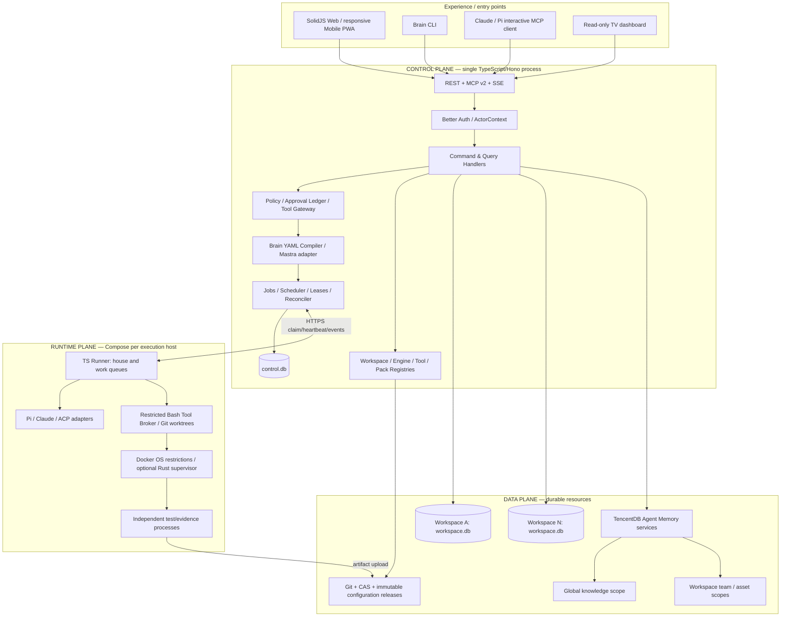
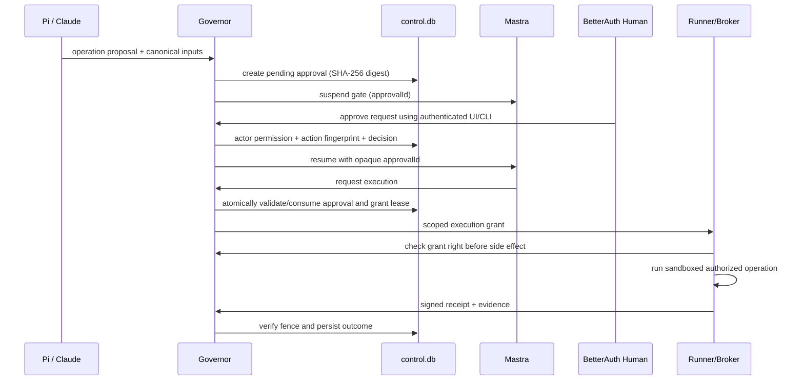

# Keyrus Brain v4.0 — Normative Architecture, Boundaries & Contracts

> **Status:** Proposed implementation baseline, 26 October 2026  
> **Audience:** Product architects, platform engineers, agent-runtime authors, security reviewers, implementers  
> **Model:** Three logical planes; TypeScript-first; Docker Compose; on-premise; global + per-workspace SQLite; Git/YAML declarations; TencentDB knowledge; Mastra dynamic workflow adapter; interchangeable Pi/Claude/ACP harnesses.
>
> **Source context:** Keyrus Brain presentation v1.1.0 (54 slides, October 2026), *keyrus-brain v2 Governor* specification, and architecture decisions from this conversation. Where this RFC changes the presentation's deployment (Postgres, Planka, MinIO, Qdrant, Helm/systemd), it is an **explicit architectural proposal**, not a claim that the existing implementation already behaves this way.

## 0. Executive architecture record

**One-line doctrine:** **Git declares. SQLite records. TencentDB remembers. Governor authorizes. Mastra coordinates. Runners execute. Independent evaluators verify.**

**Normative keywords:** **MUST** = mandatory invariant; **SHOULD** = recommended default with documented exception; **MAY** = optional. `Brain` means Keyrus Brain, `Governor` means the central TypeScript process; `control.db` is the single global operational database; each `workspace.db` is independently owned by a workspace. An *actor* is a verified human, runner, agent or workflow identity, never just unverified model text.

### Frozen decisions

| ID | Concern | Decision | Boundaries / qualification |
|---|---|---|---|
| ADR-001 | Primary language | TypeScript + Node.js LTS | Optional Rust **executor only**, not a second application backend |
| ADR-002 | Central app | Hono modular monolith; SolidJS web/mobile PWA and CLI | HTTP is an adapter, not domain code |
| ADR-003 | Authentication | Better Auth + Organization plugin | Browser identity distinct from runner/machine identity |
| ADR-004 | Declarative authority | Git commit + YAML + Markdown + Bash | All stable configuration defined in files; no config-editing by DB row |
| ADR-005 | Operational authority | SQLite WAL `control.db` + `workspace.db` per workspace | One active Governor writer, no cross-file atomic-transaction assumption |
| ADR-006 | Workflow orchestration | Brain-owned YAML → validated IR → Mastra dynamic graph | Mastra is beta; fallback adapter to XState possible, do not mix engines for the same run |
| ADR-007 | Human approval | Better Auth identity + Governor ledger + suspended workflow | No model-supplied string equals authoritative human approval |
| ADR-008 | Agent harness | Pi default, Claude fallback; ACP when verified | MCP is *agent→Brain*; ACP/native adapter is *Brain→harness* |
| ADR-009 | Tools | Bash + `TOOL.md`; `test.sh` for trusted release | Runtime sandbox and policy enforcement separate from Markdown |
| ADR-010 | Capitalization | Three independent equivalent successful operations create a **candidate** | No automatic privilege or global publication |
| ADR-011 | Memory | TencentDB Agent Memory: shared global and workspace-scoped assets | Memory doesn't own runs/approvals/executable releases |
| ADR-012 | Artifacts | Content-addressed filesystem + Git | CAS immutable once published; SQLite stores references |
| ADR-013 | Execution | TypeScript runner containers through Docker Compose | Resource/capability routing and independent enforcement |
| ADR-014 | Observability | Pino, SQLite aggregates; Victoria stack optional | High-volume transcripts go to compressed artifacts |
| ADR-015 | Board | Native SolidJS, data in workspace SQLite | No Kan.bn or Planka in new target |
| ADR-016 | Deployment | Docker Compose only | No mandatory Redis, Postgres, Kubernetes, systemd, NATS or Kafka |

### Out of scope for V1

Active-active Governor HA; workflow GUI builder; direct model authorization for privileged operations; infinite autonomous retry loops; platform-wide full-text storage of unredacted prompts; arbitrary third-party tool code as trusted; cross-customer memory sharing without review; per-workspace TencentDB processes by default; a standalone MCP server per Bash script.

## 1. Product capabilities and domain terms

### 1.1 First-class concepts

- **Organization:** administrative/security boundary in Better Auth; not interchangeable with a customer workspace.
- **Workspace:** portable governed bounded context representing project, client service, product or operational domain.
- **Workspace type:** reusable Git-declared defaults, enabled packs, risk rules and agent/team pattern.
- **Workspace instance:** Git-declared specialization plus independent operational database and evidence.
- **Agent definition:** Markdown instructions + YAML frontmatter: role, capabilities, routing tier and tools; **not** a running process.
- **Harness/engine:** Pi, Claude or other external agent runtime; replaceable execution adapter.
- **Session:** actual execution owned by runner, identified by `session_id`; recorded in SQLite.
- **Dispatch:** user/workflow intent approved for job planning; creates jobs and workflow instances.
- **Job:** schedulable durable execution request; claims use leases and attempts.
- **Workflow definition:** YAML graph, immutable at specific Git SHA and content digest.
- **Workflow run:** observed Mastra state plus Governor authoritative operational projections and receipts.
- **Tool:** executable Bash capability with immutable release digest, typed input, effect declaration and independent policy enforcement.
- **Skill:** portable `SKILL.md` / TencentDB knowledge, not inherently executable authority.
- **Pack:** Git-declared bundle of tools, roles, workflows, monitors and evaluation fixtures.
- **Evidence bundle:** verified artifacts, source hashes, tool receipts and a deterministic verdict; required for completion.
- **Approval:** authoritative, time-bound, context-bound human authorization record in global SQLite.
- **Memory asset:** TencentDB-managed asset with scope, provenance, ACL, lifecycle and optional Git source link.

### 1.2 Presentation parity / acceptance domains

Preserve MAXIT-style Today/briefing, Bridge multi-workspace overview, SRE read-only scans, support diagnosis/drafts, SLA, approval inbox, boards/decisions, live sessions, runner capability routing, keeper reconciliation, TV read-only dashboards, PWA/mobile alerting, memory, onboarding and delivery/eval packs. Preserve Director → workspace lead → specialists logically; delegation only when it adds distinct context or parallel work and passes cost/evidence measurement.

## 2. Three-plane architecture



**Logical versus physical:** CP = one long-lived central application; DP = files/DBs and selected TencentDB services; RP = worker processes on machines with source/cluster access. Plane boundaries MUST be expressed in contracts, not presumed from container layout alone.

## 3. Boundary ownership matrix — normative

| Boundary | Transport | Input | Output | Owner and invariants | Failure policy |
|---|---|---|---|---|---|
| UI/CLI/MCP → Governor | HTTPS JSON / SSE; MCP | `ActorContext`, `CommandEnvelope` | `CommandReceipt`, `QueryResult`, stream | Governor authenticates and authorizes all | Structured error; no partial unauthorized effects |
| Git → Config Compiler | read-only Git worktree | repo SHA, YAML/MD/Bash | `ResolvedConfigRelease` + diagnostics | Git authoritative, compiler deterministic, policy floor monotonic | Reject config change; keep last valid release |
| Governor → Mastra | embedded TS adapter | immutable graph release, run input | run ID, step status, suspended/wake info | Mastra orchestrates, **not** authoritative security or jobs | Mark run blocked, reconcile on restart |
| Governor → workspace DB | local `better-sqlite3` | authorized workspace query/command | transaction result/outbox | Each DB owns local tasks, sessions, evidence projections | Retry SQL busy with bounds; no cross-DB transaction |
| Governor → control DB | local `better-sqlite3` | privileged global mutation | job, lease, approval, audit receipt | Global transactional authority | Fail closed on corruption/disk full |
| Governor → TencentDB | scoped HTTP API | memory query/promotion | scoped asset + source/provenance | Knowledge only; no privileged API keys to runners | Degrade memory retrieval, queue indexing |
| Governor → Runner | outbound runner HTTPS claim/heartbeat | `JobOffer`, `ExecutionGrant` | `AttemptEvent`, `EvidenceReceipt` | Governor leases; runner local checks | Leases expire; ambiguous effects require reconciliation |
| Runner → Harness | ACP v1 / native Pi RPC / Claude adapter | `EngineSessionSpec` | events, usage, artifacts | Harness does not own authority | Capability negotiation, stop unsupported features |
| Runner → Tool Broker | local typed call + arg-array | `ToolExecutionSpec` | exit/output/effects/evidence | Runtime enforces credentials/OS sandbox | Deny if unable to enforce |
| Tool candidate → Git | reviewed proposal/PR | MD + Bash + tests | commit and digest | Humans/release pipeline control trust | Candidate remains quarantined |
| Workspace → Global memory | async reviewed promotion | scrubbed skill/evidence | TencentDB asset refs | Governed explicit release | Do not publish on partial verification |
| Cross-DB projection | durable outbox | versioned event | idempotent local read model update | Source DB remains authority | Retry; UI displays lag as needed |
| Backup/export | quiesce/snapshot | config SHA, DB, CAS, memory export | signed/hashed manifest | Exporter records consistency watermark | Mark incomplete if any component unsupported |

### Security boundaries

**Never trust:** LLM output, ticket content, repository instructions, generic MCP clients, tool-declared `read-only`, prompt context, or a runner's self-reported completion. Every privileged effect MUST pass policy in Governor and enforced runtime limits; a valid human approval cannot authorize a broader action than the reviewed digest.

## 4. Configuration authority — Git only

### 4.1 Proposed configuration repo

```text
brain-config/
  brain.yaml                       # platform defaults + security floor references
  schemas/                         # Brain-owned JSON Schemas
  types/<type>/type.yaml           # reusable workspace archetypes
  registries/
    agents/<role>.md               # frontmatter + instructions
    engines/<engine>.yaml
    workflows/<id>.yaml
    policies/<id>.yaml
    packs/<pack>/pack.yaml
    tools/<id>/{TOOL.md,run.sh,test.sh}
  workspaces/<workspace-slug>/
    workspace.yaml
    agents/*.md
    workflows/*.yaml               # optional local overrides
    tools/<tool-id>/{TOOL.md,run.sh,test.sh}
    AGENTS.md
  deploy/compose*.yaml
```

The config repo MUST contain **no secrets**. Secret references are permitted; actual values MUST live in Compose secrets or a secured external provider. Better Auth users/memberships, device sessions and approval decisions are operational data, **not** declarative YAML.

### 4.2 Resolution

`security floor → global defaults → workspace type → workspace instance → allowed request overrides`.

- **Known fields only**; unknown fields fail validation unless explicitly namespaced as extensions.
- `arrays` merge by stable ID for named resources; anonymous arrays replace, never blindly concatenate.
- `null` cannot disable a mandatory guard; denial takes precedence over allowances.
- Restrictive values can override permissive ones, but never vice versa for immutable floor rules.
- Resolve `tool@digest`, `agent@digest`, `workflow@digest`, `policy@digest`, `pack@digest`.
- Every compilation emits `effective.yaml`, deterministic canonical JSON, SHA-256 digest, origin/path provenance map, warnings and compatibility report.
- Active runs pin `git_sha`, `config_digest`, workflow and tool digests; new Git changes apply to **new runs** unless an explicit controlled migration is approved.

### 4.3 `brain.yaml` example

```yaml
# brain.yaml (PROPOSED Brain schema, not upstream Mastra syntax)
apiVersion: brain.keyrus/v1
kind: BrainConfig
metadata: {name: keyrus-brain}
spec:
  securityFloor:
    defaultToolPolicy: deny
    runtimeReadOnlyDefault: true
    productionApproval: exact-action-human
    evidenceRequiredForCompletion: true
    runnerIsolationRequired: true
  scheduling:
    retryUnknownExternalEffects: false
    leaseSeconds: 60
    heartbeatSeconds: 15
    maxActiveRunsGlobal: 12
  capitalization:
    ruleOfThree:
      enabled: true
      independentSuccessfulRuns: 3
      createCandidateAutomatically: true
      trustedPublication: review-required
  registries:
    workspaceTypes: types/
    agents: registries/agents/
    tools: registries/tools/
    workflows: registries/workflows/
```

## 5. Workspace boundary and portable units

**Workspace = Git definition + one workspace operational DB + CAS artifact subtree + TencentDB logical scope + references to global authority**. Not a separate application process by default.

### 5.1 `workspace.yaml`

```yaml
# workspaces/orange-oci/workspace.yaml
apiVersion: brain.keyrus/v1
kind: Workspace
metadata: {id: orange-oci, type: product-operations, displayName: Orange OCI}
spec:
  repositories:
    - {id: maxit-bff, remote: "ssh://git.internal/orange/maxit-bff.git"}
    - {id: maxit-infra, remote: "ssh://git.internal/orange/maxit-infra.git"}
  environments:
    - {id: int, runnerCapability: "kube:orange-oci:int"}
    - {id: prod, runnerCapability: "kube:orange-oci:prod", requiresApproval: true}
  team: {lead: lead, roles: [backend-dev, devops, sre, support-l2, qa]}
  engines: {default: pi, fallback: claude}
  workflows: {ticket: support-investigate, incident: incident-converge, release: delivery-dossier}
  memory: {provider: tencentdb, scope: workspace, globalRead: [approved-skills, standards]}
  tools: {globalBindings: [k8s.list-pods], local: [bff-health-check]}
  governance: {defaultMode: plan, productionRequiresHuman: true}
  limits: {maxConcurrentWriters: 2, dailyTokenBudget: 200000}
```

### 5.2 Workspace runtime storage

```text
/data/
  control/control.db
  workspaces/<opaque-workspace-id>/
    workspace.db
    artifacts/sha256/<prefix>/<digest>
    exports/
    manifest.json                # runtime export metadata ONLY
  tencentdb/                    # memory services' own volumes and indexes
  backups/                      # preferably separate mount/media/off-host
```

**No database paths from URL slugs**. Resolve immutable opaque IDs against the global workspace registry after membership validation. Restrict allowed directories, reject symlinks/path traversal, bound SQLite open handles by LRU. Runners never mount central DB files.

### 5.3 Workspace lifecycle

`draft → discovering → configured → verifying → active ↔ suspended → exporting → archived` (plus `restore_pending`, `restore_blocked`). An archived workspace cannot claim new jobs. Cloning copies Git declarations and optional selected templates, **never** secrets, approval grants or private memory without authorization.

## 6. Operational data model — SQLite only

### 6.1 `control.db` authoritative tables

| Domain | Tables (illustrative) | Authoritative? |
|---|---|---|
| Auth | Better Auth-generated `user`, `session`, `account`, organization/membership tables | Yes, identity |
| Workspace directory | `workspaces`, `workspace_membership_projection`, `config_releases`, `active_config` | Workspace pointer/status, release activation |
| Runner registry | `runners`, `runner_capabilities`, `runner_health` | Yes |
| Global job coordination | `jobs`, `job_attempts`, `job_leases`, `resource_locks`, `runner_commands` | Yes |
| Authorization | `approval_requests`, `approval_decisions`, `approval_consumptions`, `revocations` | Yes |
| Audit | `audit_events`, `global_outbox`, `idempotency_keys`, `execution_grants` | Yes |
| Platform metrics | `usage_rollups`, `service_health`, `drift_observations` | Derived |

### 6.2 `workspace.db` authoritative local tables

| Domain | Tables (illustrative) | Authoritative? |
|---|---|---|
| Work management | `boards`, `cards`, `card_comments`, `decision_records`, `acceptance_criteria` | Yes |
| Dispatch/project | `dispatches`, `workflow_runs`, `workflow_steps`, `workspace_job_projection` | Local business truth; **global jobs remain control authority** |
| Agent usage | `sessions`, `session_events_index`, `tool_invocations`, `tool_effects` | Yes |
| Evidence | `evidence_bundles`, `evidence_checks`, `artifacts`, `verification_verdicts` | Yes for local proof index |
| Support/SRE | `tickets`, `sla_timers`, `incidents`, `observations`, `connector_cursors` | Yes |
| Self improvement | `action_observations`, `pattern_groups`, `tool_candidates`, `skills_promotions` | Yes |
| Projection sync | `workspace_outbox`, `global_event_inbox`, `read_models` | Durable projection history |
| Mastra | workflow-definition projection/snapshots in Mastra-managed tables | Mastra private runtime projection, never business approval authority |

### 6.3 Atomicity boundaries

All *global authorization and job lease decisions* MUST commit in a **single `control.db` transaction**. All workspace-local state/outbox changes commit in one `workspace.db` transaction. SQLite WAL does **not** guarantee one atomic COMMIT across attached DBs; use idempotent durable outbox/inbox, sequence IDs and reconciler instead. Event handlers MUST be restart-safe and idempotent.

**Mastra storage decision:** prefer a **file-backed `@mastra/libsql` store at the workspace `workspace.db` path**, if tested compatible with Drizzle/better-sqlite3 on the pinned release. Mastra creates and owns its own tables; Brain MUST NOT modify these tables directly. This reduces SQLite files but **does not** create atomic application↔Mastra transactions. If cross-driver contention or migration collision fails the POC, allow `workspace.mastra.db` in the same workspace export bundle as an explicit documented fallback. The product abstraction remains "SQLite per workspace operational unit", not necessarily literally one physical file under every engine version.

### 6.4 Storage PRAGMAs and transactions

- WAL on local SSD/bind volume; never put SQLite WAL on an unsupported NFS share.
- `busy_timeout`, foreign keys, bounded connection count and short transactions.
- Avoid long SQLite transactions while waiting for LLM, network, model or human.
- No high-volume transcripts in DB; store compressed/redacted CAS artifacts and event pointers.
- Schema migrations versioned in app source, performed only by authorized release process; rollback requires restore/compatible reverse migration.

## 7. Workflow-as-code contract (Brain YAML, Mastra adapter)

### 7.1 DSL design

Brain's stable workflow vocabulary is **six node kinds**: `dispatch`, `gate`, `eval`, `steer`, `merge`, `subgraph`. Fan-out/fan-in is declared at graph level via `dependsOn` and `parallel` groups, not additional privileged stage types. Additional non-privileged activity such as drafting or data mapping is a registered tool referenced by a `dispatch` stage. Loops use a bounded `retry`/`converge` policy, never arbitrary script-evaluated conditions. The DSL MUST NOT allow arbitrary JavaScript or shell code inline.

All stage inputs/outputs use JSON Schema with versioned IDs. Conditions use an approved expression vocabulary or registered pure predicates; no `eval`, dynamic imports, or model-decided privilege switches. Compiled intermediate representation **must not depend on Mastra field names**.

### 7.2 Example workflow

```yaml
# registries/workflows/support-investigate.yaml
apiVersion: brain.keyrus/v1
kind: Workflow
metadata: {id: support-investigate, version: 1.0.0}
spec:
  inputSchema:
    type: object
    properties: {ticketId: {type: string}}
    required: [ticketId]
  outputSchema:
    type: object
    properties: {reportId: {type: string}, published: {type: boolean}}
    required: [reportId, published]
  defaults: {mode: plan, risk: low, maxCostUsd: 2}
  nodes:
    - id: investigate
      kind: dispatch
      agent: support-analyst
      toolBindings: [tickets.get, git.search, memory.search]
      outputSchemaRef: schemas/ticket-analysis.json
      timeoutSeconds: 900
    - id: verify
      kind: eval
      dependsOn: [investigate]
      evalPack: support-draft
    - id: approve-reply
      kind: gate
      dependsOn: [verify]
      gateType: human-approval
      operation: tickets.publish-comment
      targetFrom: "input.ticketId"
      subjectFrom: "steps.investigate.draftDigest"
      approvalPolicy: support-publication
    - id: publish
      kind: dispatch
      dependsOn: [approve-reply]
      tool: tickets.publish-comment
      executionMode: governed-side-effect
    - id: final-check
      kind: eval
      dependsOn: [publish]
      evalPack: ticket-published
```

**Note:** This is a **Brain-owned** DSL, not native Mastra `graph` format. `spec.nodes` compile to a Mastra graph of registered `brain.*` primitives. The compiler checks dependencies, data mapping, authorization requirements, DAG acyclicity except explicitly bounded `converge` constructs, and output schema compatibility. Never register arbitrary agent-supplied code as a Mastra step.

### 7.3 Compiler phases

1. Load Git-ref-restricted files from approved config checkout.
2. Parse YAML preserving source location (line/column) for diagnostics.
3. Validate Brain JSON Schema, unknown field rejection, all references and version constraints.
4. Resolve workspace inheritance and immutable global policy floor.
5. Type-check step input/output and path references; ensure no unreachable or implicit privileged edges.
6. Compute canonical IR, policy/tool/agent digests and workflow digest.
7. Translate to Mastra dynamic JSON references against **pre-registered trusted tools/nested workflows**.
8. Register under immutable internal ID `brain.<id>.<digest-prefix>` (avoid same-ID mutation for pinned runs).
9. Run synthetic dry-run and test-case graph checks.
10. Persist configuration activation metadata in global control DB and run reference in workspace DB.

### 7.4 Workflow lifecycle and statuses

`created → validated → ready → running ↔ suspended → succeeded | partial | failed | cancelled | blocked`.

- `suspended` means Mastra is waiting for a durable external event/human decision; approval request remains in global ledger.
- `partial` is a Brain outcome with a bundle naming unmet criteria; not an equivalent to `succeeded`.
- An LLM's `OUTCOME: done` is never a state transition by itself.
- Resume MUST re-evaluate current authorization and target fingerprints, regardless of workflow snapshot.
- Reconciler on restart enumerates global pending jobs, workspace workflow runs and Mastra resumable snapshots. Duplicate resume MUST be idempotently rejected.

### 7.5 Mastra-specific contract and limitations

- Target `@mastra/core` dynamic workflows and `@mastra/libsql` after a **pin-and-benchmark** gate; dynamic workflows are officially **beta**, and runtime snapshots require persisted storage.
- Only register a **small set** of trusted `brain.dispatch`, `brain.gate`, `brain.eval`, `brain.steer`, `brain.merge`, `brain.subgraph` adapters. The adapters route through Governor application services rather than calling Pi/Bash directly.
- Never expose Mastra's direct dynamic-workflow administration HTTP endpoints to users/agents; Git+Governor compiler is the only mutation path.
- Revisions generate new digest-based workflow IDs. In-flight workflows and versions remain available until all references complete or are migrated explicitly.
- Do not use Mastra Agents or Memory as a second authoritative agent loop/knowledge store.
- Workflow graph storage is a **derived cache/projection** of Git configuration; a missing/stale graph can be recompiled from pinned Git release, provided its pinned step registry is present.

## 8. Human-in-the-loop (HITL) contracts

### 8.1 Approval lifecycle

`draft_request → pending → approved | rejected | expired | revoked`, with separate `consumed` state for one-shot execution grants. `approved` is not equivalent to `executed`.



Approval bound values: `workspace`, `actor human`, `operation`, `tool release digest`, canonical argument hash, immutable target ID and environment, artifact/revision hash where relevant, max effect scope, policy/config digest, issued/expiry timestamps, nonce, one-time-use count, human decision verbatim plus origin channel and decision receipt. **An agent may propose or display an approval but cannot fabricate a human decision by sending model text through MCP.** CLI/MCP approval for a human MUST use a separate authenticated human-controlled confirmation, e.g. browser/PWA or properly authenticated terminal confirmation not delegated to the model.

### 8.2 Human review experience

Web/mobile: exact before/after preview, diff/target, origin, evidence, timeout and actions (approve, reject, request changes). Client-side text is advisory; hash of canonical payload is generated server-side. All decisions audited including rejection. Notifications originate from outbox; unknown/expired approvals never auto-accept.

### 8.3 Durable wait correctness

- Persist `approval_request` in `control.db` before the corresponding workflow step becomes externally resumable.
- Mastra snapshot and Governor approval commit are **not atomic**; use reconciliation with a correlation ID to repair either ordering failure.
- When approval arrives before suspended snapshot is visible, store wake intent durably; replay after snapshot persistence.
- On revocation/expiry, any pending, queued or leased operation MUST be stopped before its side effect where technically possible. Never claim rollback of external effects already performed.

## 9. Harness-agnostic contracts

**Direction A: agent → Brain.** Expose REST/CLI/MCP, all calling identical application command/query handlers. **Direction B: Brain → agent.** Use ACP v1 when validated, otherwise Pi RPC or native Claude adapter. MCP is not a session lifecycle protocol; ACP is not a general authorization platform.

### 9.1 Minimal engine capability contract

```ts
// packages/contracts/src/engine.ts — logical DTO, not upstream SDK API
export type EngineCapability = 'start'|'events'|'cancel'|'resume'|'steer'|'interactive'|'headless'|'tool-intercept'|'context-fork'|'usage';
export interface EngineSessionSpec {
  contractVersion: 'brain.engine/v1';
  workspaceId: string; dispatchId: string; jobId: string; attemptId: string;
  engineId: string; modelId: string; runnerId: string;
  checkoutRef: string; workingDirectory: string; configDigest: string;
  allowedToolReleaseDigests: string[];
  limits: {maxTokens?: number; maxUsd?: number; timeoutMs: number};
  contextArtifactId: string; approvalRefs: string[];
}
export interface EngineAdapter {
  id: string;
  capabilities(): ReadonlySet<EngineCapability>;
  start(spec: EngineSessionSpec): Promise<{sessionId: string}>;
  events(sessionId: string): AsyncIterable<EngineEvent>;
  cancel(sessionId: string, reason: string): Promise<void>;
  steer?(sessionId: string, message: string): Promise<void>;
  resume?(sessionId: string): Promise<void>;
}
export interface EngineEvent {
  contractVersion: 'brain.engine.event/v1';
  eventId: string; sessionId: string; attemptId: string; sequence: number;
  kind: 'session.started'|'session.stopped'|'text'|'tool.proposed'|'tool.result'|'usage'|'artifact'|'human.input.requested'|'error';
  occurredAt: string; payload: unknown;
}
```

- Do not misrepresent unsupported steering or context-fork capabilities; return structured `UNSUPPORTED_CAPABILITY`.
- Session state is normalized for product UX, but preserve raw engine artifacts (redacted) for debugging.
- For every engine adapter provide: start/events/cancel, health, resource usage, policy gate tests, exit mapping; resume/steer only if supported.
- **Do not rely on engine hooks alone for privileged enforcement:** container OS permissions and the external tool broker must deny bypass via shell/network/process access.

### 9.2 Agent → Brain command bus envelope

```ts
// packages/contracts/src/command.ts
export interface ActorContext {
  kind: 'human'|'runner'|'agent'|'workflow';
  actorId: string; organizationId: string; workspaceId?: string;
  delegatedBy?: string; runId?: string; scopes: string[];
  authMethod: 'session'|'machine-key'|'delegated-grant';
}
export interface CommandEnvelope<T = unknown> {
  contractVersion: 'brain.command/v1'; commandId: string;
  commandType: string; workspaceId?: string; idempotencyKey: string;
  expectedVersion?: number; payload: T;
}
export interface CommandReceipt {
  commandId: string; accepted: boolean; outcome: 'applied'|'queued'|'pending-approval'|'rejected';
  eventId?: string; resourceId?: string; error?: {code: string; detail: string};
}
```

Actual actor is resolved from validated auth context on server, **never** trusted from client-supplied JSON. Clients MAY send an acting-on-behalf-of hint, which must be independently resolved and authorized.

## 10. Job, lease and resource-lock contracts

### 10.1 Job lifecycle

`queued → waiting_capability | waiting_approval | leased → running → verifying → succeeded | partial | failed | cancelled | blocked`; `recovering` for expired/ambiguous attempts; `outcome_unknown` for effects whose success cannot be established after a crash.

### 10.2 Job ownership

Global `control.db` owns `jobs`, `job_attempts`, `leases`, resource conflicts, approval consumption and runner commands. Workspace DB stores business instance, projections and evidence. Never perform unbounded retries of external writes. All retries are per failure class and risk.

### 10.3 Lease rules

- `claim` atomic with at-most-one live lease for a conflicting resource.
- An attempt has increasing `attempt_no` and `fencing_token` per resource.
- `heartbeat` and `complete` require current `(jobId, attemptId, runnerId, fencingToken)` and unexpired grant.
- Runner receives only a short-lived signed/scoped execution grant and specific requested capability, not a broad administrator credential.
- On expiry, mark attempt unknown/recovering; create fresh attempt only after determining whether external effect is retryable.
- Never depend on a stale fencing token alone to secure a target that cannot check it (e.g. Git remote); serialize merge under Governor and verify expected Git ref before push.

### 10.4 Resource key grammar

`repo/<workspaceId>/<repoId>/writer`, `repo/<workspaceId>/<repoId>/merge`, `env/<workspaceId>/<environmentId>/<operation>`, `tool/<workspaceId>/<toolId>/<target>`. Canonical normalized IDs, no freeform slash injection. Lock grants are separate from task reservations and human approvals.

### 10.5 Runner resource admission

Runner reports: tool availability, repo connectivity, Kubernetes per-environment capabilities, current CPU/memory/disk pressure, isolation level, concurrent jobs and per-lane activity (`house`, `work`). Governor filters eligible runners; **runner independently accepts/declines** based on live pressure. `p-queue` handles process-local admission only; global leases govern distributed ownership.

### 10.6 Locking primitives

`control.db` SQLite leases + fencing for distributed logical authority; OS/file locks (`proper-lockfile`, if needed) for local multi-process staging; Git worktrees for independent writers; per-repo serialized merge controller; cgroups/OS resource limits for runaway subprocesses. `async-mutex` is optional, never treated as cross-machine lock.

## 11. Tools and Rule of Three

### 11.1 Tool-as-files contract

```text
workspaces/<slug>/tools/<tool-id>/
  TOOL.md       # frontmatter + contract + human usage
  run.sh        # executable; positional argv or validated stdin JSON
  test.sh       # trusted publication required
  fixtures/     # sanitized examples; optional
```

Tool frontmatter: immutable `id`, `version`, effect class, risk, required runtime capabilities, input/output JSON Schema references, timeout, max output bytes, redaction profile, allowed environment classes, owner, source licenses. A Markdown claim of `read-only` is insufficient: tool broker classifies/restricts actual OS credentials and capabilities.

### 11.2 Tool invocation contract

```ts
// packages/contracts/src/tool.ts
export interface ToolInvocation {
  contractVersion: 'brain.tool/v1';
  invocationId: string; workspaceId: string; dispatchId?: string;
  jobId: string; attemptId: string; toolId: string; releaseDigest: string;
  input: Record<string, unknown>; inputDigest: string;
  target: {environmentId: string; resourceId: string};
  approvalId?: string; executionGrantId: string;
  idempotencyKey: string; fencingToken: number;
}
export interface ToolReceipt {
  invocationId: string; attemptId: string; fencingToken: number;
  result: 'succeeded'|'failed'|'partial'|'unknown';
  startedAt: string; finishedAt?: string; exitCode?: number;
  stdoutArtifactId?: string; stderrArtifactId?: string;
  evidenceArtifactIds: string[]; effectsObserved: string[];
}
```

### 11.3 Rule of Three

Three **independent** **successful** **semantically equivalent** executions of a currently unpackaged operation MUST enqueue exactly one packaging candidate. Count distinct original runs (not retries or nested commands from one run); normalize command AST/argv and parameters; redact secrets; look for existing equivalent tool before packaging; ambiguous clusters may be reviewed by Pi/Claude but not trusted without deterministic fixtures.

`observed(1) → recognized(2) → candidate(3) → generated → validated → reviewed → workspace-active → global-promoted (optional)`.

Tool generation output: `TOOL.md`, `run.sh`, `test.sh`; test `bash -n`, ShellCheck, shfmt, Bats, negative cases, output schema, secret scan, permission test and fixed-size timeout. A tool candidate has no grant. Existing trusted releases are immutable. Skill capitalisation uses TencentDB **after** evidence and scope review, never as executable authority.

### 11.4 Tools vs Skills vs Packs

- **Tool** = executable capability/version in Git/CAS, registered by Governor.
- **Skill** = portable `SKILL.md` experience and optional resource files, indexed/bound in TencentDB; may *describe* tools but cannot grant them.
- **Workflow** = YAML sequencing and gates compiled by Governor.
- **Pack** = Git bundle (agents, tools, workflows, evals, UI bindings) with version and dependencies.
- **Connector** = transport/credentials and permission-limited integration to external software.

## 12. Memory boundary — TencentDB global and workspace

MemoryCore manages memory, Skills and metadata; knowledge processing (Wiki/CodeGraph) may require MemoryKnowledge. TencentDB also has its own asset ACL/team model. Brain MUST maintain a **one-way authorization mapping** from Better Auth/Governor to TencentDB; do not allow TencentDB memberships to elevate Governor permissions.

### 12.1 Memory scopes

| Scope | Examples | Default |
|---|---|---|
| Global | Approved engineering standards, generic skills, shareable lessons | Readable only to eligible org roles |
| Team | Shared practices across authorized workspaces | Explicit membership |
| Workspace | Project code facts, runbooks, support ticket context | Workspace restricted |
| Agent private | Individual draft context/sessions | Owner/private by default |

Global and workspace scopes MAY share one TencentDB deployment, but MUST use enforced ACLs, namespace/team mapping, asset provenance and scoped credentials. Physical TencentDB isolation is an **optional stricter profile**, not the default for every workspace. If TencentDB doesn't support complete scoped memory export, the workspace export manifest MUST mark memory backup as partial and not falsely claim independent full restore.

### 12.2 Memory contracts

```ts
// packages/contracts/src/memory.ts
export interface MemoryScope {
  organizationId: string; workspaceId?: string; teamId?: string;
  visibility: 'global-approved'|'team'|'workspace'|'private';
}
export interface MemoryQuery {
  contractVersion: 'brain.memory/v1'; queryId: string;
  scope: MemoryScope; agentRole: string; query: string;
  sourceTypes: ('chat'|'skill'|'wiki'|'codegraph')[];
  limit: number; maxChars: number;
}
export interface MemoryPromotionRequest {
  candidateId: string; sourceWorkspaceId: string; targetScope: MemoryScope;
  sourceEvidenceIds: string[]; sourceReleaseDigests: string[];
  contentDigest: string; classification: 'public'|'internal'|'confidential';
}
```

Memory retrieval results MUST carry `sourceId`, source timestamp/version, scope, confidence/source classification and deletion/revocation ability. Cached retrieval cannot bypass updated workspace membership. Publication is async after evidence + redaction + review. Unverified memories MUST NOT be promoted to global scope.

## 13. Evidence boundary

Every approved completion requires a **content-addressed EvidenceBundle** with: `dispatchId`, `jobId`, attempt/fence, pinned Git SHA/config/workflow/tool digests, diff/artifact hashes, deterministic checks (tests/lint/security/schema), external effect receipts, approval references, verifier verdict, timestamps and missing/unmet acceptance criteria. LLM verifier is an additional signal, not a substitute for deterministic checks.

Bundle states: `assembling → submitted → verified | rejected | incomplete`. Board `Done` requires `verified` and authorized outcome; `Partial` requires named failures/missing evidence. Evidence bundles are immutable once signed/registered; corrections create new versions.

## 14. Connector, pack and reconciler contracts

Connector `probe`, `read`, `list`, `observe` are read-only; `mutate` is a distinct high-risk capability. Connector manifests define endpoint type, credential references, required runner capability, rate budget, data classification, target environment filters and canonical operation names. Do not place raw kubeconfigs or client API keys in Governor.

Packs: `core`, `onboarding`, `support`, `sre`, `delivery`, `eval`. Pack versions pin all their agent/tool/workflow/eval dependencies and minimum Brain contract version.

Reconciler: compare **desired state from Git and plan** against **observed facts from DB/remote systems**, write durable `drift_observations`, schedule safe work only after configurable debounce/count and approval gates. Idempotent event processing and watermarks are required. Keep periodic `house` lane separate from long-running `work` lane.

## 15. Human experience API surface

### 15.1 Channels

- **Web (SolidJS)**: Today, Bridge, Workspaces, Native Board, Decisions, Approvals, Sessions, Jobs/Runners, Tools/Skills, Evidence, SLA/Support, SRE, Delivery, Settings.
- **Mobile PWA**: brief, alerts, ticket/incident triage, human approvals, session steering and safe read-only commands. Native Android is replaceable client if chosen later.
- **CLI (`brain`)**: login, workspace use/list, context, today, dispatch, jobs, approvals, tool search/run, sessions, config explain/validate, workspace backup/export/import, doctor.
- **Claude/Pi interactive**: Brain MCP server or CLI; no direct privileged DB/runner credentials.
- **TV/kiosk**: read-only dashboards with scoped revocable identity and no approval UI.

### 15.2 REST endpoints — conceptual public API

| Method | Route | Contract | Security |
|---|---|---|---|
| GET | `/v1/workspaces` | `WorkspaceSummary[]` | Membership filtered |
| GET | `/v1/workspaces/:id/context` | `WorkspaceContext` | Membership + current config hash |
| POST | `/v1/commands` | `CommandEnvelope` → `CommandReceipt` | Scope, idempotency, policy |
| GET | `/v1/jobs/:id` | `JobSnapshot` | Org/workspace access |
| POST | `/v1/approvals/:id/decision` | `HumanApprovalDecision` | Authenticated human only |
| POST | `/v1/runners/claim` | `JobClaimRequest` → `JobOffer` | Machine identity and capability |
| POST | `/v1/runners/:id/heartbeat` | `LeaseHeartbeat` | Attempt/fence checked |
| POST | `/v1/attempts/:id/events` | `AttemptEventBatch` | Seq/idempotency |
| POST | `/v1/attempts/:id/complete` | `Tool/JobReceipt` | Current lease/fence, evidence |
| GET | `/v1/sessions/:id/events` | SSE stream | Workspace authorization |
| POST | `/v1/memory/search` | `MemoryQuery` | Double-checked memory scope |
| POST | `/v1/workspaces/:id/export` | Export job | Workspace lead / data admin |
| GET | `/mcp` | MCP Streamable HTTP | MCP caller auth and tool access |

These paths are proposed Brain APIs, not upstream Mastra or TencentDB endpoint names. All errors use typed `BrainError` codes: `UNAUTHENTICATED`, `FORBIDDEN`, `NOT_FOUND`, `CONFLICT`, `STALE_VERSION`, `APPROVAL_REQUIRED`, `APPROVAL_EXPIRED`, `LEASE_LOST`, `POLICY_DENIED`, `UNSUPPORTED_CAPABILITY`, `EVIDENCE_MISSING`, `DEPENDENCY_UNAVAILABLE`, `OUTCOME_UNKNOWN`.

### 15.3 Events

Canonical event envelope: `eventId`, `schemaVersion`, `aggregateType`, `aggregateId`, `workspaceId?`, `correlationId`, `causationId`, `sequence`, `occurredAt`, `actorRef`, `configDigest?`, `payload` plus optional artifact pointer; persist in DB outbox/inbox. Required families: `dispatch.*`, `workflow.*`, `job.*`, `runner.*`, `approval.*`, `tool.*`, `session.*`, `evidence.*`, `memory.*`, `config.*`, `reconciliation.*`. SSE may be lossy; durable replay derives from SQLite sequence and cursor.

## 16. Security and trust model

### 16.1 Threats and mandatory mitigations

| Threat | Mandatory control |
|---|---|
| Prompt injection from ticket/repo/memory | Explicit untrusted source label, no direct action without broker |
| Agent forges approval / identity | Better Auth human-bound decision, server-generated digest, no delegated agent approval |
| Tool claims read-only but mutates | Runtime OS permissions, network policy, scoped credentials, audits |
| Harness bypass via raw shell | Restrict shell/fs/network credentials; enforce broker for privileged operations |
| Stale job after lease expiry | Fencing, attempt IDs, revocation checks, external reconciliation |
| Cross-workspace DB/file leakage | ID-based context resolver, confined paths, ACLs, test cross-tenant denial |
| Cross-team TencentDB leak | Scope mapping, team/asset ACL, deny default, retrieval tests |
| Secret leakage in logs/memory | Redact-before-store, secret refs not values, retention, encryption |
| Config self-escalation | Git review + immutable floor + compiler validation; no runtime config edit rights |
| Workflow rollback after partial external effect | `outcome_unknown` + reconciliation, no blind retry |
| Supply chain compromise | Digest-pinned tool releases, reviewed dependencies, reproducible bundles/scan |
| Runner compromised | Narrow machine identity, no DB volume mount, short-lived grants, egress restrictions |

### 16.2 Sandbox requirement

Rootless/non-root runner container, read-only root FS where practical, dropped capabilities, seccomp, no host Docker socket, no uncontrolled home or kubeconfig mounts, per-job checkout and explicit writable volumes, network egress allowlist, strict time/memory/PID/file caps. Sandbox Runtime/bubblewrap MAY be used after nested-container tests. Rust MAY supervise cgroups/process trees, but Rust code itself is not an isolation boundary.

## 17. Source-of-truth and failure semantics

| Failure | Expected behavior |
|---|---|
| Control DB unavailable/full | All privileged operations fail closed; runners stop upon grant expiry |
| Workspace DB unavailable | Workspace suspended for mutations; no claim of task completion |
| Mastra snapshot unavailable | Reconcile blocked run; do not guess past step completion |
| TencentDB unavailable | Optional retrieval degraded; approval/scheduling still work; indexing outbox retries |
| Runner disconnected | Lease eventually expires; unknown side effects reconciled, no blind repeat |
| Approval arrives early | Durable wake request recorded; resume after snapshot confirmed |
| Git config modified without release | Detect drift; active jobs keep pinned config, no silent promotion |
| Conflicting merge | Rebase in isolated queue, verify and ask for new approval if target/diff changes |
| Evidence write incomplete | No Done; retry artifact upload or mark Partial/Blocked |
| Process killed during backup | Export marked incomplete; old verified backup remains available |

## 18. Operational deployment — Docker Compose only

### 18.1 Compose topology

- `governor`: Node.js/Hono + Better Auth + SolidJS static bundle; mounts global and workspace SQLite directories + CAS/config release read-only; one active replica.
- `memory-core`: pinned TencentDB service with its own persistent volume; optional `memory-knowledge`, `memory-hub`, `memory-proxy` by profile/feature. Default shared instance: global team + workspace teams.
- `backup` one-shot Compose profile using online SQLite backup + artifacts + scoped TencentDB export **if supported**.
- `runner` deployed as separate Compose project on each execution host. It calls Governor outbound over TLS/VPN. No SQLite mounts.
- Optional `victorialogs`, `victoriametrics`, `ntfy` via profiles only.

Resource profile baseline (planning estimate, not verified benchmark): central Governor target 2 vCPU/2–4 GB with memory-core additional allocation; runner sized for Java/Node builds and allowed concurrency. TencentDB indexing, CodeGraph generation and LLM inference can dominate peak load; measure separately. Use local Qwen/OpenAI-compatible endpoint, not local inference inside the central Governor container.

### 18.2 Backups/restore

Backup includes `control.db` (as separately authorized global backup), every `workspace.db` via SQLite online backup, selected artifact hashes, matching Git commit/config bundle, Mastra snapshots, scoped memory export refs and consistency watermark. Workspace portability imports scoped auth/membership **references** but not user password records or existing reusable approval grants. Restore enters `restore_pending`, validates all digests and policies and remains suspended until authorized activation. Restore tests required in CI/acceptance.

Retention: approvals and audit per business/legal policy; raw transcripts shorter than evidence; memory data classification and deletion apply independently. Off-host encrypted copies recommended; local backup volume alone not disaster recovery.

## 19. Observability and SLOs

Metrics: accepted tasks/hour, cost per evidence-accepted change, first-pass CI, approval precision, time-in-HITL, tool-use safety denials, Rule-of-Three candidate yield, memory relevance, tool reuse, fallback rate, runner resource availability, lock wait, lease recovery time, cursor lag, SSE delivery lag and daily spend. Pino structured JSON logs with correlation IDs; compress verbose engine transcripts in CAS. VictoriaLogs/VictoriaMetrics remain optional. SLO targets must be established from measurements, not claimed without benchmarks.

## 20. Implementation modules and lightweight OSS map

| Module | Preferred OSS | Keep custom |
|---|---|---|
| Web/API | Hono, SolidJS, Tailwind v4, Zag, TanStack Virtual | Business UX, common command handlers |
| Auth | Better Auth + Organization (+ scoped API keys) | Operation-level policy/approval ledger |
| Persistence | Drizzle + better-sqlite3 | Cross-DB outbox, leases, migrations |
| Workflow | `@mastra/core` dynamic workflows + `@mastra/libsql` | YAML DSL/compiler, HITL bridge, proof/authorization |
| YAML/schema | `yaml` + Zod v4/JSON Schema validator | Inheritance, policy floor, reference resolution |
| Inbound agents | MCP TS SDK v2; Brain CLI | Stable platform commands |
| Outbound agents | ACP TS SDK v1, Pi RPC, Claude adapter | Capability registry, normalized events |
| Process/locks | Execa, `p-queue`, `proper-lockfile`, native Git | Global leases, tool broker, merge queue |
| Recurring/retry | `cron-parser`, `p-retry` | Persisted scheduler and safe retry taxonomy |
| Bash quality | ShellCheck, Bats, shfmt | Rule-of-Three classification and review |
| Evaluations | Vitest, Evalite; Playwright/Promptfoo on demand | Evidence contracts, verdict policy |
| Memory | TencentDB Agent Memory | ACL/identity mapping, promotion, invalidation |
| Analytics | Pino, ECharts; Victoria optional | Product metrics and SLA calculations |
| Spec/change planning | OpenSpec file conventions optionally | Change contract compiler and gate |

**Do not** simultaneously adopt Mastra+XState+OMA as three runtime workflow authorities; choose one per run behind Brain's `WorkflowEnginePort`.

## 21. Repository layout — implementation

```text
keyrus-brain/
  apps/
    governor/         # Hono, Better Auth, modules, API, MCP
    web/              # SolidJS web/mobile PWA and TV
    cli/              # brain TypeScript CLI
    runner/           # Pi/Claude/ACP and Bash Tool Broker
  packages/
    contracts/        # JSON Schema + TS DTOs, error codes, event registry
    domain/           # Pure reducers + invariants
    application/      # Authorized commands and queries
    config-compiler/  # YAML → canonical IR → Mastra adapter
    workflows-mastra/ # Per-workspace Mastra storage and trusted steps
    governance/       # Risk, approval, grants, audit
    jobs/             # Scheduler, leases, fencing, locks, reconciler
    tools/            # Bash loader/packager, Rule of Three
    memory-tencentdb/ # Scoped API integration and promotion
    persistence/      # Global/workspace SQLite repositories
    pack-sdk/         # Connector and pack manifests
    engine-adapters/  # Pi/Claude/ACP
    evidence/         # Manifest, integrity and verification
  config/             # Git-backed or separately versioned brain-config repo
  tests/
    contracts/
    integration/
    chaos/
    security/
    scenarios/
  deploy/
    compose.yaml
    compose.memory.yaml
    compose.runner.yaml
    compose.observability.yaml
  native/
    rust-executor/    # Optional and deferable
```

## 22. Mandatory acceptance test matrix

| ID | Scenario | Expected result |
|---|---|---|
| AC-01 | YAML workflow compiles and executes identical semantics across restart | Reproduced from pinned SHA |
| AC-02 | Invalid YAML/unknown tool/cyclic unauthorized graph | Compilation fails; last active config unchanged |
| AC-03 | Two concurrent global jobs seek same repo writer lock | One live lease only |
| AC-04 | Kill Governor with 100 HITL pending | All approvals still pending and resumable |
| AC-05 | Approve through authenticated Web; try replay via MCP as agent | Agent blocked; single human decision consumed once |
| AC-06 | Approval target/diff hash changes before execution | Reapproval required |
| AC-07 | Runner crashes after production tool call but before receipt | Outcome unknown; no blind retry |
| AC-08 | Stale runner with old fence reports success | Rejected; does not complete job |
| AC-09 | Two writers build in isolated Git worktrees | Worktrees separate; merge serialized |
| AC-10 | Pi and Claude complete same synthetic workflow | Equivalent normalized external outcomes and evidence |
| AC-11 | Unsupported ACP/engine steer | Structured unsupported error, no fake success |
| AC-12 | Same dangerous operation through REST/MCP/CLI/Bash | Denied by same policy in every channel |
| AC-13 | Three independent successful equivalent commands | One quarantined tool candidate, validated before publication |
| AC-14 | Three retries of one failing operation | No tool candidate |
| AC-15 | Candidate tool modifies policy YAML | Runtime denied; no automatic activation |
| AC-16 | Workspace A requests workspace B private TencentDB assets | Denied and audited |
| AC-17 | TencentDB offline during approval | Approval still completes; memory indexing retries |
| AC-18 | Export workspace + restore to clean instance | Tasks/evidence/config restored; old approvals never active |
| AC-19 | Promote sanitized workspace skill to global | Review, scrub and provenance required |
| AC-20 | Memory asset permission revoked | Retrieval denied immediately even with cache |
| AC-21 | Git config changes mid-run | Existing run remains pinned; new run sees new release |
| AC-22 | Disk full/corrupt control DB | Mutations fail closed; watchdog reports degraded |
| AC-23 | Sandbox tries to access Docker socket/secret paths | Denied by OS/container, not merely prompt |
| AC-24 | Long Java build competes with house checks | House lane still makes progress under admission rules |
| AC-25 | Disabled workflow package still referenced by suspended run | Pinned release retained until migration/completion |
| AC-26 | Outbox delivers event twice | Projector applies once, consistent projections |

## 23. Delivery slices / implementation order

| Slice | Scope | Exit gate |
|---|---|---|
| S0 | Hono + Better Auth + control/workspace SQLite + Compose + typed contracts | Auth and tenant negative tests |
| S1 | Git/YAML compiler and release resolution + `config explain` | Deterministic hashes and monotonic floor |
| S2 | Mastra dynamic workflows storage and portable DAG + 100 pending HITL | Restart/resume and version-pinning benchmark |
| S3 | Global durable jobs/locks, Compose runner, Pi RPC + Claude adapter | Crash/fencing and concurrency tests |
| S4 | Tool broker, Bash catalog, approval-bound side effects, evidence | No unauthorized execution through all routes |
| S5 | MCP/CLI/ACP, normalized live sessions, Today and Board | Harness parity and UX traceability |
| S6 | TencentDB global/workspace scopes, memory promotion, Skill lifecycle | Cross-workspace isolation and portability test |
| S7 | Support/SRE/Delivery/Onboarding packs + reconciler and Rule of Three | Presentation-derived workflow acceptance tests |
| S8 | Restore/backup hardening, optional Rust, Victoria, eval harness | Disaster recovery and resource benchmark |

## 24. Compatibility and release policy

Every boundary contract MUST have a semver-like **schema version**, a compatibility table and contract tests. Additive fields remain optional; required-field and state-machine changes are breaking. Engine adapters publish capabilities and tested upstream version. Workflow releases are immutable per digest. Connector packages and tool releases MUST be pinned by digest, tested and promoted through Git-reviewed releases. Feature flags live in Git; live emergency revocations may live in SQLite as operational authority, with subsequent Git remediation.

## 25. Open validation gates — not invented guarantees

1. **Mastra per-workspace storage:** verify same-file `workspace.db` concurrency between Mastra libSQL and Drizzle/better-sqlite3, active snapshot migrations, and reload with pinned graph definitions. Fallback: extra `workspace.mastra.db` file in same workspace backup unit.
2. **TencentDB isolation:** pin upstream release; verify Better Auth → TencentDB user/team/agent mapping, private/restricted ACLs, CodeGraph private repo support, scoped export and service footprint.
3. **Harness parity:** Pi RPC, Claude CLI and ACP adapters have different feature sets; validate no advertised-but-missing steer/resume/tool interception.
4. **Sandbox:** benchmark Bubblewrap/Anthropic sandbox runtime inside Docker Compose with rootless permissions, network restrictions and Java/Kubernetes build tool requirements.
5. **Backup correctness:** test consistent export across workspace SQLite/CAS/config and TencentDB, including a pending approval and an in-flight job.
6. **License/security review:** verify pinned TencentDB component licenses and redistribution requirements, dependencies and SBOM; do not assume GitHub visibility alone grants unrestricted redistribution rights.

## 26. External technical verification links (as of October 26, 2026)

- Mastra Dynamic Workflows (beta): https://mastra.ai/docs/workflows/dynamic-workflows
- Mastra Storage and libSQL: https://mastra.ai/docs/storage
- Mastra dynamic workflows announcement (12 August 2026): https://mastra.ai/blog/introducing-dynamic-workflows
- Better Auth installation / SQLite/Drizzle: https://better-auth.com/docs/installation
- Better Auth API Key: https://better-auth.com/docs/plugins/api-key/reference
- MCP TypeScript SDK v2: https://ts.sdk.modelcontextprotocol.io/v2/
- ACP TypeScript SDK (stable v1): https://github.com/agentclientprotocol/typescript-sdk
- TencentDB Agent Memory: https://github.com/TencentCloud/TencentDB-Agent-Memory
- TencentDB MemoryCore: https://github.com/TencentCloud/TencentDB-Agent-Memory/blob/feat/server_team/MemoryCore/README.md
- TencentDB self-hosting: https://github.com/TencentCloud/TencentDB-Agent-Memory/blob/feat/server_team/INSTALL.md
- SQLite WAL multi-database atomicity: https://www.sqlite.org/wal.html

---

**Definition of Done for this RFC:** configuration can be reconstructed from Git; operations can be restored from SQLite and artifacts; TencentDB memory can be scoped and safely degraded; any harness can drive or be driven through documented APIs; every mutation has a human-/policy-bound authorization path and replay-safe evidence; all services run under Docker Compose without a mandatory external broker or relational database server.
