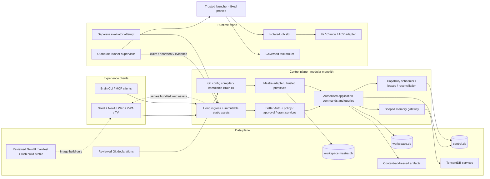

# 01 — Architecture, ownership and module boundaries

## System topology

Arrows describe calls, not authority transfer. Mastra invokes application primitives. It never receives a database mutation API, raw deployment credentials, an approval decision API or a runner adapter. Runners never mount central databases or the Governor secret directory. HTTP, MCP and CLI produce the same command payloads. A UI query joins authorized read models; it cannot bypass the command service for mutations.

Experience is a client layer over the three logical planes, not a fourth authority plane. The NewUI manifest/build-profile box is a build input/artifact, not a production service. The machine-readable ownership model is [architecture.json](../../contracts/v1/architecture.json), validated as `ArchitectureModel` against the same schema authority as configuration. Its bindings name the exact current config/profile/manifest/deployment reference files.

## Modular monolith and ownership

The control plane is **one modular monolith**: one Governor process, one composition root and one deployment. Identity, governance, configuration, jobs, workflows, evidence, knowledge, board, packs and operations are internal folders. They call public functions in-process. There is no internal HTTP, broker, general event bus, service locator or dynamic module loader.

The runtime plane retains separate runner and trusted launcher executables because their isolation and credentials differ. Web is a static Solid/NewUI bundle served by Governor. CLI is a thin client. Only `packages/contracts` is a shared workspace package; domain functions, adapters and Brain UI compositions remain ordinary folders in their owning applications. Full functionality is preserved. Extract another package only for a demonstrated independent consumer, not to mirror a diagram.

The canonical layout is [module-layout.json](../../contracts/v1/module-layout.json). This table is generated by `scripts/generate_implementation_indexes.py`:

<!-- BEGIN GENERATED LAYOUT -->
| Target | Owns | Public entry | Forbidden |
|---|---|---|---|
| `apps/governor` | Single Governor composition root, application use cases, internal modules and local persistence | `src/main.ts; src/container.ts` | Runner/harness execution; UI components |
| `apps/runner` | Outbound supervisor, engine adapters, tool broker, spool and launcher client | `src/main.ts` | Central database access; human approval decisions |
| `apps/launcher` | Trusted rootless Docker launcher, fixed profiles and cleanup journal | `src/main.ts; Unix HTTP protocol` | Arbitrary Docker passthrough; product business decisions |
| `apps/web` | Solid/NewUI SPA, domain compositions in src/ui, Governor client and route state | `src/app.tsx; src/index.css` | Server imports; NewUI internals; direct database access |
| `apps/cli` | Thin typed Governor client, human login and output formatting | `src/main.ts` | Direct database or module-private access |
| `packages/contracts` | Canonical generated DTOs, validators and wire catalogs shared by executable consumers | `src/index.ts; src/validate.ts` | Vendor SDKs; database IO; application authorization |

Governor module folders share this one deployment:

| Module | Folder | Responsibility |
|---|---|---|
| identity | `apps/governor/src/modules/identity` | Better Auth integration, principal construction and current memberships |
| governance | `apps/governor/src/modules/governance` | Policy, delegation, exact approvals, step-up and effect permits |
| configuration | `apps/governor/src/modules/configuration` | Restricted Git/YAML loading, release compilation and activation |
| jobs | `apps/governor/src/modules/jobs` | Placement, admission, leases/fences, scheduling and reconciliation facts |
| workflows | `apps/governor/src/modules/workflows` | Brain IR and Mastra adapter, primitive registry and durable wakes |
| evidence | `apps/governor/src/modules/evidence` | Artifact associations, independent verification and completion acceptance |
| knowledge | `apps/governor/src/modules/knowledge` | Scoped memory gateway, TencentDB adapter, publication and export |
| work | `apps/governor/src/modules/work` | Objectives, immutable plan versions, WorkItems, dependencies, assignments, business decisions and execution links |
| sessions | `apps/governor/src/modules/sessions` | Native and managed BrainSessions, durable messages, portable checkpoints and cross-agent collaboration |
| capabilities | `apps/governor/src/modules/capabilities` | Capability discovery, private candidates, packaging, tests and governed publication |
| workspaces | `apps/governor/src/modules/workspaces` | Workspace settings, source associations, context, quotas and available capabilities |
| resources | `apps/governor/src/modules/resources` | Documents, immutable versions, preview, associations, classification and storage lifecycle |
| integrations | `apps/governor/src/modules/integrations` | GitHub/GitLab connections, secret references, repository bindings, webhooks and change proposals |
| packs | `apps/governor/src/modules/packs` | Compiled onboarding/support/SRE/delivery/eval modules and connector adapters |
| operations | `apps/governor/src/modules/operations` | Health, bounded timers, backup/restore, audit and notifications |
<!-- END GENERATED LAYOUT -->

Pure reducers live in Governor `src/domain`; use cases in `src/application` coordinate module public functions. Connection lifecycle/current schema/inbox/outbox live in `src/infrastructure/persistence`. A table has one writer owner. A synchronous local transaction may coordinate modules through injected transaction functions; no network, model call or human wait belongs inside it. Cross-file work still uses durable outbox/inbox.

Each module exports an `index.ts` boundary. Cross-module private imports are forbidden. Pass narrow dependencies as function arguments or constructors; adapters bind in `src/container.ts`. Keep the six replaceability/security boundaries and public wire contracts; do not add an interface, package, transport or plugin for every internal helper. Vendor types stay in the owning adapter folder. The boundary checker enforces root isolation and public imports, not arbitrary file-size rules.

NewUI owns controls, overlays, tokens, tables/lists and templates. Brain compositions live under `apps/web/src/ui`, inside the application CSS scan. UI assets bind at image build through UIConfig/WebBuildConfig and the reviewed manifest; runtime YAML cannot install a frontend. Governor serves `/app/web` and verifies `/app/ui/ui-foundation.json`; API/auth/SSE/MCP/runner routes resolve before SPA fallback. Vite proxies only `/v1` and `/api/auth`.

Mastra executes dependencies, suspension and resumption through the WorkflowEnginePort. Governor owns authorization, jobs, decisions and receipts. Brain persists business facts and correlations without implementing a second generic workflow engine. The G03 durable-wait probe is required before accepting Mastra execution. Native engine and memory adapters remain replaceable folders, not independent product services.

The launcher has exactly the preinstalled `agent`, `privileged-tool` and `evaluator` profiles. One tested rootless Docker implementation is required. Approved target/network/image/resource facts select a profile; agent input cannot author a network policy, host mount or daemon request. Isolation and privileged-host separation remain mandatory. Optional VM/Rust implementations are outside the required target.

## Data ownership

`control.db`: identities through Better Auth, organization/workspace directory, active config pointers, runners, jobs, attempts, capacity reservations, approval requests/decisions/consumption, effect permits, resource fencing counters, revocations, audit, global inbox/outbox and command idempotency.

`workspace.db`: cards, decisions, ticket/incident history, SLA intervals, workflow business state, step/output references, session indexes, evidence and evaluation indexes, memory publication candidates, connector cursors, workspace inbox/outbox. It contains a projection of global job state, clearly marked with a source cursor.

`workspace.mastra.db`: private engine snapshots and definitions. No hand-authored SQL touches its tables. Missing snapshots block unsafe continuation; business truth and receipts remain in Brain tables.

Git owns declarations, not current memberships, heartbeat, approvals or job status. TencentDB owns memory content and knowledge indexes, not human decisions or executable permission. An authoritative verbatim decision remains in SQLite; a sanitized derived memory can reference it.

CAS stores immutable bytes addressed by SHA-256. Namespace authorization still applies: knowing a digest does not grant access. Tool/config release roots are separate from mutable runner checkouts. Workspace export bundles include verified bytes and source references.

## Application command path

1. Ingress authenticates credential and constructs internal `ActorContext`; reject client actor claims.
2. Decode versioned payload with the schema validator; enforce byte and nesting limits before expensive work.
3. Resolve organization/workspace, current membership and operational revocations.
4. Find typed command handler; compute canonical request hash; enforce idempotency.
5. Evaluate policy and expected aggregate version; commit only the local authority transaction.
6. Emit outbox event/intent in that transaction; return receipt and resource ID.
7. Workers materialize downstream work. UI may show `queued` and projection lag before workspace history catches up.

Transport adapters translate errors, never authorize. A command receipt means the command was durably accepted/applied; it never means a queued workflow has succeeded.

## Replaceability tests

Each adapter gets a shared conformance suite and a fixture adapter. A fixture workflow engine reproduces start/wake/cancel behavior without Mastra; a fixture harness returns deterministic events; a memory fixture enforces scope and simulates outages. Run domain/application tests with these fixtures. Run vendor integration tests separately so failures identify the boundary. Replaceability means retaining external semantics, not identical internal snapshot formats.

Within the current build, a running attempt keeps its selected engine and pinned configuration; do not silently swap them during execution. Current-build definitions/artifacts remain available for restart/recovery. Historical adapter binaries, cross-version run conversion and rolling-upgrade coexistence are excluded by the user's [implementation policy](../../contracts/v1/implementation-policy.json). Breaking implementation changes may update the target as a whole. Optional Rust may implement a process supervisor port; it does not become a second domain backend.
